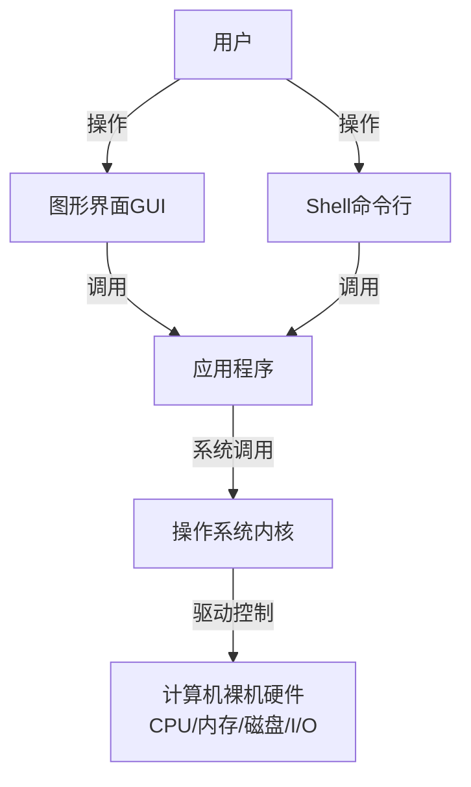

# 《现代操作系统》1.1 什么是操作系统 Markdown笔记
> 教材：现代操作系统（原书第4版），对应页码 P1~P4
> 格式约定：**1.1.x小节为书本原文顺序整理**；个人理解、对比总结放在本节末尾附加拓展区（和上一节1.2格式统一，可直接合并笔记）

## 1.1 什么是操作系统
操作系统（Operating System，OS）是运行在计算机上的**系统软件集合**，它管理计算机硬件资源，为应用程序提供服务，是用户、应用程序与计算机硬件之间的中间层。

### 1.1.1 操作系统作为资源管理器
计算机包含多种硬件资源：CPU、主存、磁盘、网卡、打印机等I/O设备。
- 硬件资源数量有限，多个并发程序会竞争使用资源。
- 操作系统负责：资源分配、调度、回收、保护隔离。
- 举例：决定哪个进程占用CPU、为程序分配内存空间、管理磁盘文件、控制外设访问。
- 目标：高效、公平地使用硬件；防止进程越界访问，避免程序互相破坏。

### 1.1.2 操作系统作为扩展机（虚拟机）
没有操作系统的计算机硬件称为**裸机**。裸机只提供底层硬件指令，编程极其繁琐。
操作系统对复杂硬件进行**抽象封装**，向上层程序提供简单统一的高层接口（系统调用）。
- 裸机层面：需要操作寄存器、磁道、扇区、硬件端口。
- OS抽象后：应用程序只需要操作“文件”“进程”等逻辑概念，不用关心硬件细节。
- 一句话理解：OS相当于给裸机包装了一台更容易编程使用的虚拟机。

### 1.1.3 两种看待操作系统的视角
1. **用户视角**：操作系统是**用户与硬件之间的接口**
    用户不需要掌握硬件底层细节，通过接口使用计算机。
    接口分为两类：命令行Shell、图形GUI界面。

2. **系统视角**：操作系统是**硬件资源管理器**
    即1.1.1内容，负责调度、分配、保护各类硬件资源，支持多道程序并发运行。

> 教材补充：操作系统不等于内核。**内核**是操作系统最核心部分，运行在内核态；而Shell、GUI程序运行在用户态，属于操作系统配套程序，不属于内核。

---

# 附加拓展内容（笔记自用，不属于教材原文小节）
## ✨ 个人补充理解
1. 操作系统的定位：**不是硬件，不是应用软件，是系统软件**。应用软件（Word、浏览器）运行在OS之上。
2. 资源管理器 和 扩展机，是同一个OS的两个不同侧面，不是两个独立系统：
    - 对内：管理硬件资源
    - 对外：向上提供简单抽象接口
3. 核心区分
    - 裸机：硬件本身，难用
    - OS内核：管理硬件，提供抽象
    - 系统调用：内核给应用程序的API
    - Shell/GUI：给人操作的接口
4. 内核态 vs 用户态（书中前置铺垫）
    - 内核态：拥有全部硬件访问权限，内核代码运行在此
    - 用户态：权限受限，普通应用程序运行在此，需要系统调用才能请求内核服务

## 📊 概念横向对比表
| 概念 | 定位 | 核心作用 |
| ---- | ---- | -------- |
| 裸机 | 物理计算机硬件 | 执行机器指令，接口复杂 |
| 操作系统内核 | 系统软件核心（内核态） | 管理硬件 + 提供硬件抽象 |
| 系统调用 | 内核提供的编程接口 | 应用请求内核服务 |
| Shell / GUI | 用户态程序 | 人和操作系统交互接口 |
| 应用软件 | 用户程序（浏览器、Office） | 完成用户业务，运行于OS之上 |

## 🧩 Mermaid层次结构图（计算机软件硬件层级）

---

