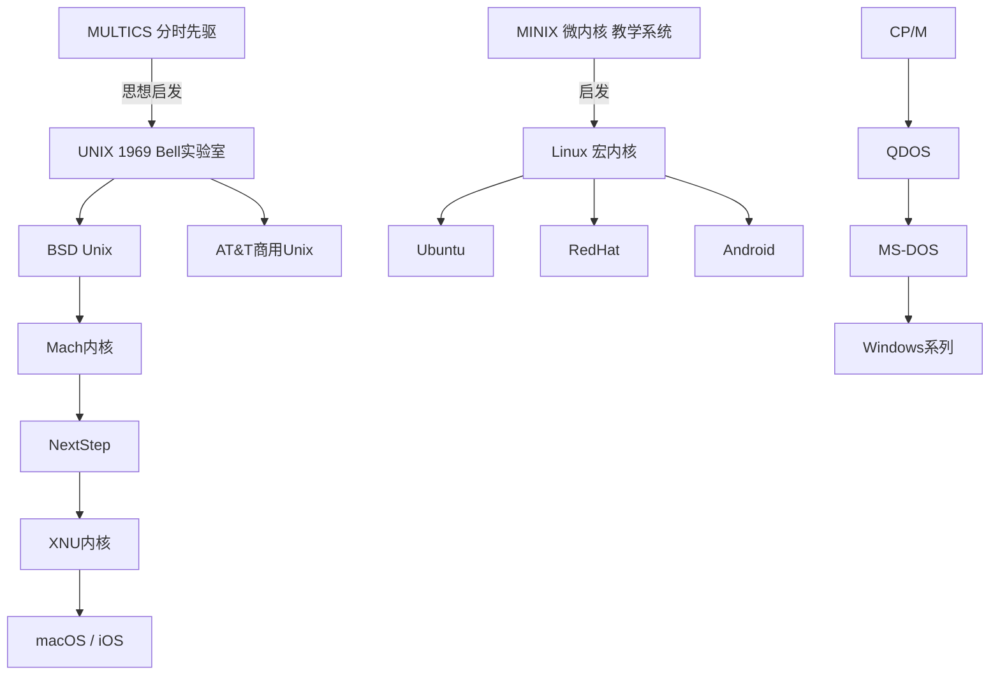

# 1.2 操作系统的历史
> 教材：现代操作系统（原书第4版），对应页码 P5~P14
> 规则：**1.2.x小节为书本原文顺序整理**；个人理解、对比表格、Mermaid谱系图统一放在本节末尾，作为拓展附加内容。

## 1.2 操作系统的历史
### 1.2.1 第一代计算机：真空管与插件板（1945–1955）
硬件基础：真空管、插件板、穿孔卡片；使用机器语言编程。
操作系统：**不存在操作系统**。
工作方式：程序员亲自到机房，插拔接线、拨动开关，通过穿孔卡片加载程序；一台计算机同一时间只能由一位程序员独占。
特点：计算机造价极其昂贵。
主要问题：大量时间消耗在人工操作上，CPU空闲时间很长，资源利用率极低。
代表机器：ENIAC。

### 1.2.2 第二代计算机：晶体管与批处理系统（1955–1965）
硬件基础：晶体管，设备可靠性提升；磁带作为大容量存储。
操作系统形态：简单监控程序，也就是**单道批处理系统**。
工作流程：操作员提前把多个作业放到磁带上，监控程序自动依次运行作业，减少频繁人工干预。
核心特点：**内存同一时刻只能存放一道作业**。
主要缺陷：作业进行I/O读写的时候，CPU只能等待，处于空闲状态，资源依然浪费。
代表系统：FMS（Fortran Monitor System）、IBM 7094 监控程序。

### 1.2.3 第三代计算机：集成电路与多道程序（1965–1980）
硬件基础：中小规模集成电路。
标志性硬件：IBM System/360 系列，实现系列机型指令集兼容。
核心技术1：**多道程序设计（多道批处理）**
原理：内存中同时存放多个作业；当其中一个作业等待I/O完成时，CPU切换去执行另外一个作业，大幅提高CPU利用率。

核心技术2：**分时系统（交互式操作系统）**
代表项目：CTSS、MULTICS。
原理：CPU采用时间片轮转，多个终端用户同时联机使用计算机；每个用户感受上如同独占一台机器。
MULTICS 的意义：目标支持数百个交互式用户，它的设计思想直接启发了后来UNIX的诞生。

本时代特点：同时存在两类操作系统，后台运行多道批处理做大规模计算，前端分时系统供用户交互；系统复杂度显著上升。

### 1.2.4 第四代计算机：个人计算机（1980–至今）
硬件基础：大规模集成电路、微处理器，硬件成本大幅下降，个人PC兴起。
早期PC系统：CP/M，之后QDOS改造成为MS-DOS，**单用户单任务操作系统**。
图形化GUI兴起：Windows、Mac OS。
教学操作系统：MINIX（本书作者塔嫩鲍姆开发，微内核架构，用于教学）。
Linux诞生：Linus Torvalds参考MINIX思想开发Linux（宏内核）。
Unix持续演化，BSD分支独立发展。
特点：PC操作系统从早期单任务，逐步发展为支持多任务、网络、图形界面。

---

# 附加拓展内容（笔记自用，不属于教材原文小节）
## ✨ 个人补充理解
1. 操作系统迭代的根本驱动力：硬件技术持续进步；首要目标是提升计算机资源（CPU、内存、I/O）利用率，其次改善人机交互体验。
2. 两条并行发展主线
    - 大型机路线：手工操作 → 单道批处理 → 多道批处理（核心目标：榨干昂贵硬件资源）
    - 交互式路线：MULTICS分时系统 → UNIX → 现代服务器/桌面OS（核心目标：实现人机交互）
3. 概念辨析
    - 多道程序是底层技术，既可以用于批处理系统（多道批处理），也可以用于分时系统。
    - 分时系统是面向交互式用户的应用场景，依靠时间片轮转调度，属于多道程序的一类应用。
4. 拓展延伸（教材未重点展开）：第四代后期衍生移动、嵌入式操作系统，面向手机、IoT设备，主打低功耗、轻量化，如Android、iOS、RTOS。

## 📊 横向对比总表
| 世代 | 年代 | 硬件基础 | OS类型 | 核心特征 | 存在问题 | 代表系统 |
| ---- | ---- | -------- | ------ | -------- | -------- | -------- |
| 第一代 | 1945–1955 | 真空管、插件板 | 无操作系统，手工操作 | 程序员独占整机，机器语言编程 | 人工操作耗时，CPU利用率极低 | ENIAC |
| 第二代 | 1955–1965 | 晶体管、磁带 | 单道批处理系统 | 自动顺序执行作业；内存仅存放一道作业 | I/O等待期间CPU空闲 | FMS、IBM7094监控程序 |
| 第三代 | 1965–1980 | 中小规模集成电路 | 多道批处理 + 分时系统 | 多道程序，内存驻留多作业；时间片轮转实现多用户交互 | 系统逻辑复杂，开发难度大 | IBM System/360、CTSS、MULTICS |
| 第四代 | 1980–至今 | 大规模集成电路、微处理器 | 个人PC操作系统 | 面向个人用户，GUI图形界面，后期支持多任务 | 早期DOS仅支持单任务 | MS-DOS，Windows，MacOS，MINIX，Linux |

## 🧬 Mermaid 操作系统血脉谱系图

