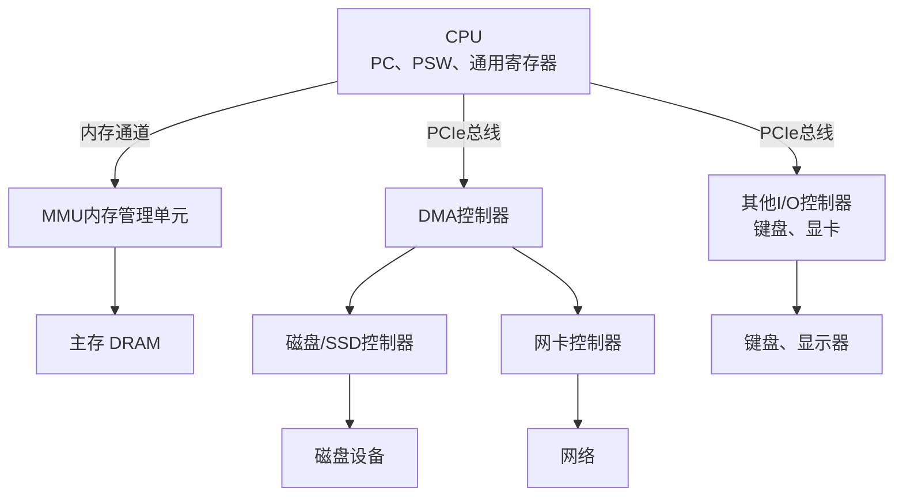
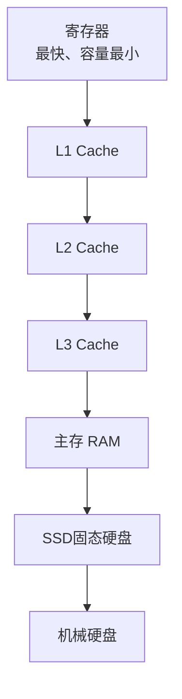

# 《现代操作系统》1.3 计算机硬件介绍 Markdown笔记
> 教材：现代操作系统（原书第5版）
> 格式约定：**1.3.x小节为书本原文顺序整理**；个人理解、对比总结、Mermaid图全部放在本节末尾【附加拓展区】，可以直接拼接在1.1、1.2笔记之后

## 1.3 计算机硬件介绍
操作系统是对硬件的抽象与管理者，想要理解操作系统的工作原理，必须先掌握底层硬件模型。现代通用计算机由 **CPU、主存、I/O设备** 三大核心组件构成，组件之间通过总线互连。操作系统内核需要直接和这些硬件打交道，硬件提供的各类机制（中断、MMU、DMA、状态寄存器等）是现代操作系统并发、保护、虚拟内存功能的硬件基础。

### 1.3.1 CPU
CPU是计算机的核心执行部件，负责逐条执行机器指令。CPU内部包含大量高速寄存器，分为两大类：
1. **用户可见寄存器（通用寄存器）**
    用于存放运算数据、内存地址。编译器可以调度、分配这些寄存器来优化程序，普通程序在用户态下可以读写。
2. **控制寄存器（操作系统重点关注）**
    - **PC（程序计数器）**：保存下一条将要从内存取出执行的指令地址。每条指令执行后，硬件自动更新PC；发生跳转、中断、陷阱时PC会被修改。
    - **PSW（程序状态字）**：极其关键，包含条件码标志（运算结果是否为0、负数、溢出）、CPU运行模式位（内核态 / 用户态）、中断允许标志等。
    > 特权指令（修改页表基址、关闭中断、修改PSW模式位等）只能在内核态执行；用户态尝试执行特权指令会触发陷阱异常。

**指令集架构**
- CISC：复杂指令集（代表：x86），指令长度不固定，指令丰富复杂。
- RISC：精简指令集（代表：ARM、RISC-V），指令定长、格式规整，流水线更容易实现，现在移动端、服务器大量使用。

**流水线与超标量**
现代CPU采用流水线技术，把一条指令拆分为取指、译码、执行、访存、写回多个阶段，多条指令可以重叠执行，提升吞吐。
超标量CPU内部有多条独立流水线，一个时钟周期可以发射多条指令。

**多核与同时多线程（SMT/超线程）**
- 多核：同一个芯片封装多个独立CPU核心，每个核心拥有独立ALU、寄存器组，可以真正并行执行。
- 同时多线程：单个核心配置多套寄存器组，硬件快速切换两个线程，让流水线尽可能不空闲，属于硬件级线程。

**中断与陷阱（硬件异常机制）**
- **中断**：异步事件，来自外部I/O设备。设备完成工作后发送中断信号打断CPU当前工作。硬件自动保存PC、PSW，切换到内核态，根据中断向量表跳转到对应的中断服务程序。中断是外设和CPU通信的核心方式。
- **陷阱（Trap）**：同步事件，由当前正在执行的指令直接触发。是程序主动或者出错产生，例如：系统调用、除零错误、非法指令、缺页异常。陷阱也是进入内核态的一条重要途径。

### 1.3.2 内存（主存 RAM）
主存是计算机的工作存储器，**按字节编址**，属于易失性存储，断电数据丢失。CPU运行程序时，代码和数据都需要加载到主存中。

**存储层次（Memory Hierarchy）**
计算机不是只有内存，而是一套速度、容量、成本梯度的存储体系：寄存器 → L1 Cache → L2 Cache → L3 Cache → 主存 → SSD/机械硬盘。
高速缓存Cache由SRAM构成，速度远快于DRAM主存，价格高、容量小。Cache工作依赖**局部性原理**：
- 时间局部性：刚访问过的数据，短时间内很可能再次访问；
- 空间局部性：访问某个地址后，附近相邻地址大概率很快被访问。
Cache会把主存一块数据（Cache行）预取到高速缓存，命中时直接高速读取；缓存不命中时才去访问主存。

**MMU（内存管理单元）**
MMU是操作系统实现虚拟内存的核心硬件。它负责：
1. 虚拟地址 → 物理地址的自动翻译；
2. 内存访问权限检查（读、写、执行保护）；
3. 地址越界、缺页时触发陷阱，交给操作系统内核处理。
CPU看到的是**虚拟地址**；内存芯片接收的是**物理地址**。MMU中配有页表基址寄存器，指向当前进程的页表。没有MMU硬件，就无法实现现代意义上的虚拟内存。

### 1.3.3 I/O设备
所有I/O设备都分为两个部分：**设备控制器 + 设备本体**。
控制器是一块独立芯片，自带少量控制寄存器和缓冲区。CPU通过读写控制器上的寄存器，向设备下发命令、读取设备状态。

三种I/O实现方式：
1. **轮询（忙等待）**
    CPU循环不断读取控制器状态寄存器，直到设备就绪。优点逻辑简单；缺点是CPU全程空转浪费，一般只用在简单低速设备。
2. **中断驱动I/O**
    CPU向设备下发命令后，继续运行自己的程序；设备完成操作后发送中断通知CPU处理。适合少量数据传输，比如键盘、鼠标。
3. **DMA（直接存储器访问）**
    DMA控制器可以独立在主存和I/O设备之间搬运大块数据，传输过程不需要CPU逐字节拷贝，传输全部完成后仅发送一次中断。磁盘、网卡等大块数据传输都使用DMA，极大降低CPU开销。

I/O设备经典分类：
- 块设备：以固定大小块为单位读写，支持随机访问（SSD、机械硬盘）；
- 字符设备：以字节流形式顺序访问，没有块结构（键盘、串口）；
除此之外还有时钟、GPU、网络适配器等特殊设备。

### 1.3.4 总线
总线是一组信号线，用于CPU、内存控制器、各个I/O控制器之间传输地址、数据、控制信号。
早期并行总线：ISA、PCI；现代主流为 **PCIe**，是高速串行总线，带宽更高。
现代计算机不是单一共享总线，而是分层总线架构：CPU直连内存控制器、L3缓存，再通过PCIe根端口连接各个外设控制器。
多个设备同时请求总线时，由总线仲裁器决定总线使用权，避免信号冲突。

### 1.3.5 引导计算机（Booting）
计算机上电瞬间，内存为空，**不存在操作系统**。硬件自动把PC寄存器设置为固件的固定起始地址：固件存放在ROM/Flash中（BIOS 或者 UEFI）。
启动流程：
1. 固件执行POST上电自检，检测基础硬件是否正常；
2. 固件扫描所有存储设备，寻找可引导设备；
3. 读取磁盘第一个扇区（引导块），引导小程序被加载进内存并运行；
4. 引导程序负责把操作系统内核加载到主存；
5. 内核获得控制权，依次初始化中断表、进程管理、内存管理、文件系统、设备驱动；
6. 内核创建第一个用户进程（init / systemd），操作系统正式开始对外提供服务。

---

# 附加拓展内容（笔记自用拓展，不属于教材原文小节）
## ✨ 个人补充理解
1. 操作系统所有核心能力都建立在硬件提供的机制之上：PSW提供用户态/内核态隔离、MMU提供虚拟内存硬件支持、中断+DMA支撑I/O系统、Cache硬件配合OS页面调度。硬件是地基，OS是上层软件。
2. 中断和陷阱最核心区分：**中断是外部硬件异步事件，不可预测；陷阱是当前指令同步触发，可复现**。系统调用本质就是主动触发陷阱，进入内核请求服务。
3. 存储层次整体的权衡公式：速度越快 → 单位成本越高 → 容量越小。局部性原理是这套层次结构能够发挥效果的前提，如果程序访问完全随机，Cache会频繁失效。
4. 用户态的限制本质是硬件限制：硬件阻止用户态代码直接修改关键寄存器、直接访问硬件；想要特权操作，必须通过陷阱陷入内核，由内核代为执行，这就是计算机安全隔离的基础。
5. DMA不是免除中断，只是减少中断次数：大批量数据传输完成后依旧要发一次中断通知内核。

## 📊 横向对比总表
### 表1 存储层次对比
| 层次 | 硬件介质 | 相对速度 | 容量 | 易失性 | 主要管理方 |
| ---- | -------- | -------- | ---- | ------ | ---------- |
| 寄存器 | CPU内部触发器 | 最快 | 极小 | 易失 | CPU硬件 |
| L1/L2/L3 Cache | SRAM | 很快 | 小 | 易失 | Cache硬件控制器 |
| 主存 RAM | DRAM | 中等 | 中等 | 易失 | MMU + OS |
| SSD/磁盘 | 闪存/磁介质 | 慢 | 很大 | 非易失 | 设备控制器 + OS |

### 表2 三种I/O方式对比
| I/O方式 | 工作特点 | CPU开销 | 典型适用场景 |
| ------- | -------- | ------- | ------------ |
| 轮询（忙等待） | CPU循环查询状态位 | 很高，CPU被占用 | 简单低速设备、嵌入式短等待场景 |
| 中断驱动I/O | 设备就绪发中断通知 | 较低 | 少量零散数据：键盘、鼠标 |
| DMA | DMA自行搬运整块数据，结束中断 | 最低 | 大块数据：磁盘、网卡 |

### 表3 中断 vs 陷阱对比
| 类型 | 同步/异步 | 触发来源 | 典型例子 |
| ---- | --------- | -------- | -------- |
| 中断 | 异步 | 外部硬件设备 | 磁盘IO完成、网卡收到数据包 |
| 陷阱 | 同步 | 当前执行指令 | 系统调用、除零异常、缺页异常 |

## 🧩 Mermaid 结构图
### 1. 硬件整体互连架构图

### 2. 存储层次金字塔

