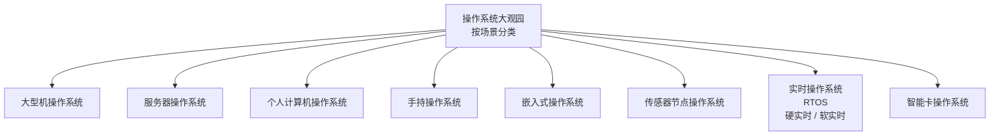

# 《现代操作系统》1.4 操作系统大观园 
> 教材：现代操作系统（原书第5版）
> 格式约定：**1.4.x小节为书本原文顺序整理**；个人理解、对比总结、Mermaid图全部放在本节末尾【附加拓展区】，可以直接拼接在1.1、1.2、1.3笔记之后

## 1.4 操作系统大观园
操作系统并不是单一形态。根据使用场景、负载特征、设计目标不同，衍生出完全不一样的操作系统。对于一类OS来说最重要的特性，在另一类OS中可能无关紧要。本节按照场景对操作系统进行分类介绍。

### 1.4.1 大型机操作系统（Mainframe Operating Systems）
运行在大型主机上，常见于银行、保险、电信等核心业务场景。
- 主要负载：海量事务处理、大规模批处理作业，I/O流量巨大；
- 核心目标：**高吞吐量、极高可靠性、容错能力**，支持7×24不间断运行；
- 特点：一次管理成千上万的并发作业，重视I/O调度、故障隔离；优先保证业务不中断；
- 代表系统：IBM z/OS（源自早期OS/360）。
> 区分：大型机 ≠ 超级计算机；大型机面向商业事务，超算面向大规模科学并行计算。

### 1.4.2 服务器操作系统（Server Operating Systems）
运行在机架服务器、云服务器上，通过网络向大量客户端提供服务。
- 典型用途：Web服务、文件服务、数据库、云虚拟机；
- 核心目标：稳定、强大的网络能力、多用户并发访问、安全性；
- 特点：经常无显示器键盘（无头运行），不需要图形界面；资源按需共享给网络上众多用户；
- 代表系统：Linux（服务器发行版）、FreeBSD、Windows Server。

### 1.4.3 个人计算机操作系统（Personal Computer Operating Systems）
也就是桌面操作系统，面向单用户使用。
- 核心目标：易用性、良好图形交互、丰富应用生态；
- 特点：虽然是单用户使用，但底层依然是多道程序系统，可以同时运行多个应用程序；重点优化人机交互体验；
- 代表系统：Windows桌面版、macOS、桌面版Linux（Ubuntu Desktop等）。

### 1.4.4 手持操作系统（Handheld Operating Systems）
用于手机、平板这类便携手持移动设备。
- 核心目标：低功耗、触控交互、移动网络支持；
- 特点：电源管理是重中之重；硬件资源有限；应用采用沙盒隔离机制；支持蜂窝网络、传感器；允许用户安装第三方应用；
- 代表系统：iOS、Android。

### 1.4.5 嵌入式操作系统（Embedded Operating Systems）
嵌入在专用硬件设备内部，设备本身不是通用计算机：智能家电、路由器、电视、汽车电控单元等。
- 核心目标：和硬件深度适配、轻量化；
- 特点：固件固化在硬件里；功能固定；很多系统裁剪掉了文件系统、图形界面；**一般不允许用户随意安装第三方应用**；
- 代表系统：VxWorks、QNX、嵌入式Linux、FreeRTOS。

### 1.4.6 传感器节点操作系统（Sensor Node Operating Systems）
面向无线传感网络（WSN）里大量微型传感器节点。节点部署在野外，依靠电池供电。
- 核心目标：极致低功耗；
- 特点：CPU、内存资源极端拮据；节点自组织组网；程序体量极小，需要频繁休眠省电；
- 代表系统：TinyOS（本书重点举例）、Contiki。

### 1.4.7 实时操作系统（Real-Time Operating Systems，RTOS）
核心判定标准：系统有明确的**时间截止约束**，任务必须在规定时限内完成。分为两类：
1. **硬实时系统**：截止时间绝对不能违背，一旦超时会引发灾难性后果。典型场景：航空航天、工业控制、自动驾驶。
2. **软实时系统**：尽量满足时间要求，偶尔超时只影响体验，不会造成严重事故。典型场景：音视频播放。
- 特点：抢占式调度、任务优先级明确、调度时延可预测、抖动小；
- 代表系统：VxWorks、QNX、FreeRTOS。
> 教材提示：Windows、原生Linux不属于实时操作系统，无法保证严格的时间截止。

### 1.4.8 智能卡操作系统（Smart Card Operating Systems）
运行在芯片智能卡内部：银行卡、SIM卡、电子身份卡。
- 硬件限制：CPU算力极弱、RAM容量极小；
- 核心目标：安全、防篡改、加密；
- 特点：一次只处理少量指令，功能简单，逻辑高度固化；
- 代表系统：Java Card。

---

# 附加拓展内容（笔记自用拓展，不属于教材原文小节）
## ✨ 个人补充理解
1. 本节分类维度是**应用场景**，不是内核架构（宏内核/微内核）。同一个内核可以适配多个场景：Linux既可以做服务器OS、嵌入式OS，也作为Android底层内核。
2. OS设计本质是取舍：
   - 大型机：牺牲一部分交互性，换取吞吐和可靠；
   - RTOS：牺牲吞吐量，换取时间确定性；
   - 传感器节点：牺牲功能丰富度，换取极低功耗；
   - 智能卡：全部设计围绕安全。
3. 易混概念辨析
   - 嵌入式OS ≠ RTOS：嵌入式是部署场景；实时是时间属性。很多嵌入式系统不需要实时；RTOS大多用于嵌入式硬件，但二者不是等同关系。
   - 手持OS（Android/iOS）和嵌入式OS最大区别：手持设备是通用移动平台，支持自由安装APP；传统嵌入式设备功能固定封闭。

## 📊 横向对比总表
| 类型 | 典型场景 | 核心设计目标 | 资源特点 | 代表系统 |
| ---- | -------- | ------------ | -------- | -------- |
| 大型机OS | 银行、保险核心事务 | 高吞吐、高可靠、容错 | 硬件强大，I/O密集 | z/OS |
| 服务器OS | Web、数据库、云主机 | 并发、网络、稳定 | 资源充足，多客户端 | Linux Server、Windows Server |
| PC桌面OS | 台式机、笔记本 | 易用、GUI、丰富应用 | 资源充足，单用户交互 | Windows、macOS |
| 手持OS | 手机、平板 | 低功耗、触控、移动网络 | 资源有限，电池供电 | iOS、Android |
| 嵌入式OS | 家电、路由器、车载设备 | 轻量化、硬件适配 | 资源受限，功能固定 | VxWorks、嵌入式Linux |
| 传感器节点OS | 无线传感网络 | 极致低功耗 | 资源极度稀缺 | TinyOS、Contiki |
| 实时RTOS | 工控、航天、音视频 | 时间可预测，满足截止时间 | 差异大，硬实时要求严格 | VxWorks、QNX、FreeRTOS |
| 智能卡OS | 银行卡、SIM卡 | 安全、防篡改 | 资源极小 | Java Card |

## 🧩 Mermaid 操作系统大观园分类树

