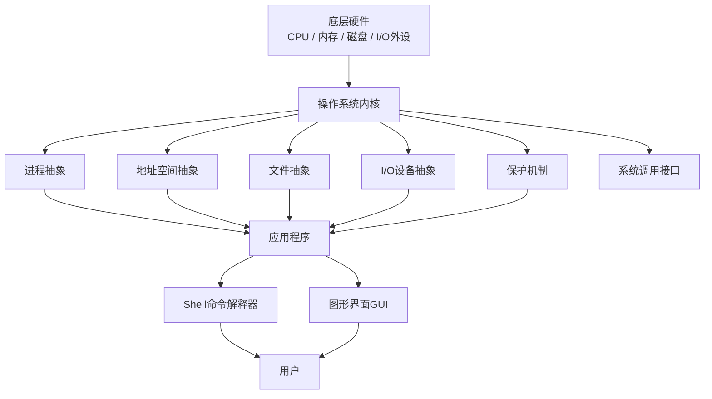

# 《现代操作系统》1.5 操作系统概念 
> 教材：现代操作系统（原书第5版）
> 格式约定：**1.5.x小节为书本原文顺序整理**；个人理解、对比总结、Mermaid图全部放在本节末尾【附加拓展区】，可以直接拼接在1.1、1.2、1.3、1.4笔记之后

## 1.5 操作系统概念
操作系统最核心的工作就是**提供一组抽象**。裸机硬件只提供非常底层、繁琐的接口（寄存器、中断、磁盘扇区等），难以直接编程。操作系统对硬件能力进行抽象封装，向上层程序和用户提供一套简单、统一、易用的模型。本节介绍操作系统六大核心抽象与概念：进程、地址空间、文件、输入输出、保护、Shell命令解释器。

### 1.5.1 进程（Process）
进程是操作系统最基础、最重要的抽象：**进程是一个正在执行的程序**。
- 一个进程包含：程序代码、当前寄存器状态（PC、PSW、通用寄存器）、数据、栈、堆，以及进程打开的文件、信号等资源。
- 程序是存放在磁盘上的静态文件；进程是程序运行时动态产生的实例，同一个程序可以同时启动多个进程。
- 并发：单核CPU上，多个进程快速交替运行（上下文切换），宏观上看起来同时执行；多核CPU可以做到真正并行。
- 上下文切换：OS保存当前进程的寄存器、状态，恢复另一个进程的状态，切换CPU执行对象，这个操作有开销。
- OS负责进程的生命周期管理：创建进程、调度进程运行、回收进程资源、终止进程。

### 1.5.2 地址空间（Address Space）
地址空间是操作系统为每个进程提供的内存抽象：**一个进程能够访问的全部内存地址的集合**。
- 每个进程拥有独立、私有的地址空间，进程认为自己独占全部内存。
- 地址空间分为：代码段（程序指令）、数据段（全局变量）、栈（函数调用、局部变量）、堆（动态分配内存）。
- 依靠MMU硬件完成虚拟地址到物理地址的转换，实现地址空间隔离；一个进程不能随意读写另一个进程的地址空间。
- 好处：程序编译时只需要关心自己的虚拟地址，不用关心物理内存实际放在哪里，支持内存隔离、虚拟内存。

### 1.5.3 文件（File）
文件是操作系统对持久存储设备（磁盘、SSD）的抽象。
- 文件本质：一个带名字的字节序列，保存在非易失存储上，断电之后数据不会丢失。
- 文件系统：操作系统提供目录（文件夹），组织成树形层次目录结构，方便管理大量文件。
- 文件附带元数据：文件大小、创建时间、修改时间、权限、所有者等信息。
- 基础文件操作：打开`open`、读`read`、写`write`、关闭`close`。
> Unix思想：**一切皆文件**，很多I/O设备也被封装成文件接口，读写设备和读写文件调用同一套API。

### 1.5.4 输入输出（I/O）
计算机外设种类繁多：键盘、鼠标、显示器、磁盘、网卡、打印机，硬件接口差异巨大。
- 操作系统把各式各样的I/O设备抽象成统一接口，屏蔽硬件底层差异。
- **设备驱动程序**：和具体硬件绑定，是OS内核中负责和硬件控制器通信的模块，对上层隐藏硬件细节。
- 设备分类（前面硬件部分提到）：块设备、字符设备。
- 应用程序不需要理解硬件控制器的命令，只需要调用OS提供的I/O接口完成读写。

### 1.5.5 保护（Protection）
计算机资源（内存、文件、外设）需要控制访问权限，**保护就是一套规则：规定谁、在什么条件下，可以访问哪些资源，以及允许做什么操作**。
- 常见权限：读、写、执行。
- 隔离：防止进程错误或者恶意修改其他进程的数据、破坏系统文件。
- 主体：用户、用户组；客体：文件、内存区域、设备。
- ✅ 教材区分：**保护（protection）** 关注系统内部的访问权限控制；**安全（security）** 侧重抵御外部攻击、黑客入侵。二者相关但不是同一个概念。

### 1.5.6 Shell（命令解释器）
Shell是面向用户的交互接口程序，接收用户输入命令，完成人机交互。
- Shell**运行在用户态，不属于内核**。
- 工作流程：读取用户输入命令 → 解析命令 → 创建新进程运行对应程序 → 等待程序结束。
- 例子：Linux的bash、zsh；Windows的cmd、PowerShell。
- GUI图形界面和Shell地位类似，都是用户接口，只是交互形式不同。

---

# 附加拓展内容（笔记自用拓展，不属于教材原文小节）
## ✨ 个人补充理解
1. 六大抽象和底层硬件一一对应，这是一条非常好的记忆主线：
    - 进程 → CPU抽象，实现并发
    - 地址空间 → 内存抽象，实现隔离、虚拟内存
    - 文件 → 持久存储抽象
    - I/O抽象 → 各类外设抽象
    - 保护机制 → 硬件特权+MMU提供权限隔离能力
    - Shell/GUI → 用户交互接口
2. 抽象的核心价值：**解耦**。应用程序只需要使用OS提供的抽象模型，不需要关心硬件型号、底层实现。更换同类型硬件，上层程序不用修改。
3. 并发的代价：上下文切换会消耗CPU时间，切换越频繁，系统开销越大。
4. 独立地址空间是现代OS安全隔离的基础；如果没有地址空间隔离，一个程序出错就会轻易破坏其他程序和内核。
5. 区分：Shell只是众多用户接口之一，没有Shell操作系统内核依然可以正常运行。

## 📊 横向对比总表
| 抽象概念 | 对应底层硬件 | 核心目标 |
| ---- | ---- | -------- |
| 进程 | CPU | 抽象CPU，支持多程序并发执行 |
| 地址空间 | 内存 + MMU | 抽象内存，给每个进程独立隔离的内存视图 |
| 文件 | SSD/机械硬盘等持久存储 | 抽象持久存储，提供命名、持久的字节流 |
| I/O抽象 | 键盘、网卡、磁盘等外设 | 屏蔽硬件差异，提供统一读写接口 |
| 保护机制 | PSW、MMU硬件权限检查 | 资源访问控制、进程隔离 |
| Shell | 无专属硬件，用户态程序 | 提供命令行人机交互接口 |

## 🧩 Mermaid 操作系统抽象关系图

