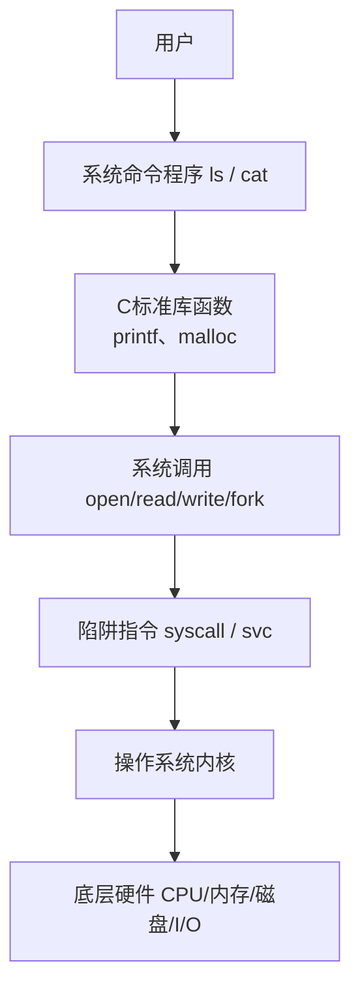

# 《现代操作系统》1.6 系统调用

> 教材：现代操作系统（原书第5版）
> 格式约定：**1.6.x小节为书本原文顺序整理**；个人理解、对比总结、Mermaid图全部放在本节末尾【附加拓展区】，可以直接拼接在1.1~1.5笔记之后

## 1.6 系统调用
用户程序运行在用户态，权限受限，无法直接操作硬件、访问内核内部数据。**系统调用（System Call）是用户进程请求操作系统内核提供服务的受控接口**，是从用户态进入内核态的正规入口。应用程序想要创建进程、读写文件、分配内存、访问外设，都需要通过系统调用完成。

### 1.6.1 系统调用的执行机制
系统调用依靠**陷阱（Trap）指令**实现，属于同步异常。完整流程：
1. 用户程序调用标准库中的包装函数，把参数放到约定的寄存器或者栈上，同时传入系统调用编号；
2. 执行专门的陷阱指令（x86：`syscall/int`；ARM：`svc`）；
3. 硬件自动动作：保存当前PC、PSW等上下文，将CPU切换到内核态，跳转到内核预设的系统调用入口；
4. 内核读取系统调用号，分发到对应的内核服务函数执行；
5. 内核完成功能处理，把结果/返回值存入约定位置；
6. 执行返回指令，切回用户态，恢复进程上下文，用户程序继续向下执行。

> 重要：系统调用本质是**主动触发陷阱**，和1.3里外部设备产生的异步中断有本质区别。

### 1.6.2 典型的系统调用分类（教材以UNIX/Linux举例）
1. **文件操作类**
`open` 打开文件、`read` 读文件、`write` 写文件、`close` 关闭文件、`lseek` 修改读写偏移量。
2. **进程管理类**
`fork` 创建子进程、`execve` 加载新程序覆盖当前进程、`waitpid` 等待子进程结束、`exit` 终止进程、`getpid` 获取进程ID。
3. **目录与文件系统类**
`mkdir` 创建目录、`rmdir` 删除目录、`chdir` 切换工作目录、`stat` 获取文件元数据（大小、权限、时间）。
4. **权限保护类**
`chmod` 修改文件访问权限、`chown` 修改文件所有者。
5. **内存、网络、IO其他调用**
`brk`/`mmap` 申请/映射内存、`socket` 系列网络调用等。

> 提示：Windows不直接暴露原生系统调用给程序员，应用一般调用Win32 API，API再向下包装系统调用。

### 1.6.3 系统调用 vs 库函数（C库libc）【教材重点辨析】
很多库函数只是**用户态的封装，本身不是系统调用**：
- **系统调用**：内核提供，一定会陷入内核；数量少，属于操作系统底层接口。
- **库函数**：运行在用户态，由标准库实现；**不一定触发系统调用**。
例子：
- `printf` 是库函数，内部缓冲满了之后，才调用 `write` 系统调用输出；
- `malloc` 是库函数，自带用户态内存池，内存池不足时，才调用 `brk/mmap` 向内核申请内存；
- `strcpy`、`sqrt` 这类纯计算库函数，全程在用户态运行，完全不触发系统调用。

一句话总结：**库函数可以调用系统调用，但不是必须调用系统调用。**

### 1.6.4 系统调用 vs 系统程序
- 系统调用：内核底层服务接口；
- 系统程序（`ls`、`cat`、`cp` 等shell命令）：属于普通应用程序，运行在用户态；
- 调用链路：命令程序 → 调用libc库函数 → 按需调用系统调用。
例如 `ls` 命令，通过库函数调用 `stat`、`readdir` 等系统调用读取目录信息，再打印到终端。

---

# 附加拓展内容（笔记自用拓展，不属于教材原文小节）
## ✨ 个人补充理解
1. 引入系统调用的目的：利用硬件的用户态/内核态隔离机制，限制用户程序权限，防止错误程序或者恶意程序破坏内核、其他进程的数据，保障系统安全稳定。
2. 系统调用是有开销的：陷入内核、上下文切换会消耗CPU，所以stdio、malloc都设计了用户态缓存，减少频繁进入内核。
3. 系统调用号是内核内部约定的数字编号，不同硬件架构、不同操作系统编号不一样，上层程序员不会直接使用编号，而是使用库包装函数。
4. 区分一条链：**硬件 → 内核（系统调用）→ C库函数 → 应用程序/命令 → 用户**，上层每一层都可以增加缓存、逻辑、封装。
5. 系统调用接口是操作系统的ABI（应用二进制接口），稳定的系统调用接口可以保证老程序在新版内核上继续运行。

## 📊 横向对比总表
| 类别 | 运行态 | 是否进入内核 | 提供者 | 示例 |
| ---- | ---- | ---- | ---- | ---- |
| 系统调用 | 内核态 | ✅ 是（陷阱陷入） | OS内核 | read、write、fork、open |
| C库函数 | 用户态 | ❗不一定，按需调用系统调用 | 标准库（libc） | printf、malloc、strcpy、sqrt |
| 系统命令程序 | 用户态 | ❌间接，依赖库 | 系统发行版 | ls、cat、cp |

## 🧩 Mermaid 调用层次关系图

