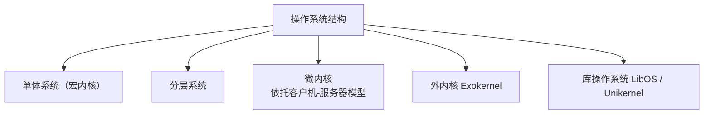

# 《现代操作系统》1.7 操作系统结构 
> 教材：现代操作系统（原书第5版）
> 格式约定：**1.7.x小节为书本原文顺序整理**；个人理解、对比总结、Mermaid图全部放在本节末尾【附加拓展区】，可以直接拼接在1.1~1.6笔记之后

## 1.7 操作系统结构
操作系统代码体量巨大，为了控制复杂度、方便开发调试，演化出多种组织结构。不同结构的核心取舍在于：**哪些功能运行在内核态，哪些放到用户态，模块之间采用什么方式通信调用**。

### 1.7.1 单体系统（Monolithic Systems，宏内核）
单体系统是最古老、最经典的内核结构。
- 组织方式：整个操作系统内核是**一个单独的二进制程序**，进程调度、内存管理、文件系统、设备驱动、网络协议栈全部运行在同一个内核地址空间、内核态。模块之间直接通过普通函数调用互相访问，没有强隔离。
- 工作模式：内核拥有主循环，接收系统调用、中断，分发到对应内部函数处理。
- 补充：现代Linux支持可加载内核模块（LKM），模块可以动态加载，但模块载入后依然共享内核地址空间，本质仍然属于单体结构。
- 优点：直接函数调用，通信开销很小，性能优秀；实现相对直接。
- 缺点：模块耦合度极高；任意一个内核模块出错、崩溃，都会造成整个系统宕机；代码庞大后维护、排错困难。
- 代表：传统UNIX、Linux。

### 1.7.2 分层系统（Layered Systems）
核心思路：将操作系统拆分成若干层级，**单向依赖**，每一层只能调用下层提供的接口，不允许反向调用。越底层越贴近硬件，越上层越靠近用户。
- 教材经典案例：Dijkstra 的 THE 系统（6层）
    - 第0层：CPU调度，实现进程切换
    - 第1层：内存管理
    - 第2层：控制台I/O管理
    - 第3层：磁盘管理
    - 第4层：用户程序
    - 第5层：操作员（用户）
- 优点：模块化清晰；下层故障一般不会直接破坏上层；便于分层调试、形式化验证。
- 缺点：合理分层边界很难划分；单向调用引入额外开销，性能下降；很多功能天然不适合严格分层。
- 现状：现代操作系统很少使用纯粹严格分层结构，很多系统借鉴分层思想，但不强制严格单向约束。

### 1.7.3 微内核（Microkernels）
设计思想：**内核态只保留最基础、必不可少的最小核心功能**；文件系统、网络协议栈、大部分设备驱动等服务，全部拆成独立的用户态服务器进程。
- 微内核中一般保留：进程调度、地址空间管理、底层中断处理、进程间通信（IPC）机制。
- 模块之间不再是直接函数调用，依靠**IPC消息传递**完成交互。
- 优点：隔离性强；某一个用户态服务崩溃，不会导致整机崩溃，可以单独重启该服务；安全性、可移植性更好；驱动运行在用户态。
- 缺点：IPC消息发送、接收、切换的开销远大于直接函数调用，性能弱于宏内核。
- 代表：MINIX（本书作者开发，教材重点案例）、QNX、L4。

### 1.7.4 客户机-服务器模型（Client-Server Model）
客户机-服务器是一种架构范式，**微内核就是该范式最典型的落地实现**。
- 思想：把操作系统服务封装成独立的服务器进程（Server）；应用程序作为客户端（Client）。客户端需要请求服务时，向服务器发送IPC消息；服务器处理完成后，通过消息返回结果，消息转发由微内核完成。
- 拓展：该模型不只用于单机微内核，分布式网络系统同样广泛使用客户-服务器模式，客户端和服务器甚至可以在不同机器上。
> 区分：客户服务器是设计思想，微内核是采用这个思想的一类OS结构，二者不能等同。

### 1.7.5 外内核（Exokernels）
外内核的设计理念和微内核有明显区别：
微内核：内核主动封装硬件，向上提供统一高层抽象（进程、文件）；
外内核：**内核尽量不做高层抽象**，内核只负责两件事：硬件资源的保护、资源复用仲裁。磁盘块、物理内存等硬件资源直接暴露给上层。
资源怎么管理、构建什么样的抽象，交给上层库或者应用自己决定。
- 优点：灵活性极强，上层可以根据业务需求自定义存储、内存模型，消除不必要的抽象层开销。
- 缺点：把资源管理的复杂性转移给上层程序，应用开发难度大幅提升。
- 代表：MIT Exokernel、Xok。

### 1.7.6 库操作系统（Library Operating Systems，LibOS）
库操作系统把操作系统的全部功能打包成一个程序库，应用程序直接链接这个OS库，**OS库和应用跑在同一个地址空间内，没有独立的内核服务进程**。
Unikernel（单内核程序）是库操作系统的典型代表：应用+OS库一起编译成一个独立镜像，直接运行在硬件或者虚拟机上。
- 优点：没有IPC、进程切换开销；镜像体积极小、启动速度极快；适合云、嵌入式专用场景。
- 缺点：通用性差，一个镜像只为单一应用服务；缺少强故障隔离。
- 代表：OSv、MirageOS。

---

# 附加拓展内容（笔记自用拓展，不属于教材原文小节）
## ✨ 个人补充理解
1. 所有内核架构的本质权衡：**性能 <----> 隔离性、可靠性**
    - 宏内核优先性能，牺牲隔离；
    - 微内核优先隔离稳定，牺牲性能；
    - 外内核追求极致灵活；库OS追求轻量化、快速启动。
2. 考试高频区分：分层系统核心是**单向向下调用**；微内核核心是**最小内核 + IPC通信 + 用户态服务**。
3. MINIX是微内核，也是本书作者作品，和前面章节呼应；Linux宏内核是对比重点。
4. 外内核：内核不造抽象，只看门（权限保护）；微内核：内核帮你造好抽象。

## 📊 横向对比总表
| 结构类型 | 核心思想 | 内核态承载内容 | 优点 | 缺点 | 典型代表 |
| ---- | ---- | ---- | ---- | ---- | ---- |
| 单体（宏内核） | 所有内核组件共享同一内核地址空间，直接函数调用 | 调度、内存、文件系统、驱动、网络栈 | 调用开销低，性能好 | 耦合高，模块崩溃会整机宕机 | Linux、传统UNIX |
| 分层系统 | 分层组织，只允许下层被上层调用，单向依赖 | 功能按层级拆分 | 模块化，便于调试验证 | 分层边界难划分，有性能损耗 | THE系统 |
| 微内核 | 内核最小化，大部分服务拆为用户态进程，IPC通信 | 调度、地址空间、IPC、基础中断 | 隔离好，服务可独立重启，安全性高 | IPC消息传递开销大，性能较差 | MINIX、QNX、L4 |
| 外内核 | 内核不提供高层抽象，只做资源保护与仲裁 | 资源权限校验、硬件复用控制 | 灵活性极高，上层自定义抽象 | 上层应用开发复杂 | MIT Exokernel、Xok |
| 库操作系统 | OS作为库链接进应用，无独立服务进程 | 几乎无独立内核服务，OS逻辑在用户库 | 镜像小、启动快、无IPC开销 | 通用性差，隔离弱 | OSv、MirageOS |

## 🧩 Mermaid 操作系统结构分类图

