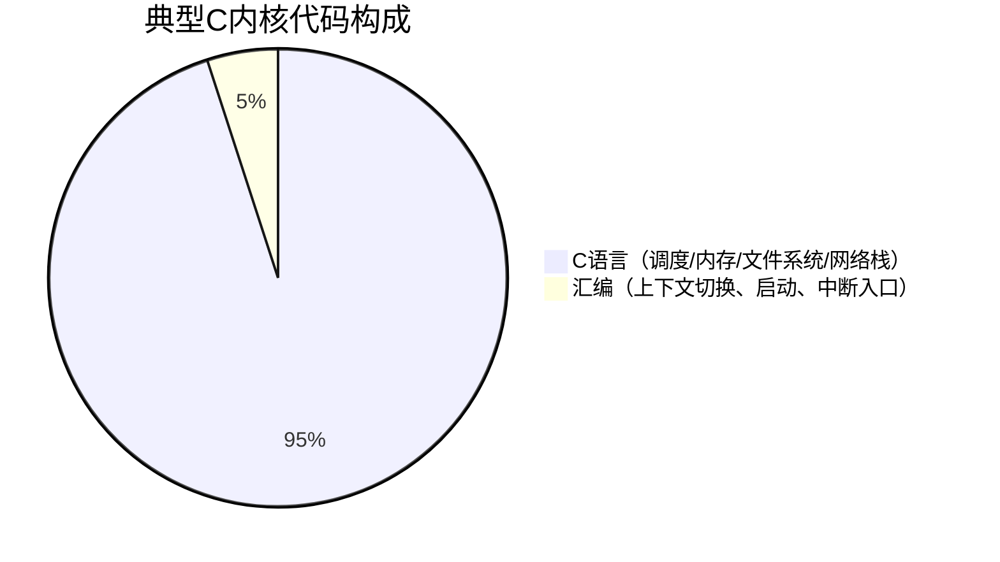
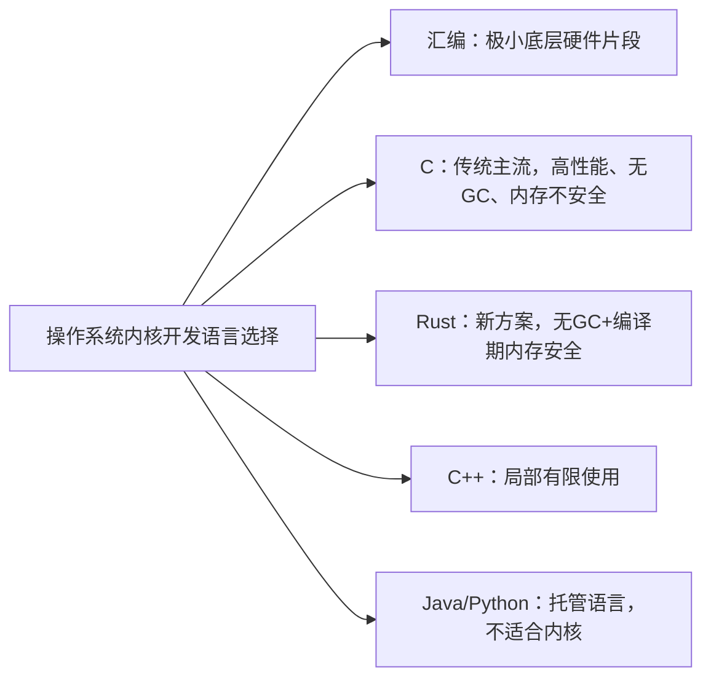

# 《现代操作系统》1.8 依靠C的世界 Markdown笔记
> 教材：现代操作系统（原书第5版）
> 格式约定：**1.8.x小节为书本原文顺序整理**；个人理解、对比总结、Mermaid图全部放在本节末尾【附加拓展区】，可以直接拼接在1.1~1.7笔记之后

## 1.8 依靠C的世界
现代主流操作系统（UNIX、Linux、MINIX、FreeBSD等）内核主体几乎都是用C语言编写，而不是汇编、C++、Java等语言。Unix最初用汇编开发，1973年改用C重写，奠定了系统软件使用C语言的传统。本节解释C语言成为操作系统开发首选语言的原因、C的局限，以及其他语言在系统开发中的适配问题。

### 1.8.1 为什么操作系统偏爱C语言
1. **贴近硬件，控制力强**
C支持指针、直接内存访问、位运算，可以操作物理地址、硬件寄存器，能够精准控制内存布局，没有额外抽象层屏蔽硬件细节，非常契合内核和硬件打交道的需求。
2. **无厚重运行时，执行行为可预测**
C没有垃圾回收GC、没有自动异常处理、没有隐形构造析构逻辑。代码执行流程可控，不会出现GC随机停顿，满足操作系统内核对时延确定性的要求。
3. **编译原生机器码，性能高**
C代码直接编译成目标平台原生指令，没有虚拟机、解释层，运行开销极小。
4. **兼顾可移植性，优于汇编**
汇编语言和CPU架构强绑定，换一种CPU就要全部重写；C语言只需要针对新平台提供适配的C编译器，少量硬件相关底层代码用汇编，绝大部分代码重新编译即可移植。Unix的跨平台成功很大程度得益于C。
5. **编译器轻量、普及度高**
C编译器易于移植，很早就被适配到各类CPU架构上，生态成熟。

### 1.8.2 C语言与生俱来的缺陷（教材重点）
C为了性能和控制权牺牲了安全性：
- **没有数组越界检查**：越界访问不会自动报错，缓冲区溢出是操作系统最常见的安全漏洞来源；
- **没有自动内存管理**：需要开发者手动申请、释放内存，极易出现内存泄漏、野指针、悬空指针；
- **类型检查弱**：强制类型转换非常自由，很容易出现隐蔽的类型错误；
- **没有内置并发安全、异常处理机制**，并发bug需要开发者自己控制。

> 正是这些内存不安全特性，导致C写的内核长期饱受漏洞困扰，但在很长一段时间里没有替代方案。

### 1.8.3 汇编语言的定位：少量必需，不适合大规模开发
C不能完全取代汇编。内核中一小部分和硬件强绑定的代码仍然必须用汇编：
- 上电引导启动代码
- 进程上下文切换（保存/恢复寄存器）
- 中断、陷阱入口处理
- 直接操作特殊控制寄存器的底层逻辑

特点：汇编代码占内核总代码量比例很低，一般在5%以内，只做C做不到的底层硬件操作，业务逻辑、调度、文件系统全部交给C。

### 1.8.4 其他语言为什么不适合作为内核主体语言
1. **C++**：支持面向对象、异常、RTTI。异常会带来不可控的执行流，构造/析构存在隐式开销；C++标准库依赖操作系统本身，内核环境无法使用完整标准库。少数驱动或子系统会有限使用C++，但主流内核主体不用。
2. **Java、Python等托管语言**：依赖虚拟机+垃圾回收。GC随时可能暂停程序，时延不可预测，虚拟机本身又需要操作系统才能运行，鸡生蛋问题，不适合内核。

### 1.8.5 系统编程语言新趋势：Rust
教材提到近年Rust作为新兴系统语言正在发展：保留无GC、底层内存操作能力，依靠所有权、借用检查在编译期保障内存安全，解决C最大的痛点。
Linux已经逐步接纳Rust，允许在内核里用Rust开发驱动模块。但Rust生态积累短，现有庞大成熟内核主体依然以C为主，短期内无法全面替代C。

---

# 附加拓展内容（笔记自用拓展，不属于教材原文小节）
## ✨ 个人补充理解
1. 选择C本质是**取舍**：牺牲内存安全，换取极致硬件控制权、性能、可移植性。
2. 区分：C适合**内核**，不代表应用程序也要用C；上层应用可以用Python、Java等托管语言，由OS内核屏蔽底层麻烦。
3. 可移植的边界：C代码的可移植建立在“编译器+少量架构相关汇编”之上，不是C代码天生跨平台。
4. Rust的思路：不是抛弃底层能力，而是把C里容易犯错的内存规则放到编译器静态检查阶段，从源头减少缓冲区溢出、野指针这类经典漏洞。

## 📊 横向对比总表（系统开发视角）
| 语言 | 有无GC | 内存安全 | 硬件操控能力 | 运行开销 | 是否适合内核主体 |
| ---- | ---- | -------- | ------------ | -------- | ---------------- |
| 汇编 | - | 无保护 | 极强 | 极小 | 仅少量底层片段 |
| C | ❌ | 弱，无自动检查 | 强 | 极小 | ✅ 主流内核首选 |
| C++ | ❌ | 依赖程序员规范 | 强 | 较小（存在隐式开销） | ⚠️ 少量子系统使用 |
| Java | ✅ | 强 | 极弱，依赖JVM | 较大 | ❌ 不适合内核 |
| Rust | ❌ | 编译期静态安全 | 强 | 极小 | ⚠️ 新兴，逐步应用于驱动 |

## 🧩 Mermaid 内核代码构成图

