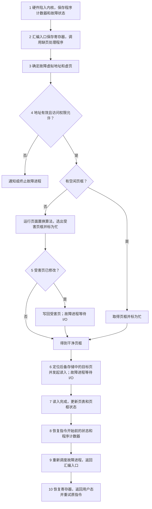

# 第三章 内存管理

## 3.6 分页的实现问题

**核心问题：**选好置换算法还不等于实现了虚拟内存。操作系统还必须在进程生命周期中维护页表和后备存储，正确处理缺页与指令重启，协调 I/O，并决定哪些工作留在内核。以下按原书 3.6.1—3.6.6 的顺序展开。

### 3.6.1 操作系统与分页

**问题：**分页不是只在缺页时运行一次的算法；进程的建立、运行、缺页和退出都改变地址映射。

| 时机 | 必须完成的工作 | 容易忽略的边界 |
| --- | --- | --- |
| 创建进程 | 确定初始程序与数据大小，分配、初始化页表；准备交换区或以可执行文件作为程序代码的来源；在进程表记录页表和后备存储信息 | 程序代码可以直接从可执行文件按需调入，未必先复制到交换区；页表在进程运行时必须可访问，进程换出时不一定常驻 |
| 进程切换并开始运行 | 更新 MMU 所使用的页表及相关寄存器；必要时使旧 TLB 项失效；可预先装入已知即将使用的页 | 没有进程标识的 TLB 若沿用旧项，可能把新进程的虚拟地址映射到旧进程页框；带进程标记的 TLB 可避免简单地全部清空 |
| 发生缺页 | 读取故障地址，确定所需虚页和后备存储位置，取得空闲页框或置换受害页，读入后重启故障指令 | 必须区分可调入的合法地址与非法地址、权限错误；不能把所有异常都当作可恢复缺页 |
| 进程终止 | 释放页表、专用页框和交换空间 | 共享页及其后备空间须等最后一个使用者结束后才释放 |

这四个时机说明，**页表是进程状态的一部分**，而 TLB 是其地址转换结果的高速缓存；更新当前页表后，旧的 TLB 映射不能无条件继续使用。

### 3.6.2 缺页中断处理

**问题：**访问的虚页不在内存时，怎样既取回正确页面，又让程序表现为这条指令正常完成？原书给出简化后的十步流程：

1. 硬件陷入内核，保存程序计数器及故障指令的相关状态。
2. 汇编中断入口保存通用寄存器等易失状态，转入缺页处理程序。
3. 确定引发故障的虚拟地址和虚页。若硬件没有直接提供故障地址，系统可能需要取出并解析故障指令。
4. 检查地址是否有效、访问是否符合保护权限。非法访问通知或终止进程；合法但不在内存的访问才继续。先找空闲页框；没有时运行页面置换算法。
5. 若受害页已修改（脏页），安排写回非易失存储；在 I/O 期间可切换到其他进程。把所选页框标为忙，防止重复分配。
6. 页框变干净后，找到所需页面的存储位置并发起读入；故障进程继续等待，CPU 可以运行其他进程。
7. I/O 完成中断到来后，更新页表中该页的页框位置和有效状态，使页框恢复可用状态。
8. 将故障指令及其状态恢复到指令开始前，令程序计数器重新指向它。
9. 重新调度故障进程，并返回调用缺页处理程序的汇编入口。
10. 汇编入口恢复寄存器等状态，返回用户态重试原指令。

下面的图把十步中的分支和等待点连起来：**非法地址或权限错误直接结束本次处理**；合法缺页在取得干净页框后读入目标页，I/O 等待期间可运行其他进程。

**为什么先检查权限？**“页面不在内存”与“这个地址根本不允许访问”是不同条件；后者不能靠从磁盘读一页来解决。**为什么还要保存指令状态？**读入只修复映射，不会自动撤销故障发生前指令已做的局部操作。

### 3.6.3 指令备份

**问题：**缺页可能发生在一条指令执行到一半时；重试必须从原指令的正确起点及正确机器状态开始。

原书以带两个操作数的变长指令为例（图 3-27）：指令字及后续操作数字段都可能跨页。故障时的程序计数器可能指向指令开始，也可能指向后面的操作数字段；仅凭当前计数器，操作系统未必能判明哪个字节才是操作码。自动递增/递减寻址还可能在故障前修改寄存器；如果重试时重复递增，访问的地址就错了。是否已修改、修改多少，还可能随指令及 CPU 实现而变。

一种硬件支持是在执行每条指令前保存其起始程序计数器，并记录已完成的自动递增/递减等副作用。内核据此撤销局部影响，再重启指令。没有这些信息时，软件必须推断故障前的执行进度，处理复杂且容易出错。**取舍：**硬件提供精确异常状态会增加实现成本，却大幅简化可重启的缺页处理。

### 3.6.4 锁定内存中的页面

**问题：**设备通过 DMA 向用户 I/O 缓冲区所在页框写数据时，若全局置换算法把这个页换走并让同一页框承载另一页，DMA 后续数据就可能写到错误页面。

- **固定页面（pinning）**：在 I/O 持续期间将缓冲区页面锁在物理内存，禁止选作受害页；I/O 结束后解除固定。这样设备使用的物理页框保持稳定，但被固定的页不能参与置换，过多固定会缩小可用内存。
- **内核缓冲区中转**：设备先读写不会被换出的内核缓冲区，完成后再与用户页面复制数据。它避免直接固定用户缓冲区，但额外复制增加时间与内存带宽开销。

这与一般缺页不同：这里要保证的是**异步 I/O 在整个传输期间使用同一个有效物理位置**，不能仅靠传输开始时地址转换正确。

### 3.6.5 后备存储

**问题：**页被换出后放在哪里，下次缺页怎样定位？原书图 3-28 对比了固定交换区与动态分配页位置。

| 方案 | 工作方式 | 优点 | 代价与适用边界 |
| --- | --- | --- | --- |
| 固定交换区位置 | 为进程预留交换空间，记录起点；按虚页偏移计算对应存储位置 | 定位简单，通常无需每页另存磁盘地址 | 进程还没用到的空间也可能被预留；数据段、栈后续增长使整块预留不灵活，可分别为代码、数据、栈准备多块区域 |
| 按页动态分配 | 页面换出时才找空闲存储块，维护“虚页 → 存储位置”的磁盘映射表；换入后可释放该块 | 常驻内存的页不必占着交换空间 | 需要每页位置记录与动态分配管理，换出/换入时管理更复杂 |

交换区可用独立分区，省去普通文件系统的块地址换算；没有合适分区时也可用预分配的交换文件。固定方案下，内存中页面可能仍有一份磁盘旧副本，若内存页被修改，旧副本不能代表最新内容；未修改时则可复用。动态方案下，常驻内存的页通常没有有效磁盘副本。

**只读代码页为何可以直接丢弃？**它原本就在可执行文件中，且未被修改；需要时从文件重新读取即可，不必为它另存交换副本。共享库的只读代码页也可这样处理。可写数据页则需有能保存其最新内容的后备位置。

### 3.6.6 策略与机制分离

**问题：**地址转换和缺页处理需要内核与硬件合作，但“从哪里取页、怎样安排后备存储、选什么置换策略”未必都必须写进同一块内核代码。

原书以 Mach 风格的**外部页面管理器（external pager）**说明分工（图 3-29）：

1. **底层 MMU 处理器**封装与特定机器有关的映射操作。
2. **内核缺页处理器**接收陷入、确定故障虚页、执行必要的映射机制。
3. **用户态外部页面管理器**管理页面来源、后备存储及较多策略。

缺页后，内核告知外部页面管理器所需页面；后者从非易失存储读入并暂映射到自己的地址空间，再告知内核位置。内核移走该临时映射、建立故障进程的映射，最后重启进程。进程建立或新对象映射时，外部页面管理器也要获知以建立页面映射与后备存储关系。

**置换策略的边界：**外部页面管理器通常不能直接读取全部页的访问位 R 和修改位 M，而许多算法依赖它们。必须由内核上报这些信息，或者让置换选择留在内核；若内核选出受害页，还需把页数据或其映射交给外部管理器写回。

**取舍：**分离让代码模块化、策略更灵活；代价是多次跨用户态/内核态边界和消息传递。原书还提到 Linux 的 `userfaultfd` 可让用户进程参与按需分页，这体现类似方向，但不等于 Linux 将整个分页机制移出内核。

### 自检

- 为什么切换进程时页表与 TLB 都要处理？带进程标记的 TLB 改变了什么？
- 一次合法缺页从陷入到重试，写回、读入、更新页表与恢复指令的顺序是什么？
- 固定交换区与动态按页分配各自节省了什么，又付出了什么？
- 外部页面管理器为何不能天然接管所有页面置换算法？

资料：Tanenbaum、Bos，《Modern Operating Systems》第 5 版，第 3 章 3.6；[教材正文](https://studylib.net/doc/27599138/operating-systems-book)、[Pearson 目录](https://www.pearson.de/media/muster/toc/toc_9781292727899.pdf)。
