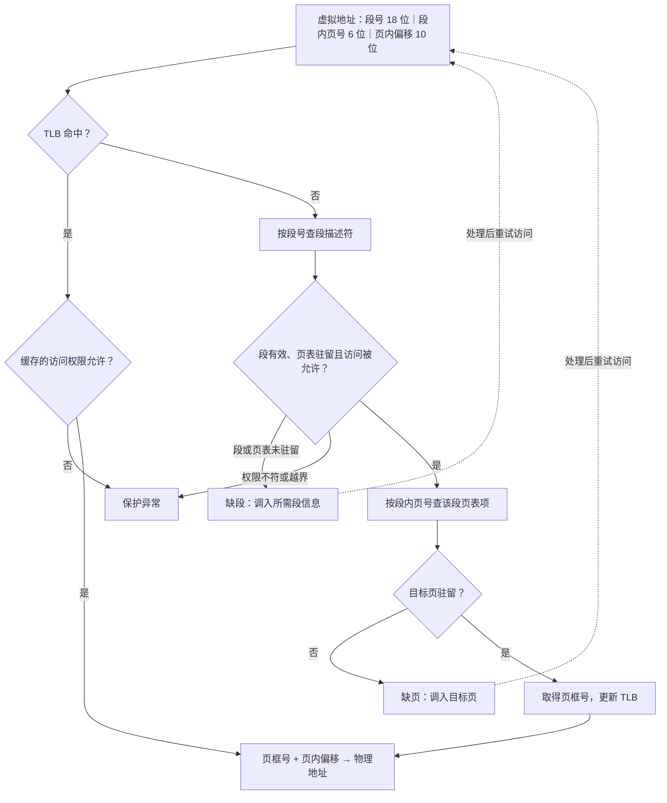

# 第三章 内存管理

## 3.7 分段

**核心问题：**分页提供一个线性虚拟地址空间，适合把程序按固定大小的页放进内存；但程序中的符号表、语法树、栈等逻辑对象可能独立增长，放在同一个连续地址空间中会互相碰撞。分段给每类逻辑对象独立的地址空间；再结合分页，解决大段难以整体装入的问题。

在原书的编译器例子中，源文本、符号表、常量表、语法树和调用栈分别增长或缩小。若为它们预留相邻虚拟地址区间，符号表即使旁边其他区间仍有空位，也可能先撞上源文本区（图 3-30）。**段（segment）**是从 0 开始、长度可变的独立线性地址空间；地址写作“段号 + 段内地址”（图 3-31）。每段能够独立扩缩，段的边界对应程序员可理解的过程、数组或栈。

分段还有两个直接作用。若每个过程是独立段并从段内地址 0 开始，重新编译某过程而使其长度变化时，其他过程的入口地址仍可按“段号，0”引用，链接更方便。多个进程可以共享一个库段；不同段还能分别设置执行、读取、写入权限，例如代码段只执行、数据段读写而不可执行。**分段的主要动机是逻辑独立、共享与保护；分页的主要动机是用有限物理内存提供大的线性地址空间**（图 3-32）。两者不是同一种问题的不同名字。

### 3.7.1 纯分段的实现

**问题：**段长不固定；如果整段作为一个单位放入物理内存，换入、换出不同大小的段后，会留下大小不一的空洞。

原书图 3-33 展示：先换走较大的段，再用较小的段填入，其余位置成为空洞；多次交换后，已占用段与空洞交错，形成**棋盘状碎片化（checkerboarding）/外部碎片**。空闲空间的总量可能够大，却没有足够大的连续空洞容纳新段。可以通过**紧缩（compaction）**搬移已有段并合并空洞，但搬移数据需要时间，还须同步修正对应地址映射。持续动态增长的段也增加放置难度。

纯分页的页框等长，任一页可放任一空闲页框，避免这种由整段大小不一造成的外部碎片；代价是固定页大小带来的页内未用空间，以及页表与地址转换开销。纯分段保留程序可见的逻辑边界与段级保护，但为可变长物理分配付出外部碎片和紧缩成本。

### 3.7.2 分段与分页结合：MULTICS

**问题：**纯分段允许逻辑对象独立增长，却要求一个大段整体常驻内存；段很大时既浪费内存，也可能根本放不下。MULTICS 把**每个段再分页**：段仍是逻辑、共享和保护单位，物理装入以固定大小页为单位，只需保留当前用到的段内页。

MULTICS 每个程序最多有 `2^18` 个段，每段最多 `65,536` 个 36 位字。每个程序有**段表/描述符段**，每个段对应一个**段描述符**。段数太多，描述符段自身也分页；描述符基址寄存器先定位它的页表，再定位描述符段的页。描述符包含段是否在内存、段长、保护信息，以及在内存时指向该段页表的指针；段在非易失存储中的位置由缺段处理器使用的其他表保存。通常的段内页大小为 1024 字，系统内部少数小段可以不分页或使用 64 字页（图 3-34）。

**结构图（对应图 3-34）：**先通过“描述符段的页表”找到段描述符，再由该描述符找到目标段的页表。图中虚线表示逻辑上按段号或页号选取表项，并非指整个段必须连续装入。

**一次地址转换**（图 3-35、3-36）：

1. 把虚拟地址分为**段号、段内页号、页内偏移**。原书示意为 18 位段号、6 位页号、10 位偏移，共 34 位。
2. 用段号取得段描述符，并检查段长与保护条件。若段页表不在内存，触发**缺段**；权限不符则陷入相应保护异常。这两种情况不等同于缺页。
3. 在该段页表中检查所需页；页不在内存才触发**缺页**，在内存则读出物理页框位置。
4. 将页框起始地址与页内偏移组合，完成读写。

**转换图（对应图 3-35、3-36，并加入图 3-37 的 TLB 快路径）：**先按段号和页号查 TLB。只有未命中才遍历描述符与段页表；“缺段”和“缺页”分别发生在不同层级，权限错误也有单独出口。以下图示省略了描述符段自身的分页细节，它已在上图展开。

若每次访问都走描述符段、段页表和数据页，访存代价过高。MULTICS 使用 16 项的高速 **TLB**，以“段号 + 虚页号”为查找键缓存到页框的映射和保护等信息；命中时跳过描述符与页表访问（图 3-37）。工作集对应的页面若能驻留 TLB，转换效率高；超过容量就会出现 TLB 失效。**这里的 TLB 失效是地址转换缓存未命中，不必然是物理页缺失。**

**取舍：**段级语义和页级按需装入兼得，但描述符段自身也分页，地址转换层次更深，需要 TLB 缓解开销；还必须分别处理缺段、缺页和保护异常。

### 3.7.3 分段与分页结合：Intel x86

原书讨论的是**32 位 x86 的历史分段加分页设计**：它也可组合两种机制。与 MULTICS 最多约 256K 个、每段最多 64K 个 36 位字相比，书中 x86 对比值是最多 16K 个段、每段最多十亿个 32 位字。段数较少，但单段更大，更符合多数程序需要大地址范围而非极多独立段的情况。

**为什么后来不以完整分段为主？**原书指出 UNIX 与 Windows 没有采用 x86 特有的完整分段内存模型，开发者更重视跨硬件平台可移植性；维护较少使用的分段硬件也占芯片面积。因此 x86-64 原生模式不再提供与 32 位模式相同的完整分段模型，旧机制主要保留在兼容场景中。不能把“32 位 x86 有分段加分页”直接套到现代 x86-64 原生模式，也不能据此说现代系统没有分页。

**理解两种组合的共同点：**先利用段界和段级权限表达逻辑对象，再由页把地址映射到物理页框；分段解决逻辑组织、共享和保护，分页解决大段整体装入与物理放置问题。

### 自检

- 编译器符号表为何会在一维空间中“撞墙”，而独立段可以缓解？
- 纯分段的外部碎片由什么造成？紧缩付出什么成本？
- MULTICS 中段描述符、段页表、TLB 各保存什么？缺段、缺页、TLB 失效有何区别？
- 为什么 32 位 x86 与 x86-64 的分段结论不能混用？

资料：Tanenbaum、Bos，《Modern Operating Systems》第 5 版，第 3 章 3.7；[教材正文](https://studylib.net/doc/27599138/operating-systems-book)、[Pearson 目录](https://www.pearson.de/media/muster/toc/toc_9781292727899.pdf)。
