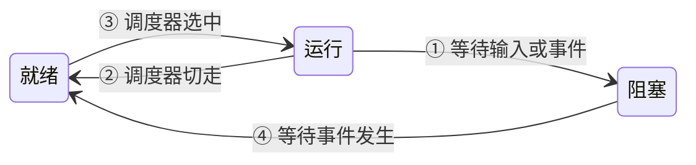

# 第二章 进程与线程

## 2.1 进程

现代计算机同时承担多项活动：服务器在等待磁盘读取时仍需处理新请求，个人计算机也会同时运行交互程序和后台服务。**进程**是描述、管理这些并发活动的基本抽象。多道程序设计让每个 CPU 快速切换所执行的进程；在单 CPU 上，同一瞬间只有一个进程真正运行，但一段时间内多个进程都能取得进展，这称为**伪并行**。多核或多处理器则还能使多个进程在硬件上真正并行。本节按单 CPU 模型解释进程；推广到多核时，每个 CPU 同一瞬间仍只执行一个进程。

### 2.1.1 进程模型

**定义：进程是正在执行的程序的一个实例**，包括程序计数器、寄存器和变量等当前值。模型把可运行的软件组织为一组顺序进程；每个进程仿佛拥有自己的虚拟 CPU，实际 CPU 则轮流为它们服务。每个进程有独立的控制流和逻辑程序计数器：切换到该进程时，保存的计数器值装入物理 CPU；切走时，再把执行位置和相关状态保存起来。因此，进程恢复后可以从原处继续执行。

**程序与进程的区别**：程序是静态的指令描述，可以存放在磁盘上而不执行；进程是有程序、输入、输出和运行状态的活动。同一个程序运行两次，就形成两个不同的进程；即使它们的代码可共享，运行状态仍分别存在。

**运行速度不可预设**：CPU 的分配和中断会改变进程取得计算进展的实际速度。程序不能靠固定次数的空循环推算另一个进程何时完成；有严格时间要求的活动需要专门的实时保证，而不能依赖多道程序设计下的相对运行速度。

### 2.1.2 进程的创建

通用操作系统需要按需创建进程。教材列出四种主要触发情形：

1. **系统初始化**：启动时建立交互用的前台进程和承担特定任务的后台进程。长期在后台处理邮件、Web 请求或打印等工作的进程称为**守护进程**。
2. **运行中的进程发出创建进程的系统调用**：例如把取数和处理数据交给相互协作的进程；在多处理器上，它们还可能同时运行。
3. **用户请求**：输入命令或打开程序时，系统为所选程序建立新进程。
4. **批处理作业启动**：资源允许时，系统从作业队列取出任务，并建立进程运行它。

**共同机制**：这些情形最终由已有进程请求操作系统创建新进程；系统启动时的最初进程由启动机制预先建立。创建请求还需直接或间接指定新进程将运行的程序。

**UNIX 的两步方式**：`fork` 先创建调用进程的子进程，子进程起初具有与父进程相同的程序映像、环境及打开的文件；通常再用 `execve` 等调用装入另一程序。把创建与装入分开，使子进程可在两者之间调整文件描述符，完成标准输入、输出或错误输出的重定向。**Windows 的方式**：`CreateProcess` 在一次调用中创建进程并装入指定程序，同时接收命令行、继承文件、优先级等参数。

**地址空间与资源**：创建后父子进程拥有各自的地址空间，一方修改自己的可写内存，另一方不会因此直接看到变化。传统 UNIX 中，子进程的初始地址空间是父进程的副本；写时复制允许先共享物理页，某一方写入时才复制相应部分，但两者的可写地址空间在逻辑上仍独立。进程也可能共享代码或继承打开的文件等其他资源。Windows 父子进程的地址空间从创建之初就不同。

### 2.1.3 进程的终止

教材把终止原因分为四类，区分进程**主动结束**与**被动终止**：

1. **正常退出（自愿）**：工作完成后主动告知操作系统，例如 UNIX 的 `exit`、Windows 的 `ExitProcess`。
2. **出错退出（自愿）**：进程发现无法完成请求，例如待处理的输入文件不存在，报告错误后自行退出。
3. **严重错误（非自愿）**：非法指令、无效内存访问、除零等执行错误可能由系统终止进程；某些错误若设置了处理方式，也可能先交给进程处理。
4. **被其他进程结束（非自愿）**：其他进程在具有相应权限时，请求系统终止目标进程，例如 UNIX 的 `kill` 或 Windows 的 `TerminateProcess`。

**父子关系不等于连带终止**：有些系统会在父进程结束时连带终止其子进程；教材指出 UNIX 和 Windows 并不采用这一普遍规则。

### 2.1.4 进程的层次结构

创建进程的进程称为**父进程**，被创建者称为**子进程**；子进程还能继续创建进程，于是形成层次结构。一个进程在该关系中只有一个父进程，可以有多个子进程。

**UNIX**：教材用启动后的 `init` 及其后代说明进程树：登录相关进程、Shell 和 Shell 启动的命令逐级产生。进程还可按**进程组**组织；与终端关联的前台进程组收到 `Ctrl+C` 等信号后，各成员可按自己的信号处理方式响应。**进程树中的父子关系**与**用于信号投递的进程组**是不同关系，不能把整棵子孙树等同于一个前台进程组。

**Windows**：教材强调它没有 UNIX 式的统一进程层次模型；创建者取得用于控制新进程的句柄，句柄可以传给其他进程，因此控制关系不必固定在父子关系上。

### 2.1.5 进程的状态

进程虽有各自的执行状态，仍可能为了输入或其他进程的结果而等待。教材的基本模型有三态：

- **运行态**：此刻正在占用 CPU 执行。
- **就绪态**：已经具备继续执行的条件，只是暂时没有分到 CPU。
- **阻塞态**：等待输入等外部事件；事件未发生前，即使 CPU 空闲也无法继续执行。

**四种状态转换及原因**：

1. **运行 → 阻塞**：进程需要的数据尚未到达，或主动请求等待，当前工作在逻辑上不能继续。
2. **运行 → 就绪**：调度器暂停当前进程，把 CPU 分给其他进程；它仍然能够运行。
3. **就绪 → 运行**：调度器选中该进程，使它获得 CPU。
4. **阻塞 → 就绪**：等待的外部事件发生，进程重新具备运行条件；若此时未获 CPU，仍需在就绪态等待。

**状态判别关键**：就绪态和运行态的进程都能继续计算，差别是有没有 CPU；阻塞态缺少继续执行所需的条件。等待事件完成只使阻塞进程**可运行**，并不保证它立刻运行。调度器决定何时让就绪进程运行，并在系统效率与进程公平性之间分配 CPU。教材用底层调度器处理切换和中断、上层以顺序进程组织工作的模型说明这种抽象；真实系统的组织未必完全如此。

**进程三态与四种转换**：

### 2.1.6 进程的实现

操作系统用**进程表**记录各进程，每个表项保存一个进程的信息，通常称为**进程控制块（PCB）**。只有保存足够的现场，进程在运行态转为就绪态或阻塞态后，才能像没有中断过一样继续执行。表项具体字段依系统而异，教材按用途给出典型内容：

- **进程管理**：寄存器、程序计数器、程序状态字、栈指针、进程状态、优先级、调度参数、进程标识符、父进程、进程组、信号以及 CPU 使用时间等。
- **内存管理**：代码段、数据段、栈段等内存信息的指针。
- **文件管理**：根目录、工作目录、文件描述符，以及用户和组标识等。

**中断与进程恢复的底层过程**：硬件在中断到来时先把程序计数器、程序状态字及可能的部分寄存器信息压栈，再根据中断向量转入对应的中断服务例程。底层汇编代码保存其余寄存器并切换到处理程序使用的栈；针对该中断的软件处理完成必要工作，可能使等待中的进程转为就绪；随后调度器选择下一运行进程。最后恢复被选进程的寄存器和内存映射并继续执行。**核心目的**是保存、恢复进程现场，使切换不破坏各进程的顺序执行语义；具体实现步骤因系统而异。

**中断后的现场保存与恢复**：

### 2.1.7 多道程序设计模型

**产生原因**：进程等待 I/O 时，CPU 本来可能空闲。让多个进程同时驻留内存，就有机会在一个进程等待时运行另一个进程，提高 CPU 利用率。简单地把单个进程的计算时间比例与进程数相乘会过于乐观，因为多个进程可能同时等待 I/O。

设每个进程有比例为 **`p`** 的时间在等待 I/O，内存中有 **`n`** 个进程，并暂按各进程等待事件相互独立估算。所有进程同时等待的概率为 **`p^n`**，此时 CPU 空闲，因此：

**CPU 利用率 ≈ `1 - p^n`**。

这里 `n` 是**多道程序设计的道数**，`p` 是**I/O 等待时间比例**，不能把它误当成计算时间比例。例如 `p = 0.8`、`n = 10` 时，估算利用率为 `1 - 0.8^10 ≈ 89.3%`，CPU 空闲比例约为 `10.7%`；若要求空闲比例**低于** `10%`，则需 `n ≥ 11`。随着道数增加，利用率提升的边际幅度逐渐减小。

**模型边界**：独立性只是一种近似；单 CPU 上不能有多个进程在同一瞬间运行，就绪进程还可能排队。更精确的预测需要考虑排队等因素，但“用其他进程填补 I/O 等待造成的 CPU 空闲”这一设计逻辑不变。

---

## 2.1 拓展总结

### 核心思想总结

1. **抽象目标**：用各自拥有执行现场的顺序进程描述并发活动；CPU 快速切换产生单 CPU 上的伪并行，多核可提供真正的并行。
2. **实现支点**：进程表保存现场，硬件中断与软件调度协作完成切换；恢复现场使每个进程保持连续执行的假象。
3. **状态题主线**：先判断进程是否具备继续执行条件，再判断是否获得 CPU；事件到来解决“能不能运行”，调度解决“何时运行”。
4. **创建题主线**：分清创建进程、装入程序和资源关系；`fork` 后通常接 `execve`，写时复制不等于父子进程共用可写地址空间。
5. **利用率题主线**：CPU 空闲须所有驻留进程同时等待；在独立近似下先算 `p^n`，再得 `1-p^n`，并检查 `p`、`n` 的含义及严格不等号。

### 高频对比表格

| 易混概念 | 区别与判别依据 |
| --- | --- |
| 程序 / 进程 | 程序是静态指令描述；进程是程序的一次执行，具有独立的当前状态。同一程序可对应多个进程。 |
| 伪并行 / 真并行 | 单 CPU 快速交替执行形成伪并行；多个 CPU 或核心在同一瞬间执行形成真并行。 |
| 前台进程 / 守护进程 | 前者直接服务用户交互；后者在后台持续等待并处理特定任务。 |
| `fork` / `execve` / `CreateProcess` | `fork` 创建子进程；`execve` 更换进程运行的程序；`CreateProcess` 把创建与装入合在一次调用中。 |
| 地址空间独立 / 资源继承 | 父子进程的可写地址空间逻辑上独立；打开的文件等其他资源仍可能继承或共享。 |
| 正常退出 / 出错退出 / 严重错误 / 被结束 | 前两者由进程主动结束；后两者通常由系统或有权限的其他进程使其非自愿终止。 |
| 进程树 / 进程组 | 进程树表示创建的父子关系；进程组用于把相关进程组织在一起，例如接收终端信号。 |
| 运行态 / 就绪态 / 阻塞态 | 运行：能运行且正占 CPU；就绪：能运行但未占 CPU；阻塞：等待条件，暂不能运行。 |
| 阻塞 → 就绪 / 就绪 → 运行 | 前者由等待事件完成触发；后者由调度器分配 CPU 触发。 |
| `p` / `1-p` / `p^n` | 分别表示单进程 I/O 等待比例、单进程非等待比例、独立近似下所有 `n` 个进程同时等待的概率。 |

> 依据：[《现代操作系统（原书第 5 版）》](https://www.cmpedu.com/books/book/5610308.htm)第 2 章 2.1「进程」，按原书 2.1.1—2.1.7 顺序整理。
