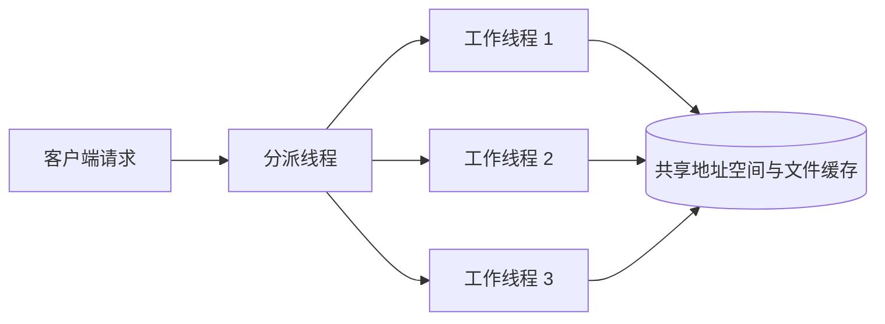
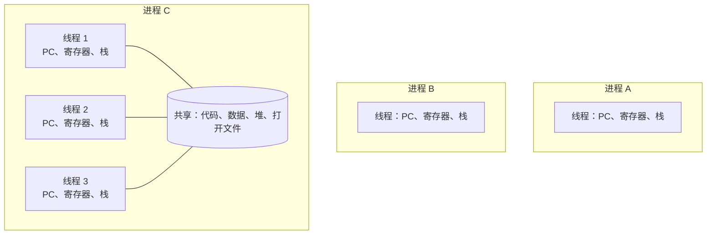
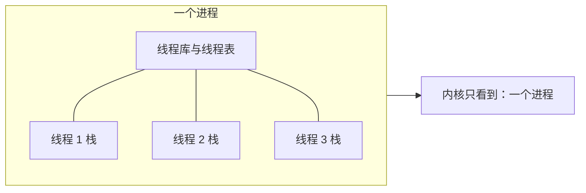
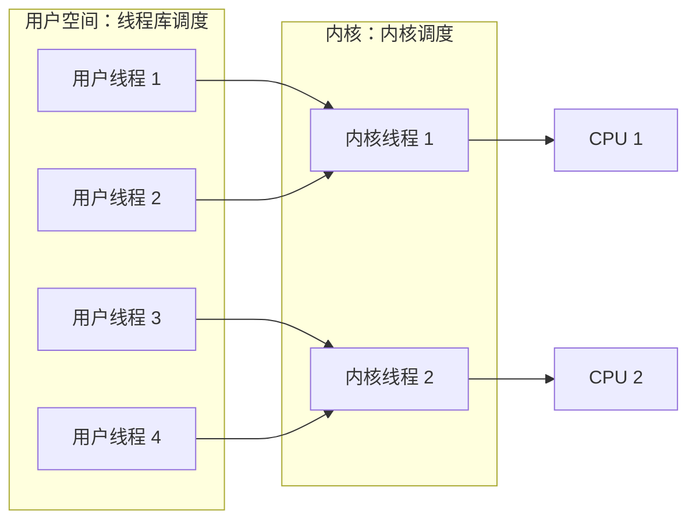

# 第二章 进程与线程

## 2.2 线程

进程模型把**资源所有权**与**执行**绑在一起：地址空间、打开文件等资源属于进程，程序计数器、寄存器和栈描述它的执行位置。很多程序却需要在同一组资源上同时推进多个活动；如果只能用进程实现，就要为每个活动复制地址空间，既昂贵又难以共享数据。**线程**把执行从进程中分离出来：一个进程可以包含多个线程，它们共享进程的地址空间和资源，但各自拥有独立的执行现场。线程有时被称为**轻量级进程**。

本节先看线程的典型用途（2.2.1），再给出经典线程模型（2.2.2），然后介绍 POSIX 线程接口（2.2.3）与三种实现方式（2.2.4—2.2.6），最后讨论把单线程程序改造成多线程程序时的问题（2.2.7）。

### 2.2.1 线程的使用

**核心动机**：许多应用本身就包含多个同时进行、且可能彼此独立阻塞的活动。把这些活动写成多个顺序线程，比在一个线程里用事件循环和状态机交织处理更自然，也能让一个活动等待 I/O 时另一个活动继续推进。

**例 1：文字处理程序。** 一个交互式文字处理程序至少要同时做三件事：

1. **交互**：等待键盘输入，并在屏幕上显示文字和光标。
2. **重排版**：用户修改文字后，重新计算换行、分页等版面。
3. **自动保存**：定期把文档写回磁盘，防止意外丢失。

若只有一个线程，程序必须在处理按键的间隙检查是否该重排版、是否该保存，把三项工作编织成复杂的状态机；某一项等待磁盘时，整个界面还会失去响应。分成三个线程后，每个线程都可以用顺序逻辑编写：交互线程只管读写屏幕，重排版线程只在文档变化后工作，自动保存线程按时间触发。线程共享同一份文档数据，不需要进程间通信来传递文本。

**例 2：Web 服务器。** 服务器收到请求后，通常要查缓存或读取磁盘上的页面，再把结果写回。教材用**分派线程 + 工作线程**说明多线程服务器：分派线程取得请求，交给一个空闲的工作线程；工作线程先查共享缓存，未命中时读取磁盘并等待，其他可运行线程继续工作。下面补充两种方案作对照：

- **单线程**：依次处理请求。等待磁盘或网络时 CPU 空闲，吞吐受 I/O 限制；一个慢请求会挡住后面的请求。
- **每请求一进程（对照）**：可以重叠 I/O，但创建进程要建立独立地址空间；进程之间共享缓存还需进程间通信。
- **工作线程复用**：分派线程把请求交给已有的空闲工作线程。线程共享地址空间和已打开文件；工作线程按顺序处理当前请求，完成后等待下一个请求。一个线程等待磁盘时，其他线程能否继续运行取决于线程实现方式。

这里的工作线程会反复处理请求，**不等于每收到一个请求就创建一个新线程**。它们共享同一地址空间和页面缓存，因此无须为访问缓存进行进程间通信。



阅读重点：分派与处理分离，工作线程之间通过共享地址空间交换数据，而不必走进程间通信。

**例 3：流水线。** 把一项工作拆成若干阶段，每个阶段一个线程，阶段之间用缓冲区传递数据。例如一个线程从磁盘读入数据块，一个线程处理数据，一个线程把结果写出；三个线程重叠运行，读磁盘、计算和写磁盘可以同时进行。流水线的吞吐由最慢的阶段决定，但总完成时间因重叠而缩短。shell 中的 `cat file | grep x | sort` 用进程实现了同样的结构；改写成线程后，各阶段还能直接共享地址空间。

**例 4：利用多核。** 线程还可以让同一进程的多个执行流在不同 CPU 或核心上**真正同时**运行。这里要区分两个概念：**并发**是多个活动在逻辑上同时推进（单核上靠快速切换也能做到），**并行**是多个活动在物理上同一瞬间执行（需要多个处理器或核心）。多核时代，线程是把一个计算任务拆开、喂满所有核心的主要手段。

**线程相对进程的好处**可以归纳为四点：

1. **响应性**：一个线程阻塞等待时，其他线程仍可继续，交互程序不会整体卡住。
2. **资源共享**：线程默认共享地址空间、全局数据和打开的文件，交换数据不需要专门的 IPC 机制。
3. **经济性**：创建和切换线程不需要新建或切换地址空间，开销明显低于进程。
4. **可扩展性**：同一份多线程程序可以在多核上获得并行加速。

这些好处都建立在“线程被正确同步”的前提下：共享地址空间也意味着一个线程能破坏另一个线程的数据，2.2.2 会说明这一点。

### 2.2.2 经典的线程模型

**定义**：线程是进程内部的一条执行流；进程是**地址空间**与**一个或多个线程**的组合。每个线程有自己的**程序计数器、寄存器、栈和状态**，因此能独立记录“执行到哪里、下一步做什么”；同一进程的所有线程共享**代码段、数据段、堆、打开的文件、子进程、定时器、信号处理方式和记账信息**等资源。

教材用一张表对比每个进程独有的项和每个线程独有的项：

| 每进程项 | 每线程项 |
| --- | --- |
| 地址空间（代码段、数据段、堆） | 程序计数器 |
| 全局变量 | 寄存器 |
| 打开的文件 | 栈 |
| 子进程 | 线程状态（运行、就绪、阻塞等） |
| 挂起的定时器与信号 | |
| 信号处理方式 | |
| 记账信息 | |

**进程与线程的结构对比**：



阅读重点：进程 A、B 各有一个线程和独立地址空间；进程 C 的三个线程共享地址空间与资源，但各自保留执行现场。线程切换只需更换 PC、寄存器和栈，地址空间不变，因此比进程切换便宜。

**共享带来的三个结论**：

1. **线程之间没有内存保护**。进程有独立的地址空间，硬件和内核可以把一个进程的错误隔离在它自己内部；同一进程的线程共享地址空间，一个线程可以读写另一个线程的栈或堆。一个线程的越界写可能破坏整个进程，因此共享数据必须用互斥、信号量等机制保护（详见 2.4 节）。
2. **线程状态与进程类似**。线程同样有运行、就绪、阻塞和终止等状态；一个线程因 I/O 阻塞时，同进程的其他线程仍可能运行，但这取决于线程由谁调度（见 2.2.4、2.2.5）。
3. **线程操作是进程内的操作**。典型的线程库提供创建（create）、退出（exit）、等待另一线程结束（join）和主动让出 CPU（yield）等操作；线程不能脱离进程单独存在，进程终止时其所有线程也随之消失。

**易混**：线程有自己的栈，但栈位于进程的地址空间内，并不是独立地址空间；“线程私有”指的是执行现场（PC、寄存器、栈、状态），而不是内存保护边界。线程之间共享全局变量和堆，因此共享数据的同步责任在程序员，而不在操作系统。

**共享资源与 `fork` 的边界**：一个线程关闭文件，可能影响同进程正在使用该文件的其他线程。教材还讨论了多线程进程调用 `fork` 时的设计难题：子进程是只保留调用线程，还是复制父进程的所有线程？若复制所有线程，原来等待输入或网络数据的线程应如何继续，也必须定义清楚。教材以 Linux 为例说明前一种语义，并提到可用 `pthread_atfork` 注册处理函数；这不是所有线程系统共同的抽象规则。

### 2.2.3 POSIX 线程

不同系统的线程 API 曾经互不兼容。IEEE 1003.1c 标准定义了 **POSIX 线程**接口，通常称为 **pthreads**。它规定的是**编程接口的语义**，不是实现方式：同一个 pthreads 程序既可以运行在用户级线程库上，也可以运行在内核级或混合实现上。

教材的小程序循环创建若干线程，各线程打印一条消息后退出；消息出现的先后顺序由调度决定，并不固定。下面是**自编的调用示意**，用来同时展示创建线程和等待指定线程结束，不是教材程序的原样转写：

```c
pthread_t tid;
pthread_create(&tid, NULL, worker, arg);  /* 新线程从 worker(arg) 开始执行 */
pthread_join(tid, NULL);                  /* 等待该线程结束并回收资源 */
```

- `pthread_create`：创建线程，指定入口函数和参数；新线程与调用者共享地址空间。
- `pthread_join`：等待指定线程终止；线程默认是**可 join 的**，结束后需要由其他线程 join 回收其资源。
- `pthread_exit`：线程主动结束自己；与进程的 `exit` 不同，它只终止当前线程，不影响同进程的其他线程。
- `pthread_yield`：教材列出的主动让出 CPU 的线程调用，使其他线程有机会运行。
- `pthread_attr_init` / `pthread_attr_destroy`：初始化 / 销毁线程属性结构；属性可用于设置栈大小、调度参数等，销毁属性结构不等于终止已创建的线程。

**理解**：pthreads 只是接口标准，所以“用了 pthreads”并不等于“线程由内核实现”。判断阻塞行为、并行能力和切换开销时，要看具体实现是用户级、内核级还是混合，而不能只看 API。

### 2.2.4 在用户空间中实现线程

**机制**：线程库完全在用户空间运行，内核不知道线程的存在，仍然把整个进程当作一个调度实体。进程内部维护一张**线程表**，记录每个线程的程序计数器、寄存器、栈指针和状态。线程切换由库完成：把当前线程的现场保存到线程表，再从另一个线程的表项恢复现场，然后跳转执行。整个过程不需要系统调用，也不进入内核。



阅读重点：线程表、栈和调度逻辑都在用户空间，内核的进程表中只有这个进程一项。

**优点**：

- **切换快**：保存和恢复寄存器、切换栈指针都在用户态完成，不需要陷入内核。
- **可移植**：不需要操作系统支持线程，只要有一个线程库就能运行。
- **调度可定制**：进程可以按应用需要选择调度策略，而不受内核通用调度器限制。

**缺点**（教材重点讨论）：

1. **阻塞系统调用会阻塞整个进程**。线程调用 `read` 等阻塞调用时，内核看到的是进程在等待，于是把整个进程挂起，同进程的其他线程都无法运行。解决办法是让库使用非阻塞 I/O 并在用户态轮询，或把可能阻塞的调用包装起来；但这会改变程序语义，也增加复杂度。
2. **缺页会阻塞整个进程**。一个线程访问的页不在内存中，内核为整个进程处理缺页，其他线程同样停住。
3. **不能利用多核**。内核一次只把一个进程调度到一个 CPU 上；该进程的多个用户级线程只能在这个 CPU 上交替运行，无法真正并行。
4. **缺少线程级抢占**。时钟中断由内核按进程处理，内核并不知道进程内有几个线程。若一个线程不主动 yield 也不阻塞，它就会一直占用 CPU，同进程的其他线程得不到运行机会；线程库自己劫持时钟信号来抢占的做法既脆弱又难与系统调用协调。

**适用场景**：线程切换极其频繁、且线程不会长时间阻塞或很少调用阻塞系统调用的程序；或者运行在不支持内核线程的旧系统上。

### 2.2.5 在内核中实现线程

**机制**：内核直接管理线程，维护一张系统级的**线程表**。线程的创建和退出通过系统调用完成，调度和切换则由内核在处理中断或系统调用时完成；内核调度器以**线程**为单位分配 CPU，而不是以进程为单位。

**优点**：

- **阻塞隔离**：一个线程因系统调用或缺页阻塞时，内核可以调度同进程的其他线程，进程不会整体停住。
- **真正并行**：同一进程的多个线程可以被分配到不同 CPU 或核心上同时执行。
- **抢占**：内核的时钟中断可以按线程抢占，单个线程无法无限占用 CPU。
- **调度信息完整**：内核掌握所有线程的状态，可以做全局的优先级和公平性决策。

**代价**：

- **系统调用开销**：创建、退出和切换线程都要进入内核，比用户级线程的库调用慢。
- **内核资源**：每个线程都要在内核中占一张表项，线程数量多时内核内存和调度开销增加。
- **策略固定**：调度由内核统一决定，应用难以按自己的语义定制线程调度。

**易混**：这里的“内核线程”指**由内核管理和调度的线程**，它与“内核自己使用的线程”（内核后台工作线程）不是同一个概念。前者是用户程序的执行流，只是管理权在内核；后者是内核内部的执行实体。

**实例（理解）**：Windows 和 Linux 都提供内核级线程。Linux 用 `clone` 创建与父进程共享地址空间、文件等资源的执行实体，再由内核调度；这与传统 `fork` 创建独立进程形成对比。

### 2.2.6 混合实现

**机制**：把**用户级线程多路复用**到**内核级线程**上。应用可以创建任意多个用户线程，线程库把它们分配到少量内核线程上运行；内核只调度内核线程，用户级调度器再决定某个内核线程当前运行哪个用户线程。

例如，8 个用户线程映射到 4 个内核线程：内核可以同时把 4 个内核线程分到 4 个 CPU 上，每个 CPU 上再由库在 2 个用户线程之间切换。



阅读重点：两层调度各管一段——库决定“哪个用户线程跑在哪个内核线程上”，内核决定“哪个内核线程上哪个 CPU”。

**优点**：

- 用户线程之间的切换仍在用户态完成，速度快。
- 多个内核线程使进程能利用多核，并在一个线程阻塞时让其他内核线程继续。
- 应用可以创建大量用户线程，而不必让内核为每个线程维护表项。

**缺点**：

- **两层调度需要协调**：库的调度决策与内核的调度决策可能互相干扰，实现复杂。
- **阻塞会牵连同组线程**：一个用户线程执行阻塞系统调用时，它所在的内核线程被阻塞，映射到该内核线程上的其他用户线程也无法运行；库通常无法把它们迁移到别的内核线程上。
- **语义和调试更复杂**：线程的实际并行度取决于映射关系，而不是用户线程数量。

**三种实现方式对比**：

| 对比项 | 用户级线程 | 内核级线程 | 混合实现 |
| --- | --- | --- | --- |
| 管理者 | 用户空间线程库 | 内核 | 库 + 内核 |
| 切换开销 | 最小（无系统调用） | 较大（进入内核） | 用户线程间小，内核线程间大 |
| 阻塞系统调用 | 阻塞整个进程 | 只阻塞该线程 | 阻塞该内核线程及其上的用户线程 |
| 多核并行 | 不能 | 能 | 能（受内核线程数限制） |
| 线程级抢占 | 一般不能 | 能 | 部分能（内核线程可被抢占） |
| 典型问题 | 阻塞、缺页、单核 | 系统调用开销 | 两层调度复杂 |

### 2.2.7 使单线程代码多线程化

把一个已有的单线程程序改成多线程，不是简单地在函数外面包一层 `pthread_create`。原程序往往隐含“整个进程只有一个执行流”的假设，多线程会打破这些假设。教材列出四类主要问题：

**1. 全局变量和静态变量。** 单线程程序中，全局变量只有一份，任何函数修改它都不会有竞争。多线程后，所有线程共享同一份全局变量；两个线程同时修改就会产生竞争，结果取决于调度顺序。教材用**假定全进程共用一份 `errno` 的实现**说明风险：一个线程的系统调用失败后写入错误码，另一个线程随后的调用可能覆盖它，导致前一个线程读到错误的错误码。**现代 Linux 的 `errno` 已是线程局部的**，此处应理解为共享状态问题的教材示例，而不是当前 Linux 的实际行为。[Linux `errno` 手册](https://man7.org/linux/man-pages/man3/errno.3.html)

处理办法：

- 把状态改成**线程局部存储（thread-local storage, TLS）**，让每个线程拥有自己的一份；
- 通过参数或返回值传递状态，减少全局变量；
- 无法避免共享时，用锁保护访问。

**2. 不可重入的库函数。** 依赖隐藏共享状态且未做同步的库函数，不能安全地被多个线程并发调用。教材用**未做线程安全处理的内存分配器**说明风险：若更新空闲链表时切换线程，另一线程可能读到不一致的链表。`strtok` 用静态状态记住切分位置，并发调用会相互干扰。**现代 Linux 的 `malloc` 已通过内部同步实现线程安全**；不能把教材中的旧实现风险写成当前 `malloc` 的普遍行为。[Linux `malloc` 手册](https://man7.org/linux/man-pages/man3/malloc.3.html)

处理办法：

- 使用**可重入版本**（如 `strtok_r` 由调用者传入保存位置的指针）；
- 用锁把对不可重入函数的调用串行化；
- 为每个线程准备独立的缓冲区，避免共享静态数据。

**3. 信号处理。** 多线程程序须区分**发给进程的信号**与**发给特定线程的信号**。前者可能递送给任意一个未屏蔽该信号的线程，程序若未安排接收线程，就不能预设处理函数在哪个线程运行；由某线程执行错误引发的同步信号或明确发给该线程的信号，则针对该线程。若处理函数访问共享数据，还须考虑与其他线程的竞争。线程可以分别设置**信号掩码**。[Linux `signal` 手册](https://man7.org/linux/man-pages/man7/signal.7.html)

处理办法：明确由哪个线程负责接收和处理信号，其他线程屏蔽该信号；处理函数尽量只做置标志、写管道等简单动作，把复杂工作留给普通线程。

**4. 栈管理。** 每个线程都需要独立的栈。用户级线程的栈通常在创建时分配固定大小；若线程递归过深或在栈上分配大数组，就会**栈溢出**，覆盖相邻线程的栈或堆数据。用户态线程库很难为每个栈设置硬件保护页，溢出往往在破坏数据后才被发现。内核级线程的栈由内核管理，通常有保护机制，但大小仍有限。

处理办法：避免深递归和大栈帧，把大对象放到堆上；为线程栈预留足够空间；在支持的平台上使用保护页或栈使用量检测。

**易混（理解）**：**可重入**与**线程安全**不是同义词。可重入函数不使用共享的可变状态，因此即使在一个调用尚未结束时被再次调用（例如被信号处理函数打断）也不会出错；线程安全函数允许被多个线程并发调用，但通常靠锁实现，若在持锁时递归调用自身仍可能死锁。改造旧代码时，先判断库函数属于哪一类，再决定用可重入版本还是加锁。

**附加问题（理解）**：在上述 Linux/POSIX `fork` 语义下，子进程只保留调用线程；若其他线程在 `fork` 时持有锁，子进程可能无法取得该锁。`exit` 终止整个进程，而 `pthread_exit` 只终止当前线程。移植旧代码时要检查这些进程级操作；`fork` 的设计分歧及原因见 2.2.2。

---

## 2.2 拓展总结

### 核心思想总结

1. **线程的本质**：把“资源所有权”和“执行”分开。进程提供地址空间和资源，线程提供独立的执行现场；同一进程的线程共享资源、各自运行。
2. **使用动机**：把程序中的多个并发活动写成顺序线程，简化设计；一个线程阻塞时其他线程继续，提高响应性；共享地址空间降低通信成本；多线程可利用多核并行。
3. **经典模型**：线程私有 PC、寄存器、栈和状态；共享代码、数据、堆、文件和信号处理方式。共享地址空间没有内存保护，因此同步责任在程序员。
4. **实现决定行为**：用户级线程切换快但不能利用多核，阻塞调用会拖住整个进程；内核级线程能并行、能隔离阻塞，但系统调用开销大；混合实现用多对多映射折中，代价是两层调度复杂。
5. **改造旧代码**：多线程化的难点不在创建线程，而在消除全局状态、使用可重入函数、明确信号的接收者、管理每线程栈，以及处理 `fork`/`exit` 等进程级语义。
6. **选择判据**：先问线程会不会频繁阻塞、需不需要多核并行、切换是否极端频繁，再在用户级、内核级和混合实现之间取舍；接口（如 pthreads）不决定实现。

### 高频对比表格

| 易混概念 | 区别与判别依据 |
| --- | --- |
| 进程 / 线程 | 进程是资源分配和保护的单位，拥有独立地址空间；线程是进程内的执行流，共享进程资源，只有私有执行现场。 |
| 线程私有 / 线程共享 | 私有：PC、寄存器、栈、状态；共享：代码、数据、堆、打开文件、信号处理方式、记账信息。 |
| 并发 / 并行 | 并发是逻辑上同时推进，单核交替执行即可；并行是物理上同时执行，需要多核或多处理器。 |
| 用户级 / 内核级线程 | 用户级由库管理，切换不进入内核，但阻塞会拖住整个进程且不能多核并行；内核级由内核管理，能隔离阻塞、利用多核，但切换需进入内核。 |
| 混合实现 / 多对一 | 混合是多对多（多个用户线程映射到多个内核线程）；若所有用户线程只映射一个内核线程，效果就接近用户级线程。 |
| 阻塞系统调用 / 阻塞线程 | 用户级实现下阻塞调用挂起整个进程；内核级实现下只挂起发起调用的线程。 |
| `pthread_create` / `pthread_join` | 前者创建线程并指定入口；后者等待线程结束并回收资源。线程默认 joinable。 |
| 可重入 / 线程安全 | 可重入不使用共享可变状态，可在任意点被重入；线程安全允许并发调用，但可能靠锁实现，不一定可重入。 |
| `fork` / `pthread_exit` / `exit` | `fork` 只复制调用线程到子进程；`pthread_exit` 结束当前线程；`exit` 结束整个进程及其所有线程。 |
| 线程切换 / 进程切换 | 线程切换更换 PC、寄存器和栈，地址空间不变；进程切换还要更换地址空间和页表，开销更大。 |

> 依据：[《现代操作系统（原书第 5 版）》](https://www.cmpedu.com/books/book/5610308.htm)第 2 章 2.2「线程」，按原书 2.2.1—2.2.7 顺序整理。第 5 版 2.2 只含上述 7 个小节；第 4 版中的「调度程序激活」与「弹出式线程」在本版目录中不再单列。
