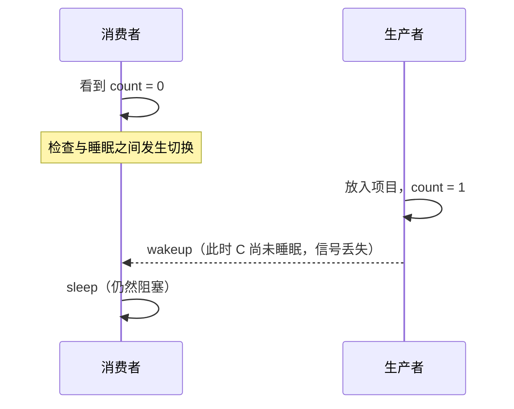

# 第二章 进程与线程

## 2.4 同步和进程间通信

多个进程或线程并发执行时，需要解决三类问题：**传递信息**（一个执行单元怎样把数据交给另一个）、**互斥**（怎样防止同时修改共享资源）和**同步**（怎样保证动作按必要顺序发生）。进程通常拥有独立地址空间；线程共享所属进程的地址空间，因此后两类问题同样适用于线程。以下代码凡标为“伪代码”的片段只描述同步关系；实际程序还须使用相应平台提供的原子操作和内存顺序保证。

### 2.4.1 竞争条件

**定义**：两个或更多执行单元读写同一共享数据，结果取决于它们执行的精确先后顺序，便发生**竞争条件**（race condition）。危险之处在于同一程序有时正确、有时错误，单步调试甚至可能改变调度顺序，使错误暂时消失。

**教材例子：打印假脱机目录。**变量 `in` 指向下一个空目录项，初值为 7。进程 A 和 B 都要把打印任务放入目录：

| 时刻 | 进程 A | 进程 B | 共享状态 |
| --- | --- | --- | --- |
| 1 | 读出 `in = 7`，尚未写入 | — | `in = 7` |
| 2 | 被切换出去 | 读出 `in = 7` | `in = 7` |
| 3 | — | 把 B 的任务写入槽 7，令 `in = 8` | 槽 7 = B |
| 4 | 恢复后把 A 的任务写入槽 7，令 `in = 8` | — | 槽 7 = A，B 的任务丢失 |

**原因：**“读 `in` → 使用槽位 → 更新 `in`”在逻辑上是一个整体，机器却可在其中任意一步切换。把 `in++` 写成一行也不意味着它是原子的。多核时，两个执行单元甚至可能真正同时运行。

### 2.4.2 临界区

**临界区**是访问共享数据或设备、必须排他执行的代码段。一个进程的程序可以分成“进入临界区 → 临界区 → 离开临界区 → 非临界区”。保护目标不仅是“不能同时进入”，还必须使系统继续向前运行。

正确方案须满足教材的四个条件：

1. **互斥：**任意时刻最多一个执行单元处于同一资源的临界区。
2. **不依赖速度与 CPU 数量：**正确性不能假定谁先运行、运行多快或只有一个 CPU。
3. **非临界区不阻塞别人：**不使用资源的进程不能阻止其他进程进入临界区。
4. **不无限等待：**任何进程都不应永远等不到进入机会。

**考点：**互斥只解决“同时进入”，不自动解决死锁、饥饿或执行顺序。例如两个线程轮流持有不同的锁并等待对方，始终互斥，却仍可能死锁。

### 2.4.3 忙等待的互斥

**忙等待**是反复检查某个条件，等待期间仍占用 CPU；以这种方式等待的锁称**自旋锁**。教材依次讨论以下方法。

**（1）屏蔽中断。**单处理器内核在极短临界区中暂时屏蔽中断，可阻止时钟中断触发的抢占。但用户程序不能任意控制中断；临界区过长会影响系统响应；多处理器上屏蔽本 CPU 的中断也挡不住其他 CPU。因此它不能成为一般的用户态互斥方案。

**（2）普通锁变量。**假设 `lock = 0` 表示空闲：

```text
while lock == 1: 继续等待
lock = 1
进入临界区
lock = 0
```

这段伪代码**错误**：A 和 B 可以都读到 0，再各自写 1，最后同时进入。检查与置位必须不可分割。

**（3）严格轮换。**共享 `turn` 指定当前允许进入者；进程 0 等待 `turn == 0`，退出时设为 1；进程 1 反之。虽然能互斥，但若进程 1 长时间停留在非临界区，进程 0 第二次想进入也得空等，违反“非临界区不阻塞别人”。**考点：轮换次序不等于按需互斥。**

**（4）Peterson 算法。**两进程先声明自己想进入，再通过 `turn` 化解双方同时申请的冲突。以下是算法模型的伪代码，不可直接用普通 C 变量实现并发程序：

```text
shared interested[2] = {false, false}
shared turn = 0

enter(i):
    other = 1 - i
    interested[i] = true
    turn = i
    while interested[other] and turn == i:
        继续等待

leave(i):
    interested[i] = false
```

若仅一方申请，对方的 `interested` 为假，可立即进入。若双方都申请，最后写入 `turn` 的一方等待，另一方先进入；先进入者退出并清除意愿后，等待者才继续。它展示了**互斥、申请意愿与冲突仲裁**怎样配合，但仍采用忙等待；在现代编程语言的弱内存模型下，还必须解决编译器和 CPU 重排问题。

**（5）硬件原子指令：TSL / XCHG。**TSL 在一个不可分割的原子操作里取出旧锁值并把锁置为 1；XCHG 原子交换寄存器值与内存值。由此可以实现：

```text
enter():
    repeat:
        old = atomic_exchange(lock, 1)
    until old == 0

leave():
    atomic_store_release(lock, 0)
```

**关键：**一次“读到 0 且占有锁”不能被其他执行单元插入。自旋适合预期等待非常短的场景；若持锁者长时间不能运行，等待者持续消耗 CPU，可能造成严重浪费。`atomic_exchange` 与 `atomic_store_release` 是概念化写法，具体语言还需匹配获取与释放内存顺序。

### 2.4.4 睡眠与唤醒

为了避免一直自旋，进程可以调用 `sleep` **阻塞**，由另一个进程调用 `wakeup` 使其重新变为**就绪**；唤醒不等于立刻获得 CPU。

**有界缓冲区的生产者—消费者问题：**容量为 `N`，`count` 表示当前项目数。生产者在满时等待，消费者在空时等待。仅用 `count` 加朴素 `sleep/wakeup` 会发生**丢失唤醒**：

1. 消费者检查到 `count == 0`，准备睡眠，但尚未调用 `sleep`。
2. 发生切换；生产者放入一个项目，使 `count = 1`，调用 `wakeup(consumer)`。
3. 消费者此时并未睡眠，这次唤醒没有留下记录。
4. 消费者恢复后调用 `sleep`，即使缓冲区已有项目仍陷入阻塞；若生产者最终填满缓冲区也睡眠，双方都无法继续。



**根因：**“检查条件”和“登记自己要等待”不是一个原子动作。给唤醒设置一个简单的“待处理位”只能修补有限情形；更通用的办法是使用信号量，或在锁保护下使用条件变量的原子释放锁并等待操作。

### 2.4.5 信号量

**信号量**是用一个整数及等待队列表示可用资源或已发生事件的同步原语。`down`（P）把正值减一并继续；若值为零，就把调用者阻塞。`up`（V）增加一个可用许可；若有人等待，则让一个等待者获得该许可并重新就绪。**检查、更新和阻塞登记必须是原子的**，否则仍会丢失唤醒。信号量可以记住尚未被消耗的 `up`。

**教材应用一：中断与驱动。**驱动先启动 I/O，然后对初值为 0 的信号量执行 `down` 并阻塞；设备完成中断时执行 `up`，驱动被唤醒。如果完成发生在 `down` 之前，许可已被记录，随后 `down` 直接通过。实际中断处理是否可直接调用特定接口，取决于操作系统实现。

**教材应用二：容量为 `N` 的生产者—消费者。**设 `empty = N`（空槽数）、`full = 0`（已有项目数）、`mutex = 1`（保护缓冲区索引和内容）。

```text
producer(item):                   consumer():
    down(empty)                      down(full)
    down(mutex)                      down(mutex)
    put(item)                        item = take()
    up(mutex)                        up(mutex)
    up(full)                         up(empty)
                                    return item
```

**逐步理解：**生产者先取得一个空槽许可，再独占修改缓冲区，提交后公布一个“满槽许可”；消费者对称地先取得满槽许可，取出后归还空槽许可。`empty/full` 管**先后与数量**，`mutex` 管**同一时刻谁能改共享结构**。在每次完整操作前后，有 `empty + full = N`；操作过程中，一个许可可能由线程暂时持有，不能机械地要求共享变量任意时刻都满足该等式。

**反例：**把生产者的 `down(mutex)` 放到 `down(empty)` 前，缓冲区满时生产者拿着 `mutex` 等空槽；消费者虽能取出项目，却先要拿 `mutex`，因而也阻塞，形成死锁。**规律：先等资源条件，再占短时间的互斥锁。**

**教材应用三：读者—写者问题。**允许多个读者同时读，写者必须独占。下面是教材的**读者优先**思想，`read_count` 的修改由 `count_mutex` 保护：

```text
shared read_count = 0
shared count_mutex = 1
shared db = 1

reader():
    down(count_mutex)
    read_count += 1
    if read_count == 1: down(db)  # 第一个读者阻止写者
    up(count_mutex)
    read_database()
    down(count_mutex)
    read_count -= 1
    if read_count == 0: up(db)    # 最后一个读者放行写者
    up(count_mutex)

writer():
    down(db)
    write_database()
    up(db)
```

例如 R1 先进入并取得 `db`，R2 随后只增加计数即可与 R1 并读；W 必须等两人都离开。**局限：**若读者不断到来，`read_count` 一直不归零，写者可能饥饿。写者优先方案可改变公平性，但会影响读者并行效率；题目若未指定优先策略，不能把某一种实现误说成唯一解。

### 2.4.6 互斥锁

**互斥锁（mutex）**只有“未锁定/已锁定”两种状态，适合保护临界区；它不像计数信号量那样表示多个资源许可。`lock` 成功后由持有者执行 `unlock`。它提供互斥，却不表示“缓冲区已有数据”这类条件。

教材展示的用户级线程锁使用 TSL/XCHG 尝试获取；失败时调用 `thread_yield`，让同一用户级线程包调度其他线程运行，避免当前线程一直占着 CPU 自旋。**是否真正进入内核阻塞**取决于线程库和锁的实现，不可把 `yield` 等同于内核睡眠。进程间共享锁需要共享内存或内核维护的对象；独立地址空间中的两个普通局部变量不会自动共享。

**futex 的设计目的：**无争用时在用户态用原子操作完成获取与释放；有争用时通过内核等待队列睡眠，释放者在需要时唤醒等待者，从而兼顾无争用路径与长时间等待。POSIX 线程接口提供 `pthread_mutex_lock/trylock/unlock` 等操作，具体实现隐藏在库与内核中。

**条件变量与互斥锁配合。**条件变量本身不储存“可用项目数”，只表示等待某个谓词成为真。Pthreads 的 `pthread_cond_wait(&cond, &mutex)` 会**原子地释放 mutex 并登记等待**；返回前重新取得 mutex。等待者应以 `while` 重新检查谓词，因为被唤醒只表示“值得再检查”，并不保证条件仍然成立，也可能出现虚假唤醒。若没有等待者，`signal` 不会像信号量 `up` 一样积累许可。

下面是与教材单槽缓冲区等价的**可编译 C/Pthreads 示例**，展示 `while + cond_wait` 的正确形态；生产者依次放入 1～3，消费者取走 3 项：

```c
#include <pthread.h>
#include <stdio.h>

static pthread_mutex_t mu = PTHREAD_MUTEX_INITIALIZER;
static pthread_cond_t not_empty = PTHREAD_COND_INITIALIZER;
static pthread_cond_t not_full = PTHREAD_COND_INITIALIZER;
static int slot;
static int occupied = 0;

static void *producer(void *arg) {
    (void)arg;
    for (int x = 1; x <= 3; ++x) {
        pthread_mutex_lock(&mu);
        while (occupied) pthread_cond_wait(&not_full, &mu);
        slot = x;
        occupied = 1;
        pthread_cond_signal(&not_empty);
        pthread_mutex_unlock(&mu);
    }
    return NULL;
}

static void *consumer(void *arg) {
    (void)arg;
    for (int i = 0; i < 3; ++i) {
        pthread_mutex_lock(&mu);
        while (!occupied) pthread_cond_wait(&not_empty, &mu);
        int x = slot;
        occupied = 0;
        pthread_cond_signal(&not_full);
        pthread_mutex_unlock(&mu);
        printf("%d\n", x);
    }
    return NULL;
}

int main(void) {
    pthread_t p, c;
    if (pthread_create(&p, NULL, producer, NULL) != 0) return 1;
    if (pthread_create(&c, NULL, consumer, NULL) != 0) return 1;
    if (pthread_join(p, NULL) != 0) return 1;
    if (pthread_join(c, NULL) != 0) return 1;
    pthread_cond_destroy(&not_empty);
    pthread_cond_destroy(&not_full);
    pthread_mutex_destroy(&mu);
    return 0;
}
```

在提供 Pthreads 的环境中可用 `cc -std=c11 -pthread demo.c -o demo && ./demo` 运行，预期依次输出 `1`、`2`、`3`。这里的槽位和 `occupied` 始终在同一把锁下访问；线程在 `cond_wait` 阻塞时让出锁，另一方才能改变状态。

### 2.4.7 管程

**管程（monitor）**把共享数据、操作数据的过程以及同步条件封装在一起，并保证同一时刻最多一个执行单元在管程内活动。教材强调它是**语言级结构**：由语言/编译器或运行时安排进入互斥，调用者不能直接绕过接口修改内部共享数据。

互斥还不足以处理“缓冲区已满/已空”。管程使用**条件变量**：`wait` 让调用者睡眠，同时让出管程；`signal` 唤醒某个等待者。这样“检查条件 → 登记等待”受到管程互斥保护，不会重现 2.4.4 的检查后、睡眠前丢失唤醒。

**唤醒后由谁执行**有不同语义：Hoare 方案让被唤醒者立即运行、发信号者暂停；Brinch Hansen 方案要求 `signal` 位于过程结束处，发信号者随即退出；另一种常见做法让发信号者继续，等待者以后重新竞争进入。编写实际代码时应遵循具体语言的规则，**用 `while` 检查条件**通常比假定唤醒后条件必然成立更稳妥。

**Java 例子：**`synchronized` 方法保护同一对象的状态，`wait()` 释放该对象监视器并等待，`notifyAll()` 唤醒等待者重新竞争锁。下面的最小单槽管程展示结构；中断交给调用方处理：

```java
final class OneSlot<T> {
    private T item;
    private boolean occupied;

    public synchronized void put(T value) throws InterruptedException {
        while (occupied) wait();
        item = value;
        occupied = true;
        notifyAll();
    }

    public synchronized T take() throws InterruptedException {
        while (!occupied) wait();
        T value = item;
        item = null;
        occupied = false;
        notifyAll();
        return value;
    }
}
```

**易混点：**管程内的条件变量不是计数器；`notifyAll()` 只使等待者有机会重新检查条件，未等待的线程不会收到可留存的许可。教材以 Java 的 `synchronized` 与 `wait/notify` 说明管程思想，但具体唤醒语义应以语言实现为准。

### 2.4.8 消息传递

共享内存方案要求参与者能访问同一片存储；跨机器通信通常需要**消息传递**。基本原语为 `send(destination, message)` 与 `receive(source, message)`。接收者在没有消息时可以阻塞，也可以让非阻塞调用立即返回。消息同时承担**数据交换**和**执行顺序协调**。

**设计问题：**跨网络时消息或确认可能丢失；超时重传能提高到达机会，但确认丢失会让接收方收到重复消息，因此需要序号或其他去重机制。还要明确进程命名、身份验证与消息复制成本。同机消息传递通常也有数据复制或管理开销，具体成本取决于实现。

**教材的生产者—消费者消息方案：**消费者先发送 `N` 个“空消息”作为缓冲区许可；生产者每生产一项，先接收一个空消息，再把项目封装成“满消息”发回。消费者收到满消息、取出项目后，再归还一个空消息。系统中的消息许可总数保持 `N`，所以生产者不能无限超前。

```text
consumer 初始化：发送 N 个 EMPTY 给 producer

producer 循环：                    consumer 循环：
    item = produce()                  FULL(item) = receive(producer)
    receive(consumer, EMPTY)          send(producer, EMPTY)
    send(consumer, FULL(item))         consume(item)
```

**缓冲方式：**消息可直接发给进程，也可发往**邮箱（mailbox）**；邮箱有容量，满时发送者可能阻塞。若完全不设缓冲，发送与接收必须在时间上相遇，称为**会合（rendezvous）**。MPI 是教材提到的并行计算消息传递接口。

### 2.4.9 屏障

**线程/进程屏障（barrier）**用于阶段式计算：每个参与者完成当前阶段后等待；只有全部参与者都到达，大家才进入下一阶段。它协调的是**一组执行单元的阶段边界**，不是保护单个临界区。

**教材例子：**并行计算金属板的温度矩阵。每个线程负责一部分网格，用时刻 `t` 的旧矩阵计算时刻 `t+1` 的新矩阵；只有所有线程都写完本轮结果，才能把新矩阵作为下一轮输入。否则快线程可能读取到“部分新、部分旧”的混合状态。

```text
for each round:
    并行计算自己负责的新矩阵区域（只读旧矩阵）
    barrier_wait()       # 所有人完成计算
    由指定参与者交换旧/新矩阵角色
    barrier_wait()       # 所有人看到本轮交换后才进入下一轮
```

**另一个同名概念：内存屏障（memory fence）。**它约束内存读写的可见性与重排，并不等待所有线程到齐。教材用“先写 `x = 100`，再设置 `turn = 1`”说明：若硬件或编译器使其他线程先观察到 `turn`、后观察到 `x`，就可能读到旧数据。**考点：阶段屏障解决谁走到下一轮；内存屏障解决读写以何种顺序被观察。**实际代码应采用语言规定的同步原语或原子内存序，不能只靠普通变量自旋。

### 2.4.10 优先级反转

**定义：**高优先级任务因等待低优先级任务持有的锁而阻塞；此时与锁无关的中优先级任务又抢占低优先级任务，使高优先级任务间接受中优先级任务拖延。教材以 1997 年“火星探路者”任务的线程调度问题说明这一机制。

```text
低优先级 L：取得锁 ── 被抢占 ───────────────→ 迟迟不能释放锁
中优先级 M：             持续运行 ─────────→
高优先级 H：             请求锁 → 阻塞 ────→
```

**为什么普通优先级调度无效：**调度器只看到 H 已阻塞、M 可运行、L 可运行；于是继续运行 M，而真正能让 H 前进的只有 L 释放锁。

**缓解方法：**

- **优先级继承：**H 等待 L 的锁时，临时把 L 提升到足够高的优先级，使 L 尽快运行并释放锁，之后恢复。教材指出探路者问题最终采用此法。
- **优先级上限：**为锁设置使用它的任务可能达到的最高优先级；持锁者按上限运行，减少被中优先级任务抢占的机会。
- 教材还提到短临界区屏蔽中断和随机优先级提升等办法；它们各有适用限制，不能替代对锁依赖关系的分析。

**考点：**反转并非“高优先级任务完全不能被低优先级任务阻塞”——锁依赖本就可能使 H 等 L；问题在于中优先级任务扩大了这一阻塞时间。

### 2.4.11 避免锁：读—复制—更新

**读—复制—更新（RCU，Read-Copy-Update）**针对读多写少的共享结构，让读者尽量不获取传统互斥锁。核心要求是：读者看到**完整旧版本或完整新版本**，不能看到写者改到一半的混合结构。

**插入节点：**写者先在不可见位置构造并初始化新节点及指针；全部准备好后，再通过一次具有正确内存顺序的原子指针发布动作把节点接入树。先前经过该位置的读者沿旧路径走，之后到达的读者可沿新路径走。

**删除节点：**写者先调整可见指针，使新读者绕过待删节点；老读者可能已持有旧节点引用，仍可沿旧结构读。因此“从结构中摘除”和“释放节点内存”必须分开。等待一个**宽限期（grace period）**，确认可能访问旧节点的读侧临界区都已结束，才能回收内存。


**关键边界：**RCU 的“无锁读”不等于随意读普通指针，也不等于写者之间无需协调。教材模型中的读侧临界区不能任意阻塞或睡眠，内存回收必须等旧读者退出；具体 RCU 实现对读侧、写侧及宽限期有各自 API 约束。若在发布后立即 `free` 旧节点，已在旧路径上的读者会出现悬空引用。

## 2.4 拓展总结

### 核心思想总结

1. **并发错误的起点是“一个逻辑动作被拆成多个可交错步骤”。**先找共享状态，再找检查、更新和阻塞登记之间是否存在空隙。
2. **互斥与同步是两道题。**锁保证同一时刻谁能改数据；信号量、条件变量、消息与屏障保证何时可以继续。只保证互斥，仍可能死锁、丢失唤醒或饥饿。
3. **原子性必须覆盖“检查条件 → 决定等待/取得资源”。**普通变量的读写顺序、单核假设和“看起来是一行代码”均不能替代原子操作。
4. **选择等待方式要看预计等待时间。**短等待可自旋；长等待应让出 CPU；无争用快路径与争用阻塞路径可以结合。
5. **正确性还包括活性与生命周期。**读者—写者可能饥饿，优先级反转会放大阻塞，RCU 必须延迟回收旧节点。

### 高频对比表格

| 易混概念 | 主要解决什么 | 核心区别 / 典型陷阱 |
| --- | --- | --- |
| 竞争条件 / 临界区 | 前者是结果依赖执行交错的问题；后者是需排他执行的代码范围 | 找到临界区是定位问题，仍需正确保护 |
| 互斥 / 同步 | 排除同时进入 / 保证事件先后与条件成立 | `mutex` 不能代替 `full/empty` |
| 自旋 / 阻塞 | 反复检查并占 CPU / 暂停运行等待唤醒 | 等待较长时自旋浪费 CPU |
| 普通锁变量 / 原子 TSL、XCHG | 都表达锁状态 | 普通“检查再置位”可被插入，原子指令不可 |
| 信号量 / 互斥锁 | 计数许可或事件 / 排他访问 | 信号量可计数；互斥锁强调持有与释放 |
| 信号量 `up` / 条件变量 `signal` | 增加或交付许可 / 通知等待者重新检查 | 前者能记住未消费许可，后者无等待者时不积累 |
| `sleep/wakeup` / 锁配合的 `cond_wait` | 睡眠与唤醒 / 原子释放锁并登记等待 | 前者的检查与睡眠之间可能丢失唤醒 |
| 读者优先 / 写者优先 | 提高读并发 / 降低写者等待 | 读者优先可能使写者饥饿 |
| 管程 / 消息传递 | 封装共享状态与互斥 / 通过收发交换信息 | 后者适合不共享地址空间的参与者 |
| 有缓冲消息 / 无缓冲会合 | 允许发送与接收错开 / 双方必须相遇 | 无缓冲发送者可能等接收者 |
| 线程屏障 / 内存屏障 | 等整组任务完成阶段 / 约束内存访问顺序 | 名称相同，作用层次不同 |
| 优先级继承 / 优先级上限 | 等待发生后临时提高持锁者优先级 / 预先规定持锁优先级 | 都是减少优先级反转影响的策略 |
| 立即回收 / RCU 延迟回收 | 立刻释放 / 等宽限期后释放 | 摘除指针不意味着旧读者已停止访问 |

### 自测题

1. 为什么普通 `lock` 变量的“先检查再置位”不能互斥？写出 A、B 的错误交错。
2. 严格轮换违反临界区正确性的哪一条？为什么 Peterson 算法不会因对方停在非临界区而阻塞？
3. 有界缓冲区中 `empty/full/mutex` 的初值各是什么？为什么不能先取 `mutex` 再等 `empty`？
4. `pthread_cond_wait` 为什么要同时传入条件变量和互斥锁？醒来后为什么用 `while` 而不是 `if`？
5. 什么是“丢失唤醒”？信号量与条件变量对“先通知、后等待”分别会怎样？
6. 读者—写者的读者优先算法为什么可能让写者饿死？
7. 阶段屏障与内存屏障分别保证什么？
8. 优先级反转中，为什么运行中优先级任务会拖慢高优先级任务？
9. RCU 删除节点后，为什么不能立刻释放它？宽限期保证了什么？

### 参考来源

- [《现代操作系统》第五版英文目录，Pearson](https://www.pearson.de/media/muster/toc/toc_9781292727899.pdf)：核对 2.4.1—2.4.11 的顺序与名称。
- [Modern Operating Systems, 5th Edition，第 2.4 节](https://studylib.net/doc/27956510/modern-operating-systems-5th-ed)：依据教材知识点整理，示例代码与表述均重新编写。
