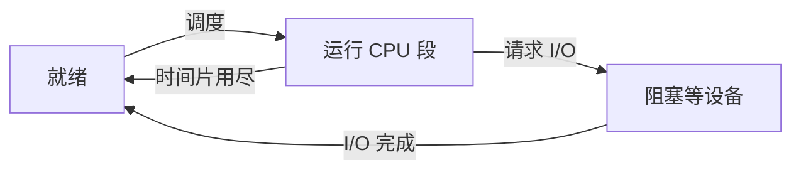
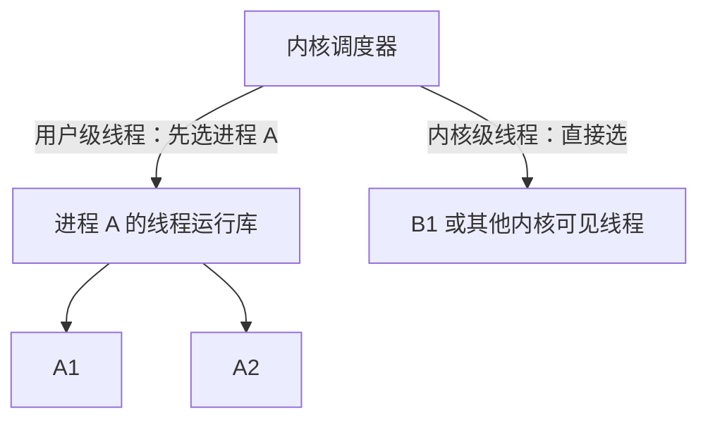

# 第二章 进程与线程

## 2.5 调度

### 2.5.1 调度概述

**要解决的问题：**多个进程或线程同时处于就绪态，而可用 CPU 不够时，操作系统必须决定**下一步运行谁、运行多久、什么时候重新选择**。作决定的部分是**调度器**；决定规则是**调度算法**。调度的对象通常是可运行的执行单元，不是已经因 I/O 等待而阻塞的执行单元。

#### 为什么需要权衡

在早期简单批处理系统中，按作业到达顺序运行即可。多道程序、分时交互、网络服务器和实时任务并存后，一个队列顺序已无法同时满足所有需求：后台计算可能希望减少切换开销，终端用户希望点击后立即响应，实时控制则要求截止时间得到保证。

**调度本身有成本。**从一个进程切到另一个进程可能涉及进入内核、保存寄存器、选择下一个进程、切换地址空间、恢复现场，以及缓存和地址转换状态变化。线程切换的具体成本取决于是否跨进程、线程实现和硬件，不能笼统认为所有切换都相同。因此“多切几次使每人更快开始”和“少切几次留下更多有效 CPU 时间”之间要取舍。

#### 先看进程行为：CPU 密集与 I/O 密集

进程常在**CPU 计算段（CPU burst）**和**等待 I/O**之间交替。CPU 密集型进程的 CPU 段通常较长，I/O 密集型进程的 CPU 段通常较短、较频繁地发起 I/O。**判断关键是两次 I/O 之间的 CPU 段长度，而不是设备等待本身有多长。**



**例子：**编译任务每次连续计算 80 ms；交互任务运行 2 ms 就发起磁盘读取。若交互任务迟迟拿不到 CPU，它连 I/O 都无法开始，CPU 与设备就难以并行工作。让它较早运行 2 ms，随后它等待设备，CPU 便可以继续执行编译任务。这个安排改善的是**整个系统资源的重叠利用**。

#### 何时重新调度

1. **创建进程后：**父、子进程都可就绪，选择谁先运行。
2. **当前进程退出后：**它不再可运行，必须选别人；若无人就绪，运行空闲任务。
3. **当前进程阻塞后：**例如等待 I/O、信号量或锁，必须让出 CPU。
4. **I/O 中断后：**先前阻塞者可能变为就绪，调度器可决定是否立即运行它。
5. **时钟中断后：**如果采用时间片抢占，时间片到期可能触发重新选择。

**非抢占式：**一旦选中进程，就让它运行至主动阻塞、退出或自愿让出；时钟到来通常不强制换人。优点是切换少、实现简单，代价是一个长计算任务可拖慢其他任务。**抢占式：**进程最多运行一个时间片，届时调度器可强制切换；交互响应较好，但要支付切换成本并处理更多并发交错。抢占通常依靠定时中断把控制权交还给内核。

#### 不同系统为什么目标不同

| 场景 | 首要问题 | 主要指标 | 常见取舍 |
| --- | --- | --- | --- |
| 批处理 | 大量作业怎样尽快完成 | 吞吐量、平均周转时间 | 可以接受较长时间片以减少切换 |
| 交互式 | 用户请求怎样尽快得到反馈 | 响应时间、符合用户预期 | 需要限制单一进程长期霸占 CPU |
| 实时系统 | 任务能否按时完成 | 截止时间、可预测性 | 宁可牺牲平均值，也要控制最坏情形 |

所有场景还需要考虑**公平性、执行既定策略以及 CPU 和 I/O 设备的均衡利用**。批处理中，**吞吐量**是单位时间完成的作业数，**周转时间**是提交到完成的总时间，**CPU 利用率**是 CPU 忙碌比例；三者不等价。优先处理许多短作业可能提高吞吐量，却使长作业迟迟无法完成。CPU 一直忙也不保证用户拿到结果快。

**易混：响应时间与周转时间。**响应时间通常关心从请求发出到首次有意义响应；周转时间关心从提交到全部完成。交互调度优先前者，批处理常关注后者。实时任务又以是否赶上截止时间为核心，平均响应快仍可能偶尔超时。

#### 核心思想与自测

**核心思想：**先识别工作负载和目标，再选算法。调度器不可能在不付出代价的情况下同时最大化吞吐、最小化响应、保证公平与满足所有截止时间。

1. I/O 密集型进程为什么常应较快获得 CPU？
2. 进程阻塞与时间片用尽都会触发切换，两者分别由谁主动发起？
3. 为什么“CPU 利用率 100%”不能证明调度效果好？

### 2.5.2 批处理系统中的调度

**要解决的问题：**一批作业等待 CPU，怎样安排先后才能让完成效率和等待时间满足要求？批处理通常无用户坐在终端前要求即时反馈，因此可以把减少切换开销和平均完成时间放在较高位置。教材依次讨论**先来先服务、最短作业优先、最短剩余时间优先**。

#### 方案一：先来先服务（FCFS）

**规则：**把就绪作业排入队尾；调度时取队首。它是**非抢占式**的：一个进程运行时，不会仅因后面来了短作业就被夺走 CPU；进程阻塞后再次就绪，也排到队尾。

```text
就绪队列：A(长) → B(短) → C(短)
执行顺序：A 完成/阻塞 → B → C
```

**优点：**规则清楚，实现只需队列，按到达顺序分配机会。**缺点：护航效应。**若 A 有很长 CPU 段，B、C 即使只需极短计算才能启动 I/O，也得等 A；设备可能空闲，短作业完成时间被显著拉长。教材用“一个长计算任务挡住大量短 I/O 任务”的情形说明，这种简单公平不等于好的系统利用率。

#### 方案二：最短作业优先（SJF）

**问题推进：**既然长作业挡住短作业，使多人等待，为何不先完成短作业？SJF 在就绪作业中选择**预计总运行时间最短者**，选中后非抢占运行。

**教材算例：**四个作业同时到达，运行时间 A=8、B=4、C=4、D=4 分钟；忽略切换与 I/O。

| 顺序 | 完成时刻 / 周转时间 | 平均周转时间 |
| --- | --- | --- |
| A→B→C→D | 8、12、16、20 | `(8+12+16+20)/4 = 14` 分钟 |
| B→C→D→A | 4、8、12、20 | `(4+8+12+20)/4 = 11` 分钟 |

**为什么能缩短平均值：**若运行时间依次为 `a,b,c,d`，四个作业完成时刻之和是 `4a+3b+2c+d`。越靠前的作业影响越多人的等待，因此应把更短的作业放在系数更大的位置。交换两个相邻且“长在前、短在后”的作业，二者自己的完成时刻总和会下降。这给出了在**所有作业同时可用、运行时间已知、目标是平均周转时间、无其他约束**时的最优性。

**代价与边界：**运行时间往往无法预先准确得知；短作业不断到达时，长作业可能长期等待；不同到达时间下，简单 SJF 也不再保证全局最小平均周转时间。教材给出错开到达的反例，提醒不能把“同时到达时最优”说成无条件最优。

#### 方案三：最短剩余时间优先（SRTN）

**问题推进：**SJF 一旦让长作业开跑，后来到达的短作业仍被挡住。SRTN 是其**抢占式**版本：每当新作业到达或需要调度时，比较所有就绪作业的**剩余运行时间**；新作业若比当前作业剩余时间短，就抢占当前作业。

**理解例子：**A 在 `t=0` 到达，需要 10 ms；B 在 `t=2` 到达，需要 2 ms。A 已运行 2 ms，剩余 8 ms，B 只需 2 ms，因此先运行 B（`2~4`），再继续 A（`4~12`）。若用非抢占 SJF，B 要等 A 在 `t=10` 结束。这个例子展示 SRTN 对新来的短作业更友好。

**优点：**降低短作业等待，尤其适合有新作业不断到达且可估算剩余时间的情形。**缺点：**仍依赖运行时间估计；额外抢占增加切换成本；长作业仍可能饥饿。

#### 三方案怎样选

| 方案 | 是否抢占 | 需要预知运行时间 | 改善的问题 | 主要代价 |
| --- | --- | --- | --- | --- |
| FCFS | 否 | 否 | 简单、到达顺序明确 | 护航效应、短作业等待长 |
| SJF | 否 | 是 | 同时到达时最小平均周转时间 | 估计难；晚到短作业仍需等待 |
| SRTN | 是 | 是，且需更新剩余量 | 及时服务新到短作业 | 抢占成本、长作业饥饿风险 |

**自测：**为何 SJF 的最优性要加“同时到达”？SRTN 的比较对象为什么是“当前作业的剩余时间”，而非它原来的总运行时间？

### 2.5.3 交互式系统中的调度

**要解决的问题：**终端用户或服务器请求不能被一个长时间运行的进程一直挡住。调度器既要让短请求尽快开始，又要避免频繁切换浪费 CPU；还要决定不同优先级、不同用户该分到多少资源。教材按**轮转 → 优先级 → 多级队列 → 最短进程优先 → 保证调度 → 彩票调度 → 公平分享**展开。

#### 方案一：轮转调度（Round Robin）

**机制：**就绪进程排队，每个进程获得一个最长为 `q` 的**时间片**。时间片用完仍可运行，就被抢占并放到队尾；若提前阻塞或退出，立即选择队首的下一个进程。

```text
就绪队列 [A, B, C]，时间片 q = 2 ms
A 用满 2 ms → [B, C, A]
B 运行 1 ms 后等待 I/O → [C, A]；B 的 I/O 完成后再入队尾
```

**解决了什么：**即使 A 永远计算，也不能一直独占 CPU；B、C 至少有轮流获得 CPU 的机会。**仍未解决：**每个进程都被同等看待，不能直接表达某些请求更紧急，也不能保证严格截止时间。

**时间片是核心取舍。**设每次强制切换开销为 `s`、每个任务都用满时间片 `q`，示意性的有效 CPU 比例为 `q/(q+s)`。教材举例 `s=1 ms`：`q=4 ms` 时有效比例为 `4/5=80%`；`q=100 ms` 时约为 `100/101≈99%`。然而若 50 个请求几乎同时排队，前 49 个都用满 100 ms，最后一个首次运行可能等约 `49×100 ms=4.9 s`（再加切换开销）。**短时间片响应快但切换多；长时间片开销少但尾部等待长。**若多数进程在时间片耗尽前就因 I/O 阻塞，实际抢占次数会少于这个最坏例子。教材把几十毫秒量级作为经验折中，而非任何平台的固定最优值。

#### 方案二：优先级调度

**问题推进：**轮转假设各进程一样重要；但实时播放、前台操作和后台维护的紧迫程度可能不同。给每个就绪进程设置优先级，运行其中**优先级最高**者。优先级可以静态配置，也可以按近期行为动态调整。

**为什么偏爱 I/O 密集任务：**它往往只用很短 CPU 就再次发出 I/O。教材给出一种示意规则：若最近一次时间片实际使用比例为 `f`，设优先级与 `1/f` 成正比。50 ms 时间片中只运行 1 ms 就阻塞，`f=1/50`，值为 50；运行 25 ms 则值为 2。这样短 CPU 段任务得以更早启动下一次设备操作。这个公式是**教材的示例策略**，不是所有系统统一采用的优先级公式。

**优点：**能体现业务重要性与行为差异。**缺点：**高优先级进程若持续就绪，低优先级进程可能**饥饿**。可以在其用完时间片后暂降优先级，或对等待过久者提权；这些补救本身也需要明确的策略。相同优先级的进程可在该优先级队列内轮转。

#### 方案三：多级队列

**问题推进：**给所有人短时间片，CPU 密集任务频繁切换；给所有人长时间片，交互任务响应又慢。教材介绍 CTSS 的多级队列思想：高优先级队列时间片短，较低队列逐级增长，例如 `1、2、4、8…` 个基本时间片；进程用尽本级配额后下移。

**推理：**交互任务往往很快等待输入或 I/O，不用满短配额，留在较高优先级；长计算任务逐级下移，以较长配额一次做更多工作，减少频繁切换/交换。当时 CTSS 进程切换还涉及磁盘交换，因此这一取舍尤其重要。

**教材算例：**一个持续计算 100 个基本时间片的进程，可能按 `1+2+4+8+16+32+37` 完成，只需约 7 次装入/运行机会，而非纯轮转下约 100 次。具体次数与实现细节相关，重点是**长任务获得越来越长的连续运行段**。

**代价：**低级队列可能长期得不到 CPU；一个后来变成交互式的任务需要被重新提升。教材还举出通过反复输入回车触发提权的历史例子，说明**调度规则可被进程行为“利用”**，不能只凭理想模型判断公平性。

#### 方案四：最短进程优先（Shortest Process Next）

**问题推进：**交互请求也是一个个“等待命令 → 处理命令”的短作业。若可预测下一次 CPU 段的长度，就能优先执行较短命令，降低平均响应时间。困难是未来运行时间未知，因此用过去的观测估计：

```text
新估计 = α × 旧估计 + (1 - α) × 本次实际运行时间，0 ≤ α ≤ 1
```

例如旧估计 10 ms，本次实际 4 ms，`α=1/2`，新估计为 7 ms；下一次实际 2 ms，再更新为 4.5 ms。`α` 越小，越重视最新一次；越大，历史影响保留越久。教材把这种**指数加权估计**称为 aging。**易混：**这里的 aging 是“用历史预测下一次 CPU 段”，与“等待太久就提高优先级以防饥饿”的老化策略不是同一个动作。

**优点：**可用历史行为近似 SJF 的短任务优势。**缺点：**预测误差会选错；突发的长请求与行为变化会破坏预期；不能因此保证每个请求都很快完成。

#### 方案五：保证调度（Guaranteed Scheduling）

**问题推进：**“公平”若只是口头承诺，调度器无从核查。保证调度把份额具体化：若 `n` 个同等参与者共享 CPU，每个参与者应得到约 `1/n`。记录每个进程**实际得到的 CPU 时间**与**截至目前应得的 CPU 时间**，计算比率：

```text
比率 r = 实际 CPU 时间 / 应得 CPU 时间
优先运行 r 最小者；运行后重新计算
```

**例子：**A 应得 100 ms、实际 50 ms，`r_A=0.5`；B 应得 100 ms、实际 120 ms，`r_B=1.2`。A 的份额欠账更大，应优先运行。**优点：**服务承诺可量化、可检查。**代价：**必须维护运行时间、应得份额和动态变化。教材以当时 Linux 的 CFS 为公平调度的相关实例；这是**书中对该版本实现的说明**，不应直接作为所有版本内核的实现断言。

#### 方案六：彩票调度（Lottery Scheduling）

**问题推进：**逐进程追踪“欠了多少 CPU”较复杂。彩票调度为进程分配票，调度时随机抽一票，持有者运行一个时间片。若 A 有 20 张、总票数 100，A **每次抽签胜率为 20%**；长期平均份额趋近 20%，但短时间内不保证恰好 20%。

**优点：**份额含义直观；新进程下次抽签就有机会；协作进程可转让票，例如客户端等待服务端时临时把票交给服务端，以加快完成共同请求。**缺点：**随机性带来短期波动，不能作为硬实时截止时间保证；票数分配本身仍是策略问题。教材以不同帧率的视频流按需要分配票数说明比例资源分配。

#### 方案七：公平分享调度（Fair-Share Scheduling）

**问题推进：**按进程公平可能对用户不公平。若用户甲启动 9 个进程、用户乙启动 1 个，平等轮转会让甲得到约 90% CPU。公平分享先规定**用户或组**的份额，再在该用户的进程之间分配。

**例子：**甲有 A、B、C、D 四个进程，乙只有 E；若两用户各应得 50%，可安排 `A→E→B→E→C→E→D→E`，使 E 不因甲多开进程而失去应得份额。**优点：**公平单位与承诺对象一致。**代价：**需维护用户/组归属与分层份额；若各进程需求差异很大，还要进一步处理组内公平与空闲份额再分配。

#### 方案选择与易混点

| 方案 | 主要解决的问题 | 主要优点 | 主要限制 |
| --- | --- | --- | --- |
| 轮转 | 防止单进程长期独占 | 简单、响应有界于排队与时间片 | 时间片过小切换多，过大响应慢 |
| 优先级 | 体现任务重要性 | 紧急任务先运行 | 低优先级可能饥饿 |
| 多级队列 | 同时照顾短交互与长计算 | 不同级别用不同配额 | 升降级规则复杂，可被行为操纵 |
| 最短进程优先 | 降低平均交互等待 | 利用历史预测短 CPU 段 | 预测不准、长任务不利 |
| 保证调度 | 兑现定量 CPU 份额 | 可审计公平 | 状态维护成本较高 |
| 彩票调度 | 概率化比例分配 | 简明、灵活、响应新进程 | 短期份额有波动 |
| 公平分享 | 避免多开进程抢占用户份额 | 以用户/组为公平单位 | 需要分层记账与再分配 |

**自测：**为什么 `q` 变大能减少切换比例却可能拉长首响应？优先级为什么需要防饥饿机制？“每进程平均分”和“每用户平均分”什么时候相互冲突？

### 2.5.4 实时系统中的调度

**要解决的问题：**某些任务的结果只有在规定时间内到达才有用。设备控制、医疗监护和音频播放都需要关注**截止时间（deadline）**；平均完成时间很短，也不能弥补某次关键任务超时。

#### 任务与事件

**硬实时：**必须满足截止时间，错过可能造成不可接受的后果。**软实时：**偶发超时不理想，但可容忍；例如音视频可能出现卡顿。**周期事件**按固定间隔出现；**非周期事件**到来时间不可预知。实时调度需要知道任务触发、执行需求及截止时间，才能判断是否来得及。

**为什么不能直接套用普通轮转：**轮转保证大家轮流运行，却不区分谁的截止时间先到；一个任务即使平均等待很短，也可能恰好在临近截止时间时排到队尾。实时系统更重视最坏情形、可预测性以及任务之间的抢占关系。

#### 周期负载的必要检查

教材先用单 CPU 上的周期任务说明资源总量限制。任务 `i` 每隔 `P_i` 时间出现一次，每次至少需要 `C_i` 的 CPU 时间，长期平均 CPU 需求是 `C_i/P_i`，总利用率为：

```text
U = Σ(C_i / P_i)，i = 1…m
```

**推理：**若 `U > 1`，每单位时间需要的 CPU 工作量超过单 CPU 能提供的时间，长期积压不可避免；因此 `U ≤ 1` 是忽略切换等开销时的**必要条件**。教材用它做初步“能否安排”的判别。

**教材算例：**三个周期任务的 `(P_i, C_i)` 分别是 `(100,50)`、`(200,30)`、`(500,100)`，单位均为 ms：

```text
U = 50/100 + 30/200 + 100/500 = 0.50 + 0.15 + 0.20 = 0.85
```

剩余理论 CPU 份额为 0.15。若再加入周期 1000 ms 的任务，在这个负载检查下每次最多可需要 `0.15×1000=150 ms`。这是**资源量上的上限**，不是任何调度策略都能按时完成的保证。

**理解补充：**对于任意截止时间、抢占限制、共享锁、非周期任务或切换开销，仅有 `U ≤ 1` 不足以推出“所有截止时间可满足”；还需要明确任务模型和具体算法进行可调度性分析。反过来，`U > 1` 在单 CPU 且需持续处理所有周期任务时一定不可能稳定完成。

#### 静态与动态调度

**静态调度**在运行前就依据已知任务及截止时间制定安排；适合任务集和执行界限可预先确定的场景，可预测性较强，但临时变化难处理。**动态调度**在运行时根据当前到来的任务作决定；能处理变化，但实现与可调度性证明更复杂。教材这一小节主要介绍分类与负载约束，没有在此系统讲解具体的 RMS 或 EDF 算法，复习时不要把后续知识误记为本节原文。

| 问题 | 应看什么 | 为什么 |
| --- | --- | --- |
| CPU 总工作量能否承担 | `U = Σ C_i/P_i` | `U > 1` 表明长期需求超过供给 |
| 某次任务能否按时完成 | 到达时刻、截止时间、算法、抢占与阻塞 | 总量够，局部时段仍可能冲突 |
| 音视频为何要求稳定 | 完成间隔的波动 | 偶发抖动会直接影响感知质量 |

**自测：**`U=0.85` 为什么不能单独证明所有任务都按时？硬实时与软实时的判别依据是什么？

### 2.5.5 策略与机制

**要解决的问题：**内核掌握 CPU 的实际分配权，却未必知道应用内部哪些工作最紧急。一个数据库服务可能创建多个子进程，分别处理查询解析、磁盘访问与用户请求；父进程知道某个请求的期限，通用调度器却未必知道。如果规则完全写死在内核中，调度器可能选出技术上合法、业务上却很差的顺序。

#### 方案：分离“谁能调度”与“按什么意图调度”

**机制（mechanism）**是执行调度的能力，例如维护就绪队列、按优先级选择可运行者、执行抢占和上下文切换。**策略（policy）**是应当给谁更高权重、谁更急、怎样分配份额等决策意图。教材提出：把调度算法做成**可参数化的机制**，允许合适的用户进程提供参数；内核仍负责真正的选择和切换。

**教材例子：**内核提供优先级调度及设置子进程优先级的接口；数据库父进程根据请求紧急程度调整子进程优先级。父进程提出“哪个孩子更重要”，内核执行“依优先级运行谁”。这不是把 CPU 调度权直接交给每个应用，而是让应用提供内核所缺的业务信息。


**好处：**通用内核不必内置每个应用的具体业务规则；应用可根据实际负载调整权重；同一调度机制可以服务不同策略。**限制：**应用给出的优先级可能与系统整体公平性冲突，所以接口必须受权限和资源配额约束；参数不合适时，机制执行得再准确也无法得到理想结果。权限约束属于理解补充，教材这一节的核心是**机制留在内核、策略信息由了解业务的一方提供**。

| 概念 | 回答的问题 | 例子 |
| --- | --- | --- |
| 策略 | 谁应该先得到 CPU，为什么 | 紧急查询的子进程优先 |
| 机制 | 如何实际实现这一选择 | 内核按优先级队列选进程并切换 |

**自测：**数据库父进程改变子进程优先级时，谁决定业务轻重，谁执行 CPU 切换？为什么完全固定的内核规则难以理解应用内部请求的紧急程度？

### 2.5.6 线程调度

**要解决的问题：**一个进程内部可能还有多个线程。此时究竟由内核先选进程、再由进程内部选线程，还是由内核直接选线程？答案取决于线程由谁管理。教材分别讨论**用户级线程**与**内核级线程**，两者可呈现不同的运行顺序与开销。

#### 用户级线程：先选进程，再选内部线程

内核不知道进程 A 中的 A1、A2、A3，只知道 A 是可运行进程，于是先给 A 一个进程时间片。A 的**用户态线程运行库**再选择其中一个线程。若线程主动 `yield` 或按线程库规则让出，A 内部可运行另一个线程；若某个用户级线程一直计算而不让出，线程库一般不能仅凭内核的进程时钟中断在同一进程内强制换到另一个用户级线程。

**教材情形：**A 获得 50 ms 进程时间片，A1、A2、A3 各运行约 5 ms 就自愿让出，可出现 `A1→A2→A3→A1…`，直到内核选另一个进程 B。在这 50 ms 内，A 的运行库不能自行把 CPU 交给 B 的线程；B 由内核另行调度。

**优点：**同一进程内部切换可在用户态完成，开销通常较低；运行库了解线程职责，可以定制“先运行请求分派线程，再运行工作线程”等应用策略。**限制：**同一进程内一个不合作的线程会拖住其他用户级线程；采用教材所述简单用户级线程模型时，某线程执行阻塞式系统调用可能阻塞整个进程。具体运行库若采用非阻塞 I/O 或混合模型，结论要按其实现重新判断。

#### 内核级线程：内核直接选线程

内核知道 A1、A2、B1 等线程，直接挑选可运行线程并给它时间片；超时可抢占。因而可能出现 `A1→B1→A2→B2` 这样的**跨进程线程交替**。一个线程因 I/O 阻塞，内核仍可运行同一进程的其他线程。

**优点：**可单独抢占与阻塞线程；内核能在全系统范围选择就绪线程。**代价：**切换通常需要进入内核，跨进程切换还可能涉及地址空间和缓存代价；内核不一定知道“哪个线程是应用的请求分派者”。**理解补充：**同一进程的内核线程切换不必然重新装载不同地址空间，代价取决于具体实现；不要把“内核级线程每次切换都完整切换地址空间”当作普遍事实。



**决策关键：**谁能看见线程，谁就能直接调度它。用户级运行库掌握应用语义，但受进程获得 CPU 的机会约束；内核掌握全系统 CPU 分配与抢占，但未必了解应用内部工作流。混合实现可能结合两者，本节不应把两种模型误写成所有实际系统仅能二选一。

| 比较 | 用户级线程 | 内核级线程 |
| --- | --- | --- |
| 内核的直接调度对象 | 进程或内核可见实体 | 单个内核线程 |
| 同进程内部选线程者 | 用户态运行库 | 内核调度器 |
| 内部线程长期不让出 | 其他用户级线程可能受阻 | 可由内核时间片抢占 |
| 简单模型中的阻塞系统调用 | 可能使整个进程阻塞 | 阻塞当前线程，其他线程可运行 |
| 优势侧重 | 低开销、应用定制 | 全系统抢占与独立阻塞 |

**自测：**为什么用户级线程模型下 `A1→B1→A2` 不能由 A 的线程运行库独自实现？同一进程的两个内核线程切换与跨进程切换为何成本可能不同？

**依据：**《现代操作系统》第五版第 2.5 节；[第五版目录（Pearson）](https://www.pearson.de/media/muster/toc/toc_9781292727899.pdf)、[教材第 2.5 节](https://studylib.net/doc/27956510/modern-operating-systems-5th-ed)。
