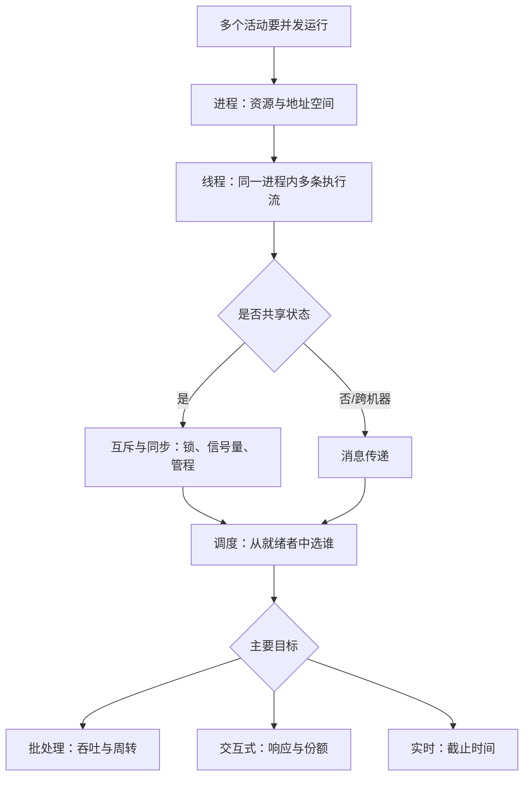

# 第二章 进程与线程

## 2.7 小结

**本章总问题：**一个 CPU 和一组共享资源怎样让多个活动“看起来各自向前运行”，同时不破坏数据、不让重要工作错过时机？本章沿着**抽象执行单元 → 组织并发 → 协调共享 → 分配 CPU**逐步回答。

### 第一步：把执行抽象成进程和线程

中断和进程切换让真实 CPU 的运行顺序不断变化；**进程模型**为程序提供各自顺序执行的概念视图。进程可动态创建、终止，通常拥有自己的地址空间和资源集合。**线程**把同一进程内的多个执行流分开：每个线程有自己的程序计数器、寄存器和栈，线程之间共享进程地址空间与资源。

**方案取舍：**多进程隔离较强，但进程间交换数据需要通信机制；多线程共享数据方便、切换可能更轻，但共享状态直接暴露竞争条件。用户级与内核级线程分别把线程管理放在运行库和内核，形成可定制性、切换成本、阻塞行为上的不同取舍。

### 第二步：选并发服务模型

服务端可以用进程或线程处理并发请求；教材还介绍**事件驱动服务器**：单个或少量事件循环以非阻塞操作等待就绪事件，把处理过程组织为状态机。**问题导向：**需要大量并发连接时，给每个连接配置独立线程可能增加管理和切换开销；事件循环则要求把业务处理拆成不会长期阻塞的步骤。两种组织方式解决同一类并发服务需求，代价落在不同位置。

### 第三步：防止共享状态被交错破坏

**竞争条件**产生于共享数据的读、改、写可被其他执行单元插入。**临界区互斥**防止同时修改；**同步**还要保证“资源可用后才能继续”等顺序。信号量用计数保存许可，互斥锁保护临界区，条件变量在锁保护下等待谓词，管程封装共享状态，消息传递在不共享地址空间时交付数据，屏障协调阶段，RCU 为读多写少结构减少读侧锁。

**方案取舍：**低层原语灵活，却容易因顺序写错而死锁或丢失唤醒；高层封装降低误用机会，但依赖语言与运行时；无锁读降低争用，却必须严格处理发布与旧节点回收。**仅“不会同时进入临界区”仍不够**，还要检查饥饿、死锁、优先级反转和生命周期。

### 第四步：在竞争 CPU 时选合适的调度目标

**批处理**重吞吐量与周转时间：FCFS 简单但有护航效应，SJF 在特定前提下可减小平均周转时间，SRTN 用抢占照顾后来到达的短作业。**交互式**重响应：轮转限制独占，优先级体现重要性，多级队列兼顾短交互与长计算，保证调度、彩票调度、公平分享从不同角度定义“该分到多少 CPU”。**实时系统**看截止时间和可预测性，不能用高平均吞吐量替代按时完成的证明。线程调度还要区分内核能否直接看见单个线程。

**读图重点：**进程和线程回答“谁在运行、共享什么”；同步和通信回答“如何协作而不出错”；调度回答“谁先占用 CPU”。后三类目标不同，不能用一种算法的优势直接推断它在所有场景都最好。

### 高频易混与自测

| 易混点 | 应怎样区分 |
| --- | --- |
| 进程与线程 | 前者主要是资源及隔离容器，后者是执行流；同一进程线程共享地址空间 |
| 就绪与阻塞 | 就绪者缺 CPU，阻塞者缺事件/资源；调度器不能直接运行仍阻塞的任务 |
| 互斥与同步 | 互斥管同时访问，同步管条件和先后；完整并发程序常需两者 |
| 周转与响应 | 周转到全部完成；响应到首次有意义反馈 |
| 平均性能与实时保证 | 平均值好，不代表每个任务都赶上截止时间 |
| 按进程公平与按用户公平 | 多开进程可能改变前者的总份额，后者先按用户分配 |

1. 若两个线程共享地址空间，为何各自仍需要独立栈？
2. 生产者—消费者问题中，哪种机制保护缓冲区，哪种机制表示空槽或已有项目？
3. 为何一个调度算法在批处理中表现好，不一定适合交互式或硬实时系统？
4. 为什么“任务已被唤醒”只意味着进入就绪队列，不意味着立即运行？

**依据：**《现代操作系统》第五版第 2.7 节及第二章相关小节；[第五版目录（Pearson）](https://www.pearson.de/media/muster/toc/toc_9781292727899.pdf)、[教材第 2.7 节](https://studylib.net/doc/27956510/modern-operating-systems-5th-ed)。
