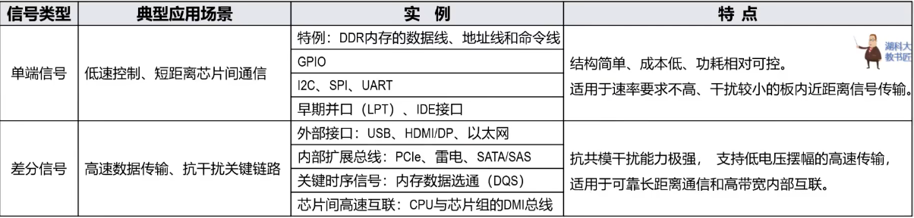
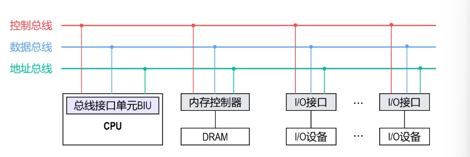
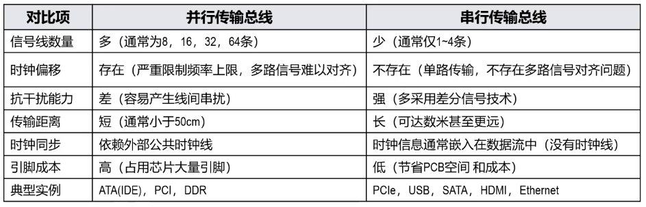
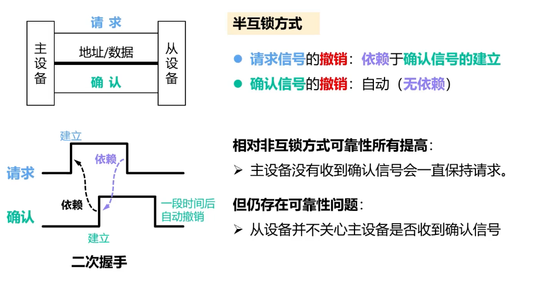
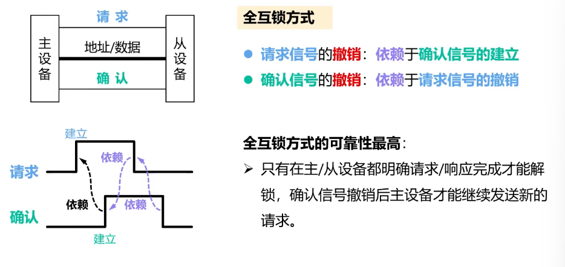
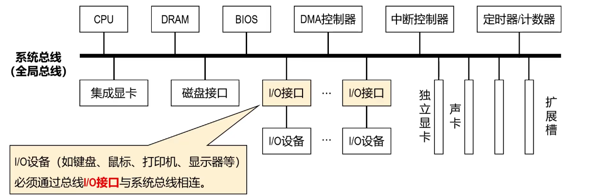
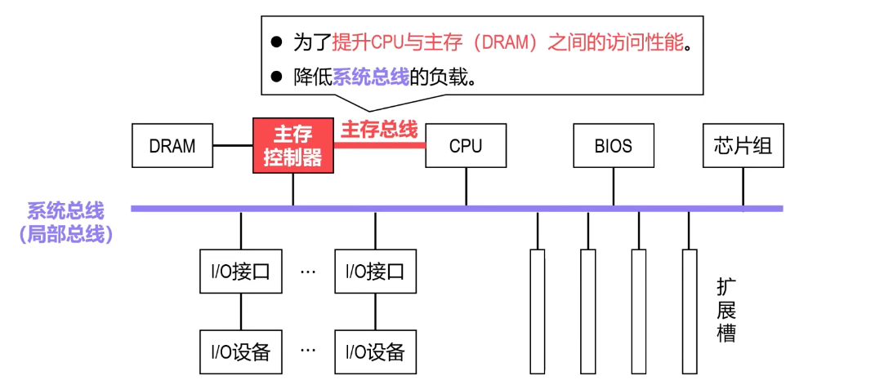
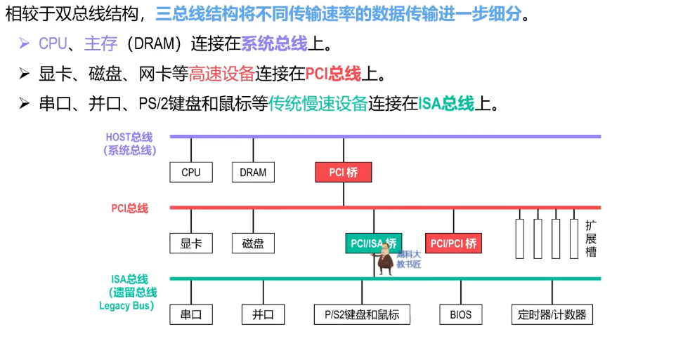
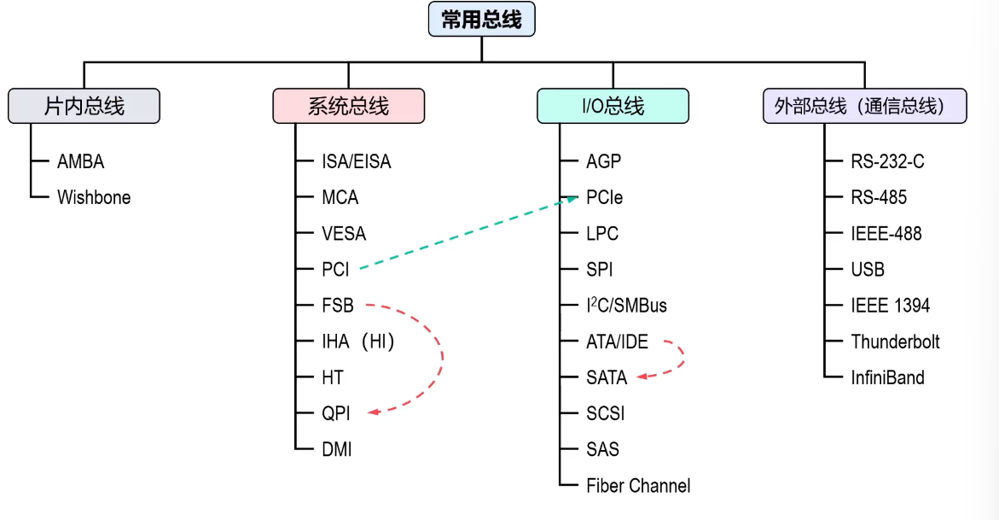

# 总线

## 7-1-1 总线概述

- 在计算机中，**总线**是用于在各功能部件（如CPU、主存、I/O设备）之间传输数据的一组**公共通信线路**。
- 总线有两个主要特点：
  - **共享**：所有功能部件都挂接在总线上，基于总线传输数据。
  - **分时**：为了避免信号冲突（碰撞），**同一时刻只允许一个功能部件向总线发送数据**，但多个功能部件可以同时从总线上接收相同的数据。
- 在基于总线的通信过程中，不同功能部件的角色（主设备和从设备）是不同的。
  - **主设备**：**拥有总线控制权**，能够主动发起一次数据传输操作的功能部件（如CPU、DMA控制器）。
  - **从设备**：**没有总线控制权**，只能响应主设备发起的请求（如被读取或写入数据）的功能部件（如主存、外设）。

- 不同厂商的设备（功能部件）若要接入同一总线，则必须遵循统一的总线标准。这种标准化可以促进不同厂商分工协作，使计算机能够以标准化的方式被生产出来，并且使不同厂商生产的相同功能的部件可以互换使用，这极大地推动了计算机产业的发展。
  - 例如，IBM的PC/XT总线标准标志着兼容机时代的来临。此后，总线标准不断演进，先后出现了16位的ISA、32位的EISA、VESA以及PCI等总线标准。
- 各种总线标准中，都会详细规定总线接口的以下四个特性：
  - **机械特性**：规定总线的物理连接方式，包括总线包含的线路数量，总线的插头和插座的形状、尺寸以及引脚的排列方式。
  - **电气特性**：规定总线信号的有效电平范围和传输方向（单向或双向），以及采用单端方式还是差分方式传输信号。
    - **单端方式**：通过一条信号线（不要与串行/并行传输的概念混淆）和一条公共接地线传输信号。信号电平的高低直接表示不同的数据，一般采用正逻辑体制，即用高电平表示逻辑“1”，低电平表示逻辑“0”。
    - **差分方式**：使用两根信号线传输信号，两路信号的振幅相等、相位相反。通过两路信号之间的电压差值表示数据，一般采用负逻辑体制，即用高电平表示逻辑“0”，低电平表示逻辑“1”。

- **功能特性**：规定总线中每一根线的功能，主要包括地址总线、数据总线、控制总线三类，以及时钟信号线、电源线和地线。
  - **地址总线**：用于传输地址信号，其宽度（所包含地址线的数量）决定了可访问的存储器或I/O地址空间大小。
  - **数据总线**：用于传输数据信号，其宽度决定了一次可同时传输的数据位数，通常与计算机字长相关。
  - **控制总线**：用于传输各类控制信号，包括读/写控制、中断请求与响应、复位等。
- **时序特性**：规定总线通信的时间约束，也就是各信号线上信号的有效时间、信号之间相互配合的时序关系。

当功能部件或I/O设备的接口标准与所要连接的总线不匹配时，两者无法直接相连，此时需要在二者之间增加**桥接转换接口**，以实现不同总线间的互连与通信。

## 7-1-2 总线分类

### 按传输方向
- **单向传输总线**：信号仅从发送方流向接收方。
- **双向传输总线**：可在两个方向交替传输信号。

### 按时序控制方式
- **同步总线**：传输双方由一个**公共时钟信号**控制，通信按预定的时钟周期进行。
  - 连线：总线时钟、地址总线/数据总线、控制总线
- **异步总线**：无公共时钟信号，通信靠收发双方之间的**握手信号（请求/确认）**来协调。
  - 连线：请求信号线、地址总线/数据总线、确认信号线

### 按总线的功能

- **总线控制器**：负责总线控制权的仲裁、总线资源的分配和管理。
- **总线接口**：设备（如DRAM、I/O设备）必须通过总线接口挂接到总线上。总线接口主要负责设备控制、设备寻址、数据输入/输出、速度缓冲、串并转换等（第8章详细介绍）。

- **数据总线**：用于在各功能部件之间传输信息，属于**双向传输总线**。
  - **信息**：数据、指令代码、状态信息、甚至是控制信息（逻辑上具有控制作用的数据，不要与控制总线上传输的信号弄混淆）。
  - **数据总线宽度**：所包含的数据线的数量，与计算机字长、存储字长有关。
  - **地址总线**：用于传输主存单元或I/O端口中的地址，属于**单向传输总线**。
  - **地址**：数据总线上所传输数据的源地址或目的地址。
  - **地址线的位数**：所包含的地址线的数量，决定了CPU可直接寻址的主存空间大小（如32条地址线，最大寻址空间为$2^{32}=4\mathrm{G}$字节）。
- **控制总线**：用于传输控制信号、状态信号、请求信号、握手（应答）信号、时序信号等。
  - 总线控制权的协商。
  - 控制地址总线和数据总线的使用。
  - 传输方向由具体控制信号决定，整体而言可看作是双向传输总线。

### 按信号传输模式
- **并行传输总线**：在同一时刻，通过多条并行的信号线同时传输多个比特。
- **串行传输总线**：数据在单条信号线（或一对差分线）上按顺序一位接一位传输。

### 按总线所处位置

#### 片内总线

- **片内总线**：是指芯片内部各功能部件之间的连接线，也称为片上总线。
  - CPU芯片内部各寄存器之间、寄存器与运算器之间的数据通路。
  - 控制器与执行部件之间的连接线。
- 由于现代处理器设计日趋复杂，行业内普遍采用IP（Intellectual Property）核的模式进行协同开发。这一趋势推动了芯片内部互连接口的标准统一，由此形成了若干广泛应用的**片上互连总线规范**。
  - ARM公司推出的AMBA总线
  - 开源的Wishbone总线

#### 系统总线

- **系统总线**（地址总线、数据总线、控制总线）：是连接CPU、主存、I/O模块等主要功能部件的“信息主干道”，它与CPU引脚直接相连。
  - 随着总线架构的演进，系统总线也被称为**主机总线、CPU总线、前端总线FSB（Front-Side Bus）**。
  - 作为CPU与其他功能部件进行数据交换的“信息主干道”，系统总线通常采用**同步传输方式**。
    - 早期系统总线一般采用并行传输总线。
    - 最新的高速系统总线多采用串行传输总线。
- 总线架构演进：单总线结构 → 双总线结构 → 三总线结构 → 高性能总线

#### I/O总线

- **I/O总线**：是计算机系统中连接各类**中低速I/O设备**的重要通道。
  - I/O总线通过专用**桥接芯片**与高速总线相连，实现了**低速设备与高速总线的分离**，从而有效**提升总线系统的整体性能**。
- 随着计算机系统性能的飞速发展，早期的系统总线（如ISA/EISA）已演变成I/O总线。

#### 外部总线

- **外部总线（一般指通信总线）**：用于实现计算机与外部系统或独立设备（如控制仪表、测试仪器、其他计算机等，而非标准I/O设备）之间的数据通信。
- 由于外部总线所连接系统或设备的特性（如连接方式、传输速率、传输距离以及工作方式等）千差万别，因此**外部总线的种类繁多**（如RS-232-C、RS-485、IEEE 488、USB、IEEE 1394、eSATA等）。
- 相对于外部总线，系统总线和I/O总线也可以称为**内部总线**。

## 7-1-3 总线的性能指标

### 总线宽度

- **总线宽度**：是指数据总线所包含数据线的数量，用位（bit）表示，如8位、16位、32位、64位等。因此，总线宽度也称为**总线位宽**。
  - 在**并行传输总线**中，数据总线宽度直接决定了可并行传输的位数。
  - 在**串行传输总线**中，总线宽度或位宽的传统概念（即物理上多条数据线同时传输）不再适用。但这并不意味着串行总线是“窄”的。相反，它通过极高的总线工作频率以及多条串行总线（通道）的并发传输来达到甚至远超传统并行总线的总带宽（最大数据传输速率）。

### 总线的时钟频率

- **总线时钟频率**：是总线时钟周期的倒数。
  - **同步传输总线**：传输双方在同一时钟信号的控制下进行发送和接收（即完全同步），时钟频率越快，传输速率越快。
  - **异步传输总线**：没有统一的时钟信号来协调发送和接收，其传输依靠一套“握手协议”（如请求/应答信号）来确保数据被正确地发送和接收。因此，异步传输总线的传输速率不直接取决于某个时钟频率。
- 在**早期微型计算机**（如基于8086/8088的PC）时代，总线的时钟频率与CPU的主频是相同的，随着CPU的飞速发展，总线时钟频率逐渐赶不上CPU的主频。因此，总线时钟频率开始使用单独的时钟信号。

### 总线工作频率

- **总线工作频率**：是指一个总线时钟周期内传输数据的次数，也称为有效频率、等效频率、数据传输率，单位通常表示为MT/s（每秒百万次传输）或GT/s（每秒十亿次传输）。
  - **SDR（单倍数据率，Single Data Rate）**：单个时钟周期传输1次数据
  - **DDR（双倍数据率，Double Data Rate）**：单个时钟周期传输2次数据
  - **QDR（四倍数据率，Quad Data Rate）**：读写端口分离，单个时钟周期

### 总线传输周期

- **总线传输周期（简称总线周期）**：是指完成一次总线操作所耗费的时间，包含4个阶段：**申请、寻址、传输、结束**，通常包含多个总线时钟周期。
  - 总线时钟频率越高，总线时钟周期越短，总线传输周期（总线周期）也越短。
  - 如果采用地址复用技术，总线传输周期相应变长。
  - 一般情况下（非DDR、非突发传输模式等），1个总线传输周期（总线周期）只能传输1个总线宽度的数据。

- **总线带宽**：是指数据总线上的最大数据传输速率，计算带宽时一般**不考虑总线周期里的申请、寻址、结束阶段，只统计实际传输阶段**。
- 总线带宽常用单位：$\boldsymbol{MB/s}$、$\boldsymbol{GB/s}$（$1\mathrm{MB}=10^6$字节，$1\mathrm{GB}=10^9$字节）。

**总线带宽 = 32（位）× 33MHz ÷ 8（位转换成字节）= 132MB/s**

### 总线负载能力

总线上能同时连接的设备数量（如PCI总线一般只能外接3个设备）。

## 7-2-1 总线传输相关基本概念--总线传输过程和总线事务

### 总线传输过程

#### 申请阶段：主设备使用总线的流程
当主设备需要使用总线进行数据传输时，过程如下：
1. **传输请求**：主设备通过控制总线，向总线控制器发出总线请求信号。
2. **总线仲裁**：总线控制器收到一个或多个请求后，根据预设的仲裁规则，决定将下一个总线传输周期的总线使用权分配给哪一个请求主设备。
3. **获得授权**：被授权的主设备收到总线控制器发回的总线许可信号，随后获得总线控制权。

#### 寻址阶段
获得总线使用权的主设备，按以下步骤寻址并启动目标从设备：
1. **启动从设备**：主设备通过地址总线和控制总线，发出目标从设备的地址（存储器地址或I/O端口地址）以及相应的控制命令（如读取数据、写入数据等）。
2. **从设备响应**：总线上所有从设备都会接收到地址与命令，与地址相匹配的从设备会自动响应主设备的命令，准备进行后续的数据传输。

#### 传输阶段
主设备与从设备之间通过数据总线进行数据传输。
- 写操作：数据从主设备传输到从设备。
- 读操作：数据从从设备传输到主设备。

一般情况下（非DDR、非突发模式等），1个总线传输周期（总线周期）只能传输1个总线宽度的数据。

#### 结束阶段
完成数据传输后，进入结束阶段，步骤如下：
1. **撤销请求**：主设备撤销总线请求，释放总线控制权。停止驱动地址总线、数据总线以及控制总线，使其回归高阻状态。
2. **控制权交还**：总线控制器检测到主设备已释放总线，随即收回总线控制权，可根据新的总线请求重新仲裁、分配使用权，开启下一个总线传输周期。

### 总线事务

- **总线事务**：总线上一对主/从设备之间完成一次信息交换的过程。（主要包括传输过程中的第二、三阶段）
- **总线事务分类（按操作性质）**
  存储器读、存储器写；I/O读、I/O写；中断响应、DMA响应。
- **总线事务组成**：一个寻址阶段 + 一个传输（数据）阶段。

## 7-2-2总线传输相关基本原理--总线仲裁

### 总线仲裁
总线仲裁是协调多个主设备访问共享总线资源的关键机制，又称总线控制、总线裁决/判优。
1. 早期系统仅CPU一个主设备，独占总线，无总线争抢问题；后期出现DMA控制器、GPU等多个总线主设备，产生总线资源争抢，引入总线控制器统一分配总线使用权。
2. **总线仲裁定义**：多个主设备同时申请总线时，总线控制器按既定策略选定一个设备获得总线使用权的过程。
3. 总线仲裁设计需要兼顾三点：
    - 优先级：保障高优先级设备及时响应；
    - 公平性：防止低优先级设备长期占用不到总线；
    - 系统效率：缩短仲裁耗时，减少总线空闲。

### 仲裁分类

#### 集中式仲裁

##### 链式查询

优点
1. 控制线仅3根（BR、BS、BG），引线少；
2. 硬件结构简单；
3. 设备扩展方便。

缺点
1. **优先级固定**：离总线控制器越近优先级越高，高优先级频繁占用总线会造成低优先级设备饥饿；
2. BG串行逐级传递，每过一个设备占用1时钟周期，仲裁速度慢；
3. **单点故障**：中间设备链路损坏，其后所有设备无法收到BG、不能使用总线。
信号说明
- BR：总线请求；BS：总线忙；BG：总线许可（串行菊花链传递）

##### 计数器定时查询方式

**计数器定时查询仲裁步骤**
① 总线控制器收到BR总线请求且总线空闲，内部设备地址计数器开始逐时钟周期计数，计数值通过计数地址线发往所有主设备。
② 各主设备自带地址判别逻辑；当收到的计数值与自身设备地址一致、且本设备发过请求时，该设备获得总线控制权，置BS总线忙信号为有效。
③ 总线控制器检测到BS有效，立刻停止计数器计数，计数器复位至初始值。

优点
1. 可灵活调整设备优先级；
2. 无单点故障问题。

缺点
1. 各设备需额外配置地址判别逻辑，控制电路复杂；
2. 控制线数量多：$2+\log_2n$（BR、BS + 地址线）；
3. 逐时钟周期计数，仲裁响应速度同菊花链，速度偏慢。

##### 独立请求方式

独立请求方式仲裁步骤
1. 主设备申请总线：各自通过**独立专用请求线**向总线控制器发总线请求。
2. 总线控制器收到多路请求后排队，按优先级选定授权设备，经由该设备**专属许可信号线**发总线许可。
3. 主设备收到许可信号，获得总线控制权。

优点
1. 优先级策略灵活：支持固定优先级、循环、FIFO、LRU等多种动态算法；
2. 并行仲裁，无串行逐级传递，总线响应速度最快。

缺点
1. 总线控制器硬件结构复杂；
2. 控制线数量最多：$2n+1$（n个BR、n个BG、1根BS）。

#### 分布式仲裁

##### 自举分散方式

##### 并行竞争方式

##### 冲突检测分散方式

## 7-2-3 总线定时

### 同步通信

#### 优点
- 时间规定明确、统一。
- 设备间的配合简单一致。

#### 缺点
- 主设备与从设备间的时间配合严格同步，必须在限定时间内完成规定操作。
- 同步时钟频率取决于总线上最慢的设备，对于各种不同速度的从设备，必须按最慢速度的从设备来设计公共时钟，严重影响总线的工作效率。

### 异步通信

#### 非互锁方式

#### 半互锁方式

#### 半互锁方式

### 半同步通信
- 控制方式简单，主设备与从设备之间在统一的同步时钟控制下严格同步。
- 同步时钟频率取决于总线上最慢的设备，对于各种不同速度的从设备，必须按最慢速度的从设备来设计公共时钟，严重影响总线的工作效率。
- 允许不同速度的设备和谐地工作，但控制方式复杂。
- 将同步通信方式与异步通信方式相结合。
- 为此增设一条“等待”（$\overline{\text{WAIT}}$）响应信号线，采用插入时钟（等待）周期的措施来协调通信双方的配合。
### 分离事务通信

分离事务通信的总线交互过程如下。
1. 主设备给从设备发出读请求信号，给出地址和请求命令。
2. 主设备收到从设备的应答后，立即释放总线控制权。
3. 从设备准备数据，此时总线可用于处理其他总线事务。
4. 从设备准备好数据后，将作为主设备重新申请总线控制权，获得总线控制权后将数据送到数据总线上。
5. 原主设备作为从设备通过总线接收数据。

分离事务通信很大程度上提高了总线利用率，但控制方式更加复杂。PCIe总线就支持这种通信。

## 7-3 总线上信息传送的方式

### 并行传送

### 串行传送

### 并串行传送

### 分时传送

## 7-4 系统总线的结构

### 单总线结构

#### 优点
- **结构简单**：所有部件通过单总线（多条并行线）连接，硬件设计复杂度低。
- **易于扩充设备**：新设备可直接挂接到共享总线上。
- **成本较低**：总线数量少，布线简单，制造成本低。
- **灵活性高**：部件间的通信统一，管理逻辑相对简单。

#### 缺点
- **带宽瓶颈**：所有设备共享同一总线带宽，高速设备无法充分发挥性能。
- **通信冲突**：所有设备争用同一总线，导致传输延迟增加。
- **系统性能受限**：总线负载重时，整体效率下降，尤其在高并发场景下。
- **可靠性低**：总线故障可能导致整个系统瘫痪。
- **扩展性受限**：随着设备增多，总线竞争加剧，性能进一步恶化。

### 双总线结构

### 三总线结构

### 高性能总线

#### 总线结构发展趋势
随着计算机技术与CPU性能的飞速进步，以及高速网络、视频图形等设备的涌现，传统的PCI总线已难以满足需求，从而催生了AGP图形加速总线、PCIe等新一代总线。相应地，总线结构自身也向着高性能不断演化，其发展趋势可总结为以下几点：
- 采用分层的多总线结构，各层次总线之间通过桥接技术进行连接和缓冲。
- 将处理器与I/O设备之间的活动与I/O设备与主存之间的数据传输分离开来，提升效率。
- 在布局上，让高速设备更靠近CPU，而慢速设备则相对远离。
- 桥接芯片高度集成，最终形成了经典的南北桥架构。

### 7-5 常用总线标准

