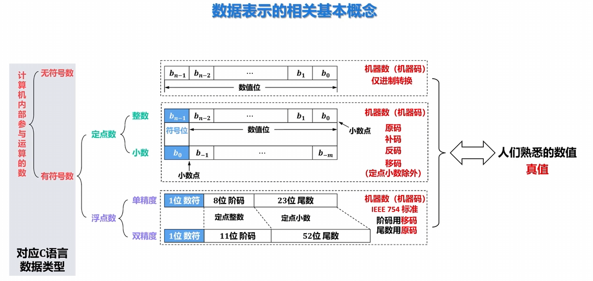
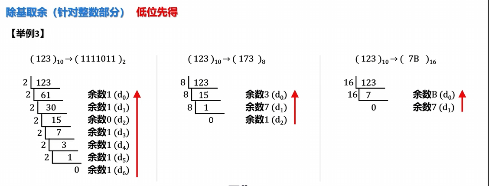
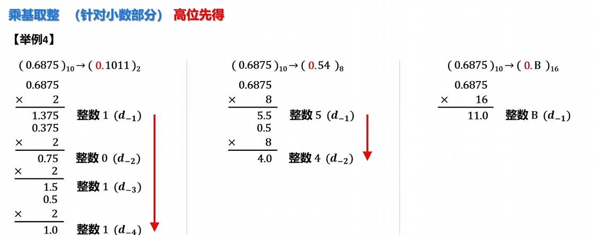
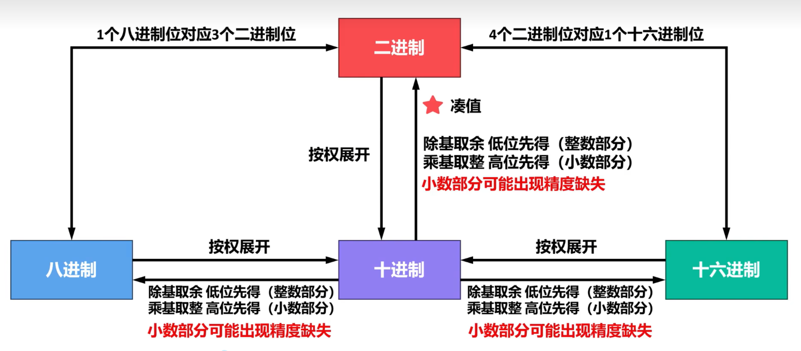
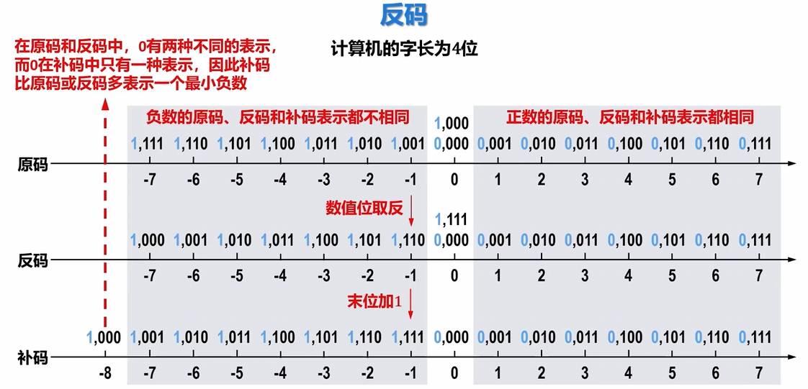
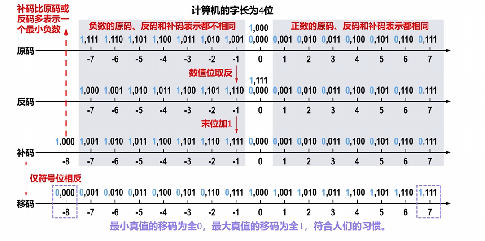

# 计算机内部的数据表示

## 2-1 数据表示的相关概念

电子计算机内部使用二进制来表示数据

### 计算机内部参与运算的数的分类

## 2-2 进位计数制及数据之间的相互转换

### 进位计数制

常用的进位计数制
├── 十进制  日常生活中最常用的
├── 二进制  计算机内部使用
├── 八进制  ┐
└── 十六进制┘  计算机外部使用，为了书写和阅读方便

### 十进制

一般地，任意一个十进制数 \( D \) 可表示为：
\[
\underbrace{d_{n-1}d_{n-2}\cdots d_1d_0}_{n\text{个整数位}}.\underbrace{d_{-1}d_{-2}\cdots d_{-m}}_{m\text{个小数位}}
\]
（\( n \) 和 \( m \) 为正整数）

十进制数 \( D \) 的取值为：
\[
\begin{aligned}
D &= \underbrace{d_{n-1}}_{\text{数码}} \times \underbrace{10^{n-1}}_{\text{位权}} + \underbrace{d_{n-2}}_{\text{数码}} \times \underbrace{10^{n-2}}_{\text{位权}} + \cdots + \underbrace{d_1}_{\text{数码}} \times \underbrace{10^1}_{\text{位权}} + \underbrace{d_0}_{\text{数码}} \times \underbrace{10^0}_{\text{位权}} \\
&+ \underbrace{d_{-1}}_{\text{数码}} \times \underbrace{10^{-1}}_{\text{位权}} + \underbrace{d_{-2}}_{\text{数码}} \times \underbrace{10^{-2}}_{\text{位权}} + \cdots + \underbrace{d_{-m}}_{\text{数码}} \times \underbrace{10^{-m}}_{\text{位权}}
\end{aligned}
\]

### 其他进制

|          | 十进制                          | 二进制    | 八进制          | 十六进制                      |
|----------|---------------------------------|-----------|-----------------|-------------------------------|
| 数码      | 0, 1, 2, 3, 4, 5, 6, 7, 8, 9    | 0, 1      | 0, 1, 2, 3, 4, 5, 6, 7 | 0, 1, 2, 3, 4, 5, 6, 7, 8, 9, A, B, C, D, E, F |
| 基数 \(r\) | 10                              | 2         | 8               | 16                            |
| 进位规则   | 逢十进一                        | 逢二进一  | 逢八进一        | 逢十六进一                    |
| 示例      | 0 1 2 3 4 5 6 7 8 9 **10** 11 12 13 14 15 16 ⋮ | 0 1 **10** 11 **100** 101 **110** 111 **1000** 1001 **1010** 1011 **1100** 1101 **1110** 1111 **10000** ⋮ | 0 1 2 3 4 5 6 7 **10** 11 12 13 14 15 16 17 **20** ⋮ | 0 1 2 3 4 5 6 7 8 9 A B C D E F **10** ⋮ |

### 任意进制->十进制

任意进制数 \( D \) 的取值为：
\[
D = d_{n-1} \times r^{n-1} + d_{n-2} \times r^{n-2} + \dots + d_1 \times r^1 + d_0 \times r^0 + d_{-1} \times r^{-1} + d_{-2} \times r^{-2} + \dots + d_{-m} \times r^{-m}
\]

|          | 十进制                          | 二进制    | 八进制                | 十六进制                                      |
|----------|---------------------------------|-----------|-----------------------|-----------------------------------------------|
| 数码 \(d_i\) | \(0,1,2,3,4,5,6,7,8,9\)         | \(0,1\)   | \(0,1,2,3,4,5,6,7\)   | \(0,1,2,3,4,5,6,7,8,9,A,B,C,D,E,F\)           |
| 基数 \(r\)   | \(10\)                          | \(2\)     | \(8\)                 | \(16\)                                        |

【举例1】
\[
\begin{align*}
(1011.101)_2 &= 1 \times 2^3 + 0 \times 2^2 + 1 \times 2^1 + 1 \times 2^0 + 1 \times 2^{-1} + 0 \times 2^{-2} + 1 \times 2^{-3} = 11.625 \\
(702.6)_8 &= 7 \times 8^2 + 0 \times 8^1 + 2 \times 8^0 + 6 \times 8^{-1} = 450.75 \\
(A9DE.CF)_{16} &= A \times 16^3 + 9 \times 16^2 + D \times 16^1 + E \times 16^0 + C \times 16^{-1} + F \times 16^{-2} \\
&= 10 \times 16^3 + 9 \times 16^2 + 13 \times 16^1 + 14 \times 16^0 + 12 \times 16^{-1} + 15 \times 16^{-2} = 43486.80859375
\end{align*}
\]

**常用2的幂次方数**：

| 幂次   | 2¹⁶   | 2¹⁵    | 2¹⁴    | 2¹³   | 2¹²  | 2¹¹  | 2¹⁰  | 2⁹  | 2⁸  | 2⁷  | 2⁶ | 2⁵ | 2⁴ | 2³ | 2² | 2¹ | 2⁰ | 2⁻¹ | 2⁻² | 2⁻³  |
|--------|-------|--------|--------|-------|------|------|------|-----|-----|-----|----|----|----|----|----|----|----|-----|-----|------|
| 十进制值 | 65536 | 32768  | 16384  | 8192  | 4096 | 2048 | 1024 | 512 | 256 | 128 | 64 | 32 | 16 | 8  | 4  | 2  | 1  | 0.5 | 0.25| 0.125|
| 备注   | 快速推导（蓝色）部分：2⁸及以上 | | | | | | | | | 熟记（红色）部分：2⁷及以下 | | | | | | | | | |

### 二进制->八进制 | 二进制->十六进制

### 3位二进制数 ↔ 1位八进制数
| 二进制 | 八进制 | 十进制 |
|--------|--------|--------|
| 000    | 0      | 0      |
| 001    | 1      | 1      |
| 010    | 2      | 2      |
| 011    | 3      | 3      |
| 100    | 4      | 4      |
| 101    | 5      | 5      |
| 110    | 6      | 6      |
| 111    | 7      | 7      |

原理：$2^3 = 8^1$

---

### 4位二进制数 ↔ 1位十六进制数
| 二进制 | 十六进制 | 十进制 |
|--------|----------|--------|
| 0000   | 0        | 0      |
| 0001   | 1        | 1      |
| 0010   | 2        | 2      |
| 0011   | 3        | 3      |
| 0100   | 4        | 4      |
| 0101   | 5        | 5      |
| 0110   | 6        | 6      |
| 0111   | 7        | 7      |
| 1000   | 8        | 8      |
| 1001   | 9        | 9      |
| 1010   | A        | 10     |
| 1011   | B        | 11     |
| 1100   | C        | 12     |
| 1101   | D        | 13     |
| 1110   | E        | 14     |
| 1111   | F        | 15     |

原理：$2^4 = 16^1$

八进制 ←————→ 二进制 ←————→ 十六进制
          ↑                  ↑
1个八进制位对应3个二进制位  1个十六进制位对应4个二进制位

### 十进制->任意进制（除基取余，乘基取整）

一般地，一个任意进制数 \(D\) 可表示为：
\[
\underbrace{d_{n-1}d_{n-2}\cdots d_1d_0}_{n\text{个整数位}}.\underbrace{d_{-1}d_{-2}\cdots d_{-m}}_{m\text{个小数位}}
\]
（\(n\) 和 \(m\) 为正整数）

任意进制数 \(D\) 的取值为：
\[
D = d_{n-1} \times r^{n-1} + d_{n-2} \times r^{n-2} + \dots + d_1 \times r^1 + d_0 \times r^0 + d_{-1} \times r^{-1} + d_{-2} \times r^{-2} + \dots + d_{-m} \times r^{-m}
\]

**除基取余（针对整数部分）**
\[
d_{n-1} \times r^{n-1} + d_{n-2} \times r^{n-2} + \dots + d_1 \times r^1 + d_0 \times r^0 = \text{十进制数的整数部分（已知）}
\]

**除基取余法**

**乘基取整（针对小数部分）**
\[
(d_{-1} \times r^{-1} + d_{-2} \times r^{-2} + \dots + d_{-m} \times r^{-m}) \times r = \underbrace{d_{-1} \times r^0}_{\text{整数 } d_{-1}} + \underbrace{d_{-2} \times r^{-1} + \dots + d_{-m} \times r^{-(m-1)}}_{\text{小数}}
\]

\[
(d_{-2} \times r^{-1} + \dots + d_{-m} \times r^{-(m-1)}) \times r = \underbrace{d_{-2} \times r^0}_{\text{整数 } d_{-2}} + \underbrace{\dots + d_{-m} \times r^{-(m-2)}}_{\text{小数}}
\]

\(\vdots\)

**终止条件：小数部分为 0 或达到指定精度**

**乘基取整法**：

但是例如0.3这种十进制转为二进制，会循环出现1001,只需要取所需进度就可以了

**可以以二进制为桥梁，再计算8进制或者16进制，或者直接用除基取余、乘基取整**

**凑值法**

### 总结

## 2-3 编码

### 2-3-1 定点数的编码--原码

#### 结构说明
| 符号位 | 数值位（二进制）       |
|--------|------------------------|
| 0 表示正数 1 表示负数 | 真值的绝对值（二进制） |

> 原码表示又称为**带符号的绝对值表示**

---

#### 【举例】

##### 定点整数
- 真值 \( x = +1110 \)：  
  \([x]_{\text{原}} = 0,1110\)
- 真值 \( x = -1110 \)：  
  \([x]_{\text{原}} = 1,1110\)

##### 定点小数
- 真值 \( x = +0.1101 \)：  
  \([x]_{\text{原}} = 0.1101\)
- 真值 \( x = -0.1101 \)：  
  \([x]_{\text{原}} = 1.1101\)

#### 定点整数的原码定义

假设真值 \( x \) 为定点整数，\( n \) 为 \( x \) 的原码表示中数值位的位数（比特数量）。

\[
[x]_{\text{原}} =
\begin{cases}
0, x & 0 \le x < 2^n \\
2^n + |x| & -2^n < x \le 0
\end{cases}
\]

---

【说明】

假设真值 \( x = -b_3b_2b_1b_0 \)，\( n = 4 \)，\( x \) 的原码表示中符号位为 \( b_4 \)（其位权值为 \( 2^4 \)）

\[
\begin{align*}
[x]_{\text{原}} &= 2^4 + |-b_3b_2b_1b_0| \\
&= 2^4 + b_3b_2b_1b_0 \\
&= 10000 + b_3b_2b_1b_0 \\
&= 1,b_3b_2b_1b_0
\end{align*}
\]

#### 定点小数的原码定义

假设真值 \( x \) 为定点小数

\[
[x]_{\text{原}} =
\begin{cases}
x & 0 \le x < 1 \\
1 + |x| & -1 < x \le 0
\end{cases}
\]

---

【举例】

- \( x = +0.1101 \)
  \[
  [x]_{\text{原}} = 0.1101
  \]

- \( x = -0.1101 \)
  \[
  \begin{align*}
  [x]_{\text{原}} &= 1 + |-0.1101| \\
  &= 1 + 0.1101 \\
  &= 1.1101
  \end{align*}
  \]

  **真值0在表示中有两种情况表示整数/小数**

#### 优缺点

优点：
表示方法简单直观

缺点：
真值0在表示中有两种情况表示整数/小数
符号位不能直接参与运算

**源码在计算机目前仅仅用于表示浮点数的尾码**

### 2-3-2 定点数的编码--补码

#### 补数的概念

##### 模的概念
- 模（或称模数）是一个数值计量系统的**计量范围**，记作`mod`或`M`。
- 只要确定了“模”，就可找到一个**与负数等价的正数**来代替此负数，该正数就是负数的**补数**。
- 超过计量范围的数都应该自动舍弃模数。

---

##### 补数的特点
- 一个负数可用它的正补数来替代，而这个正补数可以用**模数加上负数本身**求得。
- 一个正数和一个负数互为补数时，它们**绝对值之和即为模数**。
- 正数的补数为该正数本身

##### 意义

- 把减法用加法实现
- 符号位也可以直接参与运算
- 减少硬件复杂度

#### 补码

将补数的概念应用到计算机内部，便出现了**补码**这种机器码（机器数）。

- 正数的补码：符号位为0，数值位就是它本身。
- 负数的补码：等于模数加上该负数本身，而模数就是最高位进位的位权值。

#### 定点整数的补码定义
假设真值 \( x \) 为定点整数，\( n \) 为 \( x \) 的补码表示中数值位的位数（比特数量），加上1个符号位，\( x \) 的补码表示共有 \( n+1 \) 位，最低位的位权值为 \( 2^0 \)，而最高位（符号位）的位权值为 \( 2^n \)，因此最高位进位的位权值为 \( 2^{n+1} \)，即模数为 \( 2^{n+1} \)。

\[
[x]_{\text{补}} =
\begin{cases}
0, x & 0 \le x < 2^n \\
2^{n+1} + x & -2^n \le x < 0 \quad (\text{mod } 2^{n+1})
\end{cases}
\]
**这里就是将负数+2^n+1,转为对应的正数补码

【举例】
某计算机的字长为8位，真值 \( x \) 为定点整数 \( (-10101)_2 \)，求 \( [x]_{\text{补}} \)。

模数为 \( 2^8 \)

\[
\begin{align*}
[x]_{\text{补}} &= 2^8 + (-10101) \\
&= 100000000 - 10101 \\
&= 1,1101011
\end{align*}
\]

**八位数补码的表示范围为-128（1，000000000）-0（0，000000000）-127**
**八位数原码表示范围为-127-0（1，000000000|0，00000000）-127**

#### 定点小数的补码定义
假设真值$x$为定点小数（纯小数），小数点左侧的位为最高位（符号位），其位权值为$2^0$，而最高位进位的位权值为$2^1$，即**模数为$2^1=2$**。

$$
[x]_{\text{补}} =
\begin{cases}
x & 0 \le x < 1 \\
2 + x & -1 \le x < 0 \quad (\text{mod } 2)
\end{cases}
$$

#### 补码的优缺点

##### 优点
- 补码表示方法使得减法运算可以转换成加法运算。
- 真值0在补码中只有一种表示，这使得补码比原码多表示一个最小负数。
- 符号位可以直接参与运算，运算时符号位的进位作为模会被自动舍弃。

**目前计算机中普遍采用补码表示有符号定点整数，例如C语言中`char`、`short`、`int`、`long`型整数都是采用补码进行表示的。**

##### 缺点

- 补码的表示相对原码更加复杂。原码的数值位与真值的绝对值相同。因此，通过原码可以很容易地得出真值。但是，补码就没有这么简单了。

### 2-3-3 定点数的编码--反码

#### 反码
- 反码通常用来作为由原码求补码或者由补码求原码的**中间过渡**。
  - 正数的反码：符号位为0，数值位就是它本身。
  - 负数的反码：符号位为1，数值位就是真值数值位取反。

#### 定点整数的反码定义
假设真值$x$为定点整数，$n$为$x$的反码表示中数值位的位数（比特数量）。

$$
[x]_{\text{反}} =
\begin{cases}
0, x & 0 \le x < 2^n \\
[x]_{\text{补}} - 1 & -2^n < x \le 0
\end{cases}
$$

**补码=反码（原码除了符号位其他位取反）+1**
**反码=补码(2^n+1+x)-1,x<=0**

#### 定点小数的反码定义
假设真值$x$为定点小数，$n$为$x$的反码表示中数值位的位数（比特数量）。

$$
[x]_{\text{反}} =
\begin{cases}
x & 0 \le x < 1 \\
(2 - 2^{-n}) + x & -1 < x \le 0
\end{cases}
$$

【举例】
- $x = +0.1101$，$[x]_{\text{反}} = 0.1101$
- $x = -0.1111$，$[x]_{\text{反}} = 2 - 2^{-4} + (-0.1111)$
  $= 10.0000 - 0.0001 - 0.1111$

**真值0在反码中有两种表示**

#### 反码的优缺点
##### 优点
- 符号位可以参与运算。

##### 缺点
- 最高位（符号位）产生的进位要加到运算结果的低位（循环进位）
- 真值0在反码中有两种不同的表示

**反码在计算机中目前很少使用**

### 2-3-4 定点数的编码---移码

- 移码就是在**真值上**加一个常数 $2^n$。
  - 在数轴上，移码所表示的范围对应于真值在数轴上的范围向轴的正方向移动$2^n$个单元。
  - 移码**只用于定点整数**的表示。

（数轴说明：真值+=2^n
- 真值范围：$-2^n \le x \le 2^n - 1$
- 移码范围：$0 \le [x]_{\text{移}} \le 2^{n+1} - 1$）

#### 移码定义
假设真值$x$为定点整数，$n$为$x$的移码表示中数值位的位数（比特数量）。

$$
[x]_{\text{移}} = x + 2^n \quad (-2^n \le x < 2^n)
$$

【举例】
- $x = +1010110$
  $[x]_{\text{移}} = +1010110 + 2^7 = +1010110 + 10000000 = 1,1010110$

- $x = -1010110$
  $[x]_{\text{移}} = -1010110 + 2^7 = -1010110 + 10000000 = 0\ 0101010$

**真值0在移码中有两种表示方式**

#### 移码的优点

- 真值0在移码中只有一种表示。
- 移码保持了真值原有的大小顺序，可以直接比较大小。
- 最小真值的移码为全0，最大真值的移码为全1，符合人们的习惯。

**当浮点数的阶码用移码来表示时，就能很方便地比较阶码的大小。**

### 2-3-5 定点数的编码--原码、补码、反码、移码之间的转化

#### 四种编码的转化关系
##### 真值与原码、反码、补码、移码的转换关系

##### 真值$x$为正数
- 真值$x$ → $[x]_{\text{原}}$：符号位为0，数值位与真值相同
- $[x]_{\text{原}}$ → $[x]_{\text{反}}$：相同（原码与反码一致）
- $[x]_{\text{反}}$ → $[x]_{\text{补}}$：相同（反码与补码一致）
- $[x]_{\text{补}}$ → $[x]_{\text{移}}$：符号位相反

##### 真值$x$为负数
- 真值$x$ → $[x]_{\text{原}}$：符号位为1，数值位为真值的绝对值
- $[x]_{\text{原}}$ → $[x]_{\text{反}}$：数值位按位取反
- $[x]_{\text{反}}$ → $[x]_{\text{补}}$：末位加1
- $[x]_{\text{补}}$ → $[x]_{\text{移}}$：符号位相反

**快速求原/补码**：
扫描法：
保持符号位不变仅对数值位从右向左顺序扫描，右起第一个1及其右边的0保持不变，其余左边的数按位取反（注意是双向的）
**已知[x]补，求[-x]补**：
全部位按位取反，末位加一