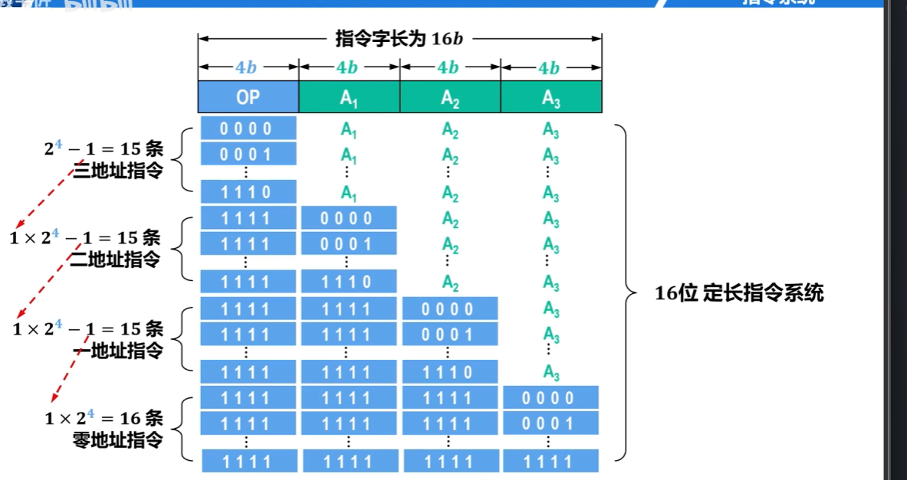
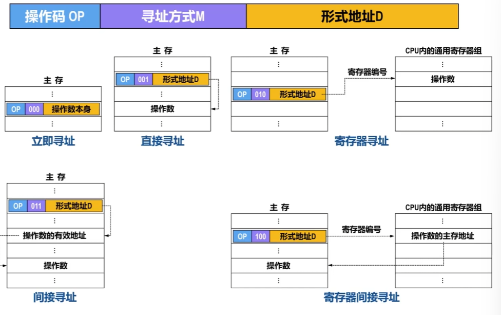

## 5-1 指令系统概述

一台计算机所有指令得集合成为该计算机得指令集，也称指令系统

指令系统是计算机软、硬件系统的设计基础。
指令系统的设计直接影响计算机的性能和成本

- [ ] 软件设计人员需要根据指令系统设计计算机的系统软件。
- [ ] 硬件设计人员需要根据指令系统设计计算机的硬件逻辑电路。

## 5-2-1 指令格式--一般格式

### 指令字长

#### 指令的一般格式
| 操作码 OP | 地址码 A |
| ---- | ---- |
构成指令的二进制位数，称为**指令字长**

#### 定长指令系统
- 指令长度固定
- 结构简单，有利于指令顺序寻址、取指和译码
- 硬件实现较容易
- 平均指令长度较长、冗余状态较多（浪费存储器空间）
- 受指令长度限制，不容易扩展
- 在精简指令集计算机（RISC）中较为常用，例如MIPS系列

#### 变长指令系统
- 指令长度可变
- 结构灵活，给取指和译码带来不便，取指过程可能涉及多次访存操作
- 硬件实现难度较大
- 平均指令长度较短、冗余状态较少
- 不受指令长度限制，可扩展性好
- 在复杂指令集计算机（CISC）中采用，例如Intel x86系列

#### 核心结论
由于存储器的基本编址单位为字节，而指令是存储在存储器中的，因此，无论是定长指令系统还是变长指令系统，指令字长都是字节的整数倍。

指令字长越长，则占用主存空间就越大，所耗费的访存时间也就越长。
根据指令字长与机器字长的关系，指令可分为以下三类：
- [ ] 半字长指令　　CPU进行1次访存，可读取2条
- [ ] 单字长指令　　CPU进行1次访存，可读取1条
- [ ] 多字长指令　　需要进行多次访存

为了提高速度，一般会将最常用的指令设计为较短的指令格式。

## 5-2-1 指令格式--指令中的地址码

| 操作码 OP | 地址码 A |
| ---- | ---- |
构成指令的二进制位数，称为**指令字长**
根据指令类型和寻址方式，地址码可能是：
- 操作数
- 操作数的地址
  - [ ] 主存地址
  - [ ] 寄存器编号
  - [ ] 外部设备端口的地址
  - [ ] 用于计算地址的偏移量

### 三地址指令格式
| 操作码 OP | 地址码 A₁ | 地址码 A₂ | 地址码 A₃ |
| ---- | ---- | ---- | ---- |
|        | 源操作数1的地址 | 源操作数2的地址 | 目的操作数的地址 |

#### 操作表达式
$(A_1)\ \text{OP}\ (A_2) \rightarrow A_3$
- $(A_1)$：源操作数1
- $\text{OP}$：指定具体的操作
- $(A_2)$：源操作数2
- $A_3$：存放运算结果的目的地址

### 二地址指令格式
| 操作码 OP | 地址码 A₁ | 地址码 A₂ |
| ---- | ---- | ---- |
|        | 源操作数1的地址 目的操作数的地址 | 源操作数2的地址 |

### 操作表达式
$(A_1)\ \text{OP}\ (A_2) \rightarrow A_1$
- $(A_1)$：源操作数1
- $\text{OP}$：指定具体的操作
- $(A_2)$：源操作数2
- $A_1$：目的操作数的地址

### 特点说明
- 与三地址指令相同，二地址指令同样是为**双目运算类**设计的。
- 但是，二地址指令为了压缩指令字长，将**运算结果**直接存放到**源操作数1的地址A₁**中。

### 一地址指令格式
| 操作码 OP | 地址码 A₁ |
| ---- | ---- |
|        | 源操作数的地址 目的操作数的地址 |

#### 操作表达式
$\text{OP}\ (A_1) \rightarrow A_1$
- $\text{OP}$：指定具体的操作
- $(A_1)$：源操作数
- $A_1$：目的操作数的地址

#### 运算类型
单目运算

### 隐式双操作数一地址指令格式
| 操作码 OP | 地址码 A₁ |
| ---- | ---- |
|        | 源操作数的地址 |

#### 操作表达式
$(AL)\ \text{OP}\ (A_1) \rightarrow AX$
- $(AL)$：由OP约定隐含于CPU内某个寄存器中的另一个源操作数
- $\text{OP}$：指定具体的操作
- $(A_1)$：源操作数
- $AX$：由OP约定隐含于CPU内存放目的操作数的某个寄存器

### 运算类型
隐含操作数双目运算

### 零地址指令格式
仅包含：操作码 OP

1. 指令本身不需要操作数，例如以下x86指令
- [ ] 空指令 NOP
- [ ] 等待指令 WAIT
- [ ] 停机指令 HLT
- [ ] 程序返回指令 RET

2. 指令需要一个操作数，该操作数隐含于CPU内的某个寄存器，例如以下x86指令
- [ ] 用于将加法运算结果调整为压缩BCD格式的指令 DAA
- [ ] 用于将减法运算结果调整为压缩BCD格式的指令 DAS

## 5-2-1 指令格式--指令中的操作码

### 操作码相关概念
- 操作码指定进行什么操作（运算）
- 不同指令的操作码的编码值是不同的，例如
  - [ ] 0000 0001表示加法操作
  - [ ] 0010 1011表示减法操作
- 根据操作码的长度（操作码字段的二进制位数）是否固定，可分为以下两种操作码：
  - [ ] 定长操作码
  - [ ] 变长操作码

#### 定长操作码
- 操作码的长度固定，并且其在指令中的位置也是固定的。
- 指令译码简单，硬件实现简单。
- 指令系统的规模（指令系统所包含的指令数量），决定了操作码的位数。
若指令系统所包含的指令数量为$x$，操作码的位数为$n$，则$x$和$n$应满足如下关系：
$$\log_2 x \le n$$

#### 变长操作码
- 操作码的长度可变，并且其在指令中的位置也不固定。
- 可以有效减少操作码的平均长度，用较短的指令字长表示了更多的指令，并且给地址码留出了更多位数，以增大寻址空间。v 

### 变长操作码的常见实现方法——扩展操作码技术
扩展操作码技术的核心思想是：操作码的长度随地址码字段中地址码数量的减少而增加。

## 5-3-1 寻址方式--概述

寻址方式是指寻找指令或指令中操作数的有效地址的方式。
- [ ] 有效地址可以是主存地址，也可以是虚拟地址（采用虚拟存储器技术）。

#### 寻址方式整体分类
1. 指令寻址方式
    - 顺序寻址
    - 跳跃寻址
2. 操作数寻址方式（特点：复杂灵活）
    - 立即寻址
    - 直接寻址
    - 间接寻址
    - 寄存器寻址
    - 寄存器间接寻址
    - 相对寻址
    - 变址寻址
    - 基址寻址
    - 堆栈寻址
    - 其他寻址

#### 操作数相关说明
操作数是程序执行时需要处理的数据，为了满足不同程序设计技巧的需要，操作数的存取方式应该比较灵活多样。

1. 从程序设计角度看，操作数可能是：
- [ ] 常数
- [ ] 简单变量
- [ ] 数组和结构体中的某个元素
- [ ] 栈（stack）中的数据
- [ ] 外设I/O接口中的状态字或控制字

2. 从指令角度看，操作数的存放位置可能是：
- [ ] CPU内的通用寄存器
- [ ] 主存
- [ ] I/O端口

## 5-3-2 寻址方式--指令寻址方式

### 顺序寻址
1. 通常情况下，构成程序的所有机器指令（指令序列）在主存中按顺序存放。
2. 大多数情况下，程序按照指令序列顺序执行。
- [ ] 如果知道指令序列中第一条指令的有效地址，在该有效地址的基础上增加一条指令所占用主存单元的数量，就可以得到下一条指令的有效地址。这种寻找指令有效地址的方法就称为**指令的顺序寻址**。

### 跳跃寻址

如果构成程序的指令序列中包含有分支指令或跳转指令，则当程序执行到这种指令时就会改变执行顺序。此时就要采取跳跃寻址。
- [ ] 分支指令通常用于基于条件来改变指令序列的执行顺序。
- [ ] 跳转指令通常用于无条件改变指令序列的执行顺序。

## 5-3-3 操作数寻址方式(1)

### 操作数寻址基础格式
- 不同指令可能采用不同的操作数寻址方式来获取操作数。
- 可将指令格式中的地址码字段划分为以下两部分：
  - 寻址方式（寻址特征）字段M
  - 形式地址字段D

#### 指令格式对比
1. 指令的一般格式
| 操作码 OP | 地址码 A |
| ---- | ---- |

2. 含有寻址方式的单地址指令格式
| 操作码 OP | 寻址方式M | 形式地址D |
| ---- | ---- | ---- |
> 寻址方式M与形式地址D整体为原地址码A；M的位数取决于所要支持不同寻址方式的数量

#### 寻址核心逻辑
操作数寻址的过程，就是把寻址方式M和形式地址D的不同组合转换成有效地址的过程。

### 立即寻址
1. 存储与读取规则
- 立即寻址方式下，操作数与指令是一起存放在主存的。
- [ ] 取指令时，操作数随指令一起被读取并送到CPU内的指令寄存器IR中。
- [ ] 指令执行时，直接从指令寄存器IR中获取操作数，无需访问其他存储单元。

2. 特点
- [ ] 取操作数快。
- [ ] 形式地址D的位宽有限，限制了操作数的表示范围。

3. 适用场景
立即寻址一般用于变量赋初值。

4. 指令结构（主存内）
| OP（操作码） | 000（寻址特征M） | 操作数本身（形式地址D） |

5. Intel x86 举例
`MOV EAX, 5132408H`
; 将十六进制立即数5132408送入32位通用寄存器EAX

### 直接寻址
1. 存储与读取规则
- 直接寻址方式下，操作数与指令是分开存放在主存中的。
- [ ] 指令中的形式地址D，直接给出了操作数的主存地址。
- [ ] 取指令时，操作数不会随指令一起被读取并送到CPU内的指令寄存器IR中。
- [ ] 指令执行时，需要访问一次主存以获取操作数。

2. 特点
- [ ] 操作数的地址直观，无需专门计算操作数的地址。
- [ ] 形式地址D的位宽有限，限制了操作数的寻址范围。
- [ ] 操作数的地址位于指令中，因此不方便修改。

3. 指令结构（主存内）
| OP（操作码） | 001（寻址特征M） | 形式地址D |
形式地址D指向主存中存放操作数的存储单元。

### 寄存器寻址
- 寄存器寻址方式下，操作数与指令是分开存放的，操作数存放在CPU内的某个通用寄存器中，指令存放在主存中。
- [ ] 指令中的形式地址D，给出的是操作数所在通用寄存器的编号。
- [ ] 取指令时，操作数不会随指令一起被读取并送到CPU内的指令寄存器IR中。
- [ ] 指令执行时，只访问寄存器（而不需要访问主存）。
### 寄存器寻址特点
- [ ] 获取操作数不需要访问主存（从寄存器获取），指令执行速度快。
- [ ] 由于通用寄存器的数量少，因此所需的形式地址D的位数就少，有利于缩短指令字长，节省存储空间。
- [ ] 由于CPU内的寄存器数量有限，因此寄存器寻址不能为大量的操作数提供存储服务。
#### 指令结构
主存内指令格式：
| OP（操作码） | 010（寻址特征M） | 形式地址D（寄存器编号） |
形式地址D存放寄存器编号，通过编号找到CPU通用寄存器组内对应的操作数。

### 间接寻址
- 间接寻址方式下，操作数与指令是分开存放在主存中的。
- [ ] 指令中的形式地址D，给出的不是操作数的有效地址，而是操作数的间接地址，间接地址所指向的主存单元中的内容才是操作数的有效地址。
- [ ] 取指令时，操作数不会随指令一起被读取并送到CPU内的指令寄存器IR中。
- [ ] 指令执行时，需要访问两次主存以获取操作数。

补充说明：
右图为单级间接寻址示意图，还可以存在多重间接寻址。

#### 指令结构（主存）
| OP（操作码） | 011（寻址特征M） | 形式地址D（间接地址） |
流程：
1. 由D读出主存单元内容 = 操作数有效地址
2. 再用有效地址访问主存，读出操作数

#### 间接寻址的特点
- [ ] 相较于直接寻址，能用较短的形式地址D访问较大的主存空间。
- [ ] 相较于直接寻址，当需要修改操作数地址时不再需要改变指令中的形式地址D，只需要修改形式地址D指向的主存单元（存有操作数地址）即可。
- [ ] 指令执行时，需要访问两次主存以获取操作数，降低了指令的执行速度。

#### 指令举例
`MOV EAX, @5132408H`
; 从主存地址5132408H所指向的存储单元中取出操作数的有效地址，
; 从该地址所指向的存储单元中取出操作数，
; 最后送入32位寄存器EAX；

### 寄存器间接寻址
- 寄存器间接寻址方式下，操作数与指令是分开存放在主存中的。
- [ ] 指令中的形式地址D，给出的不是操作数的有效地址，而是通用寄存器的编号；而该编号的通用寄存器，其内容就是操作数的主存地址。
- [ ] 取指令时，操作数不会随指令一起被读取并送到CPU内的指令寄存器IR中。
#### 寄存器间接寻址的特点
- [ ] 具有间接寻址的优点（扩充了操作数的寻址范围，提高了编程灵活性），还比间接寻址少访问一次主存。
- [ ] 与寄存器寻址的缺点类似，由于CPU内的寄存器数量有限，因此寄存器间接寻址不能为大量的操作数提供存储其主存地址的服务。

#### Intel x86 指令举例
`MOV EAX, [EBX]`
; 将32位通用寄存器EBX中存储的主存地址所指向主存单元中的内容，送入32位通用寄存器EAX

### 总结

## 5-3-4 操作数寻址方式(2)

### 相对寻址
#### 指令格式
| 操作码OP | 寻址方式M（相对寻址特征码，例：101） | 形式地址D（相对PC的偏移量） |
- M：标识相对寻址；D：相对于当前PC值的偏移量，用于生成操作数主存地址

#### 寻址规则
- 相对寻址方式下，操作数与指令是分开存放在主存中的。
- [ ] 指令中的形式地址D，是需要给程序计数器PC中的内容加上的偏移量，可正可负（用补码表示），相加后得到操作数主存地址或转移目标地址。
- [ ] 取指令时，操作数不会随指令一起被读取并送到CPU内的指令寄存器IR中。
- [ ] 指令译码或执行阶段，计算操作数主存地址/转移目标地址。

#### 特点与用途
- [ ] 编程仅需给定指令与操作数相对距离，无需关心绝对地址，支持共享代码浮动。
- [ ] 可实现程序跳转执行。

### 变址寻址
(寄存器编码可变+形式地址D不变)
#### 指令格式
| 操作码 OP | 寻址方式M（变址特征码，例：110） | 寄存器编号n | 形式地址D |
计算规则：变址寄存器n的内容 + 形式地址D = 操作数主存地址

#### 寻址规则
- 变址寻址方式下，操作数与指令是分开存放在主存中的。
- [ ] 指令中的寄存器编号n指明使用CPU内的变址寄存器（通用/专用），寄存器内存放可变基地址，与形式地址D相加得到操作数主存地址。
- [ ] 取指令时，操作数不会随指令一起被读取并送到CPU内的指令寄存器IR中。
- [ ] 指令执行时，需要访问一次主存以获取操作数。

#### 变址寻址的特点和用途
- [ ] 变址寄存器n的内容可变，而形式地址D的值设定后在指令执行过程中将保持不变。变址寄存器n的位数大于形式地址D的位数，扩大了寻址范围（可表示整个存储空间）。
- [ ] 主要应用于对数组元素的访问。将数组的首地址赋值给指令中的形式地址D，使变址寄存器n的值按顺序变化，就可以对数组中的各元素进行相同的操作。

### 基址寻址

#### 和变址寻址对比
统一指令格式：
| 操作码 OP | 寻址方式M | 寄存器编号n | 形式地址D |

1. 变址寻址
- 变址寄存器：内容可变
- 形式地址D：值保持不变

2. 基址寻址
- 基址寄存器：内容不变
- 形式地址D：值可变

补充说明：
二者的寻址过程完全相同。

### 堆栈寻址
对存放在堆栈中的操作数进行寻址的方法称为堆栈寻址。

堆栈分为两类：
1. 寄存器堆栈（硬堆栈）
- 在专用寄存器组划分，遵循后进先出LIFO；
- 成本高，无法大容量存储，使用较少。

2. 存储器堆栈（软堆栈，主流）
- 在主存划分存储区，遵循后进先出LIFO；
- 当前计算机普遍使用；
- 依靠堆栈指针寄存器SP记录栈顶存储单元地址。

### 其他寻址

1. 概念：将多种基础寻址方式组合，形成复合寻址方式。
2. 适用场景：主要用于复杂指令集计算机CISC。
3. 常见组合：
- 相对寻址 + 间接寻址
- 变址寻址 + 间接寻址
- 间接寻址 + 变址寻址

### 补充说明
- 不同指令系统只会选用上述一部分寻址方式。
- 前文讲解均为单地址指令的寻址；多地址指令中，每一个地址字段都可搭配独立的寻址方式（寻址特征）字段。

## 5-4 指令的操作类型

### 指令基本操作类型总述
1. 不同架构计算机结构、性能、应用领域不同，指令系统差异很大。
2. 但各类计算机指令系统包含的**基本操作类型、功能大体相似**。

#### 指令的六大基本操作类型
1. 数据传送指令
2. 算术和逻辑运算指令
3. 移位操作指令
4. 程序控制指令
5. 输入输出指令
6. 其他指令

### 1. 数据传送指令

1. 定位：最基本、最常用的指令。
2. 功能：完成两个部件之间的数据传送，分为两类：
- 寄存器与寄存器之间的数据传送
- 寄存器与存储器之间的数据传送
3. 典型指令方案
- 方案1：统一使用通用MOV指令完成各类数据传送
- 方案2：分两条专用指令
  LOAD：从主存读取数据送入寄存器
  STORE：将寄存器数据写入主存
4. 传送单位
支持字节、字、双字；部分架构（Intel x86）支持成组数据传送。

### 2. 算术和逻辑运算指令
1. 作用：实现CPU最基础的运算功能
- 算术运算：加(ADD)、减(SUB)、乘(MUL)、除(DIV)等
- 逻辑运算：与(AND)、或(OR)、非(NOT)、异或(XOR)等

2. 不同架构支持差异很大
- 简易机型：仅支持二进制定点加、减、比较、求补，硬件简单
- 通用机型：定点基础运算 + 浮点运算、十进制运算，甚至乘方、开方、多项式计算
- 大型/巨型机：标量运算 + 向量运算，可直接对向量、矩阵批量求和、求积

### 3. 移位操作指令
作用：指定计算机执行对应移位操作，分为三大类：
1. 逻辑移位指令：移位对象为无符号数
2. 算术移位指令：移位对象为有符号数
3. 循环移位指令：移位对象为无符号数
    - 小循环（不带CF标志位）
      - 不带CF循环右移
      - 不带CF循环左移
    - 大循环（带CF标志位）
      - 带CF循环右移
      - 带CF循环左移

### 4. 程序控制指令

#### 程序控制指令-转移指令
转移指令分为两类：无条件转移指令、条件转移指令

##### 条件转移指令说明
1. 判断依据：根据状态标志寄存器（条件码寄存器）内的标志位判断是否转移。
2. 常用标志位：进位标志CF、有符号溢出标志OF、结果为零标志ZF、结果为负标志NF。
3. 标志生成逻辑：标志位由前序指令运算结果自动生成，作为条件转移的判断条件。

#### 循环控制指令
##### 三大核心功能（实现循环程序）
1. 对循环控制变量的修改
2. 条件测试和判断
3. 地址转移

##### 总结
循环控制指令本质是功能更强的转移指令。

#### 子程序调用与返回指令
1. 作用场景
主程序需要复用公用代码时，执行**子程序调用指令**进入子程序；子程序运行结束后执行**返回指令**，切回主程序继续执行。

2. 入口地址要求
子程序调用指令必须写明子程序的入口地址。

3. 断点定义
调用指令的下一条指令地址称为**断点**，是子程序执行完后回到主程序的目标地址。

4. 断点保护与恢复机制
- 调用指令：自动把断点（返回地址）压入堆栈保存（断点保护）；
- 返回指令：从堆栈弹出断点送入程序计数器PC，程序回到断点位置继续执行。

### 5. 输入输出指令（I/O指令）
1. 核心作用：完成主机与外部设备之间的数据信息传输
2. 两大功能：
- 主机向外设发送控制命令，控制外设工作
- 主机从外设端口寄存器读取外设工作状态
3. 统一编址特殊规则：
外设与主存统一编址时，无需专用I/O指令，直接使用访存指令访问外设。

### 6. 其他指令
一、通用控制类指令
1. 停机指令
2. 等待指令
3. 空操作指令
4. 开中断指令
5. 关中断指令
6. 特权指令
    - 面向操作系统，负责系统资源分配与管理，权限特殊，不开放给普通用户；
    - 多任务、多用户计算机系统必备。

二、多处理器扩展
多处理器系统额外配备专用多处理机指令。

## 5-5 复杂指令集计算机和精简指令计算机

### CISC与RISC 两种指令集发展方向
1. 前提：不同处理器架构设计理念不同，指令系统存在差异，目前分两大发展路线。

#### 复杂指令集计算机 CISC(Complex Instruction Set Computer)
- 思路：持续扩充复杂指令、增加多种寻址方式，适配各类新技术新功能。
- 代表架构：Intel x86、IA64。

#### 精简指令集计算机 RISC(Reduced Instruction Set Computer)
- 思路：精简指令数量、统一指令格式、简化寻址方式；降低硬件成本、代码量与功耗，利于CPU并行运算，提升整体性能。
- 代表架构：ARM、MIPS、RISC-V。

### 复杂指令集计算机CISC
#### CISC的三大设计需求
1. 降低指令系统与高级语言之间的语义差距
- 降低编译器设计难度
- 提高编译效率
- 优化编译结果
- 增加语义接近高级语言语句的指令

2. 确保软件的向后兼容
- 同系列新机型需兼容旧软件，更新指令集时不能删减原有指令，指令数量持续增多

3. 更好地支持操作系统
- 操作系统功能扩充，指令集持续新增配套指令（多媒体、3D指令等）

#### 最终结果
- 持续向指令系统新增指令
- 指令系统愈发庞大、复杂

#### CISC 主要特点
- 指令系统庞大复杂，指令数量通常200条以上
- 指令字长不固定，指令格式多，寻址方式种类丰富
- 访存指令无使用限制
- 不同指令的使用频率差距悬殊
- 指令执行周期差异大，多数指令占用多个时钟周期，需额外方案实现流水线
- 普遍采用微程序控制器

### RISC 诞生背景与设计思路
1. CISC八二定律
经过研究测试得出：典型CISC程序里，80%的程序仅使用指令集中20%的指令。

2. RISC诞生
基于八二定律，遵循“大道至简”理念，提出精简指令集计算机RISC，是计算机架构重大变革。

3. RISC优化方向
针对CISC指令繁多、寻址复杂、格式杂乱的缺陷，通过缩减指令数量、简化寻址、统一指令格式，大幅提升CPU性能。

### 精简指令集计算机(RISC)

#### RISC的主要特点
- 选用高频简单指令，复杂功能通过多条简单指令组合实现
- 指令字长固定，指令格式、寻址方式数量少
- 仅Load、Store指令可访问主存，其余运算均在寄存器间完成
- CPU配备大量通用寄存器，降低访存次数
- 标配指令流水线，多数指令单时钟周期完成
- 采用硬布线控制逻辑，极少使用微程序，控制单元速度更快
- 重视编译优化，缩短程序运行耗时

### CISC与RISC软件兼容对比
- CISC：同系列新机型完整保留旧机型全部指令，可实现软件向后兼容
- RISC：一般无法实现软件兼容