# 输入输出系统

## 8-1 输入输出系统概述

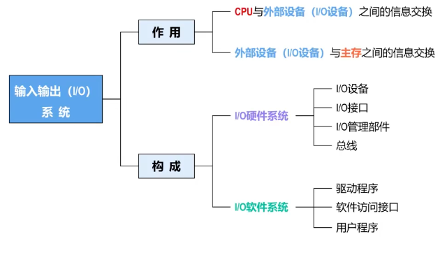

## 8-2 I/O设备及其特性

#### 定义
输入输出设备是计算机与人（或其他系统）进行数据交互的装置，也称为外部设备（简称外设）。
#### 分类
输入设备
负责将数据、文字、图片、音频、视频等转换成计算机可以识别的二进制信息的设备。
输出设备
负责将计算机的处理结果转换成数字、文字、图像、声音、视频等的设备。
### 输入输出设备的种类繁多
结构差异
机械式、电子式
信号差异
数字信号、模拟信号
性能差异
慢速（如串口设备），高速（如网络设备）
访问差异
顺序访问（字符设备），随机访问（块设备）

### I/O设备特性
- 异步性
  1. CPU运算速度极快（纳秒级），而I/O设备（如硬盘、键盘、打印机等）数据处理/传输速度极慢（毫秒级甚至更慢），若强制使用“公共时钟同步”，CPU需要持续等待慢速设备完成操作，导致运算资源被大量浪费。
  2. 采用异步通信：I/O设备自主准备数据（如硬盘读取、等待按键触发）时，CPU可执行其他进程/任务；仅当I/O设备完成数据处理后，通过中断机制主动向CPU发信号，此时CPU才会“暂时中断当前任务→执行中断服务程序（为I/O设备服务）→返回断点继续原任务”。
  3. 通过“并行+中断”机制，让CPU和I/O设备解耦依赖，双方在各自节奏下工作。

- 实时性
  不同速度的I/O设备（慢速/高速），在准备好数据后都需要CPU及时响应处理，否则：
  - 对慢速设备（如键盘、鼠标的按下）如果不及时响应，则会影响用户体验。
  - 对高速设备（如万兆网卡、高速数据采集卡）的数据如果不及时处理，则会产生数据丢失。
  - 对实时测控设备的信息如果不及时处理，则可能导致严重的事故（甚至灾难）。

- 独立性
  通过软硬件分层抽象，屏蔽不同I/O设备的差异，降低CPU与I/O设备的连接、控制等复杂度。
  - 硬件层面：各类I/O设备采用标准总线接口与CPU连接，使得不同I/O设备以一致方式接入系统，减少硬件设计的多样性和复杂度。
  - 软件层面：不同I/O设备采用统一的访问调用接口，使输入输出与具体设备类型无关，让程序无需关注I/O设备的硬件细节，只需通过访问调用接口操作外设。

## 8-3 I/O接口

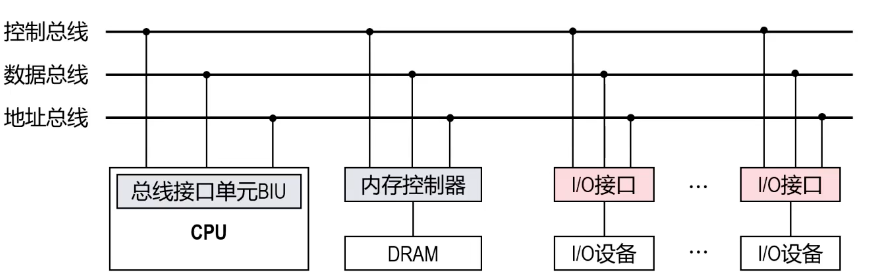

### I/O接口核心功能
- 设备寻址
- 设备控制
- 状态检测
- 数据交互
- 数据缓冲
- 格式转换
- 中断、时序控制、数据检错/纠错

### I/O接口的结构

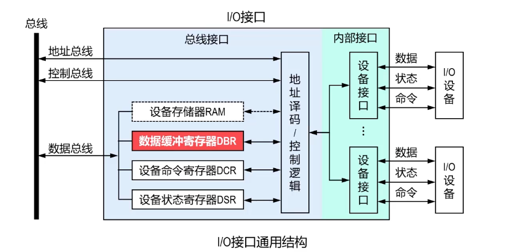

#### 数据缓冲寄存器DBR
用于数据缓冲，以协调CPU与I/O设备之间的速度差异。
- CPU进行读操作：DBR暂存从I/O设备读取的数据，进而被CPU通过总线
#### 设备命令寄存器DCR
接收CPU发来的设备控制命令（如复位、识别、读写等），进而实现对设备的控制。
- 不同设备所能支持的命令不同。
- 简单设备（如键盘输入和字符终端输出设备）可能没有DCR。
#### 设备状态寄存器DSR
用于向CPU反馈设备状态（如设备就绪、设备忙、设备错误等）。
- 在程序查询方式中，CPU通过去读DSR来判断设备的状态，以便确定程序下一步应执行的操作。
- 简单设备（如键盘输入和字符终端输出设备）可能没有DCR。
#### 地址译码
对地址总线传来的地址信号进行译码，以选中对应的设备接口及其内部寄存器，从而实现CPU与特定I/O设备之间的通信。
#### 控制逻辑
I/O接口的指挥中心，它根据CPU通过数据总线发来的控制命令，协调接口内部各寄存器的工作流程，并管理与外部I/O设备之间的“握手”通信（数据、状态、命令）。

#### 控制总线
传输的是协调总线操作本身的全局信号，主要用于时序控制、总线请求/应答、中断响应等。

### I/O接口的编址

### 统一编址
- I/O设备地址与主存地址统一编址，按不同地址区域来区分。
- 不需要专用的I/O指令，采用访存指令就可以访问I/O设备。

#### I/O地址分配
- I/O接口中的寄存器和存储器在统一地址空间中拥有唯一地址。
- 大部分I/O接口的地址在设计时已确定，软硬件都需要遵循约定。
- 扩展卡、热插拔设备等则在系统启动时动态分配地址。

#### 内存映射与缓存限制
- I/O地址被映射到主存空间，通过访存指令访问。
- 由于I/O接口数据动态变化（如设备状态实时更新），因此不能使用cache缓存，否则CPU无法获取最新状态。
#### 编程注意事项
- 在C语言中，访问I/O数据的变量应声明为volatile类型。
- 目的是防止编译器进行不当优化（如将变量缓存在寄存器中），以确保每次访问都直接从内存的I/O地址空间读取最新值。
#### 优点
- 不需要专用的I/O指令。
- 编程灵活。

#### 缺点
- 主存空间被I/O设备地址占用一部分。
- I/O设备地址与主存地址等长，因此，I/O接口中的译码逻辑复杂。

### 独立编址
- I/O地址（I/O端口）空间与主存地址空间相互独立。
- 必须使用专用的I/O指令访问I/O设备。

### I/O接口的软件架构

### I/O软件层次结构
在现代计算机系统中，用户不能直接访问I/O设备，必须通过操作系统间接访问并控制具体的I/O设备。
操作系统向用户提供层次结构的I/O软件，以屏蔽复杂的I/O设备细节。

#### 1. 用户态：与系统无关的I/O库函数
- 调用系统调用库函数实现I/O库。
- 增加缓冲机制，尽量减少对下层系统调用库的调用，减少上下文切换（用户态切换到内核态），提升性能。
- 向上层用户提供与操作系统无关的I/O库函数（如C语言中的printf()、scanf()、fopen()、fseek()、fread()、fwrite()、fclose()等）。
- 用户程序主要调用I/O库函数访问I/O设备，与操作系统无关，方便程序跨系统移植。

#### 2. 内核态：与设备无关的系统调用
- 通过访管指令进入内核态。
- 调用设备驱动程序实现系统调用库。
- 向上层提供统一的I/O调用接口（如UNIX系统open()、read()、write()、seek()、ioctl()、close()），屏蔽I/O设备底层访问细节。

#### 3. 内核态：设备驱动程序
- 通过I/O指令或访存指令访问接口内DBR、DCR、DSR，完成和硬件设备的数据、命令交互。
- 一般包含对应设备的中断服务程序。

### I/O接口的分类

| 分类角度 | 类型 | 主要特点 | 应用举例 |
| ---- | ---- | ---- | ---- |
| 数据传送方式 | 并行接口 | 多位数据并行传送，速度快，传输距离受限 | SCSI、IDE等接口 |
| | 串行接口 | 数据逐位传输，速度相对较慢，传输距离长 | SAS、SATA、USB等接口 |
| 接口的灵活性 | 可编程接口 | 可通过编程选择多种工作方式和功能 | 8255A（并行接口芯片）、8250（串行接口芯片） |
| | 不可编程接口 | 功能固定 | 地址译码器 |
| 通用性 | 通用接口 | 可供多种I/O设备使用，通用性强 | USB接口（可接键盘、鼠标、磁盘等）、雷电接口 |
| | 专用接口 | 为某类I/O设备或功能专门设计 | SATA（仅用于连接存储设备） |
| 总线传输的通信方式 | 同步接口 | 与总线之间的信息传输由统一的时钟信号控制 | PCI总线接口，SDRAM内存接口 |
| | 异步接口 | 与总线之间的信息传输采用应答方式控制 | UART（通用异步收发器，用于串口通信） |
| 访问I/O设备方式 | 多种 | 直接传送、程序控制、程序中断、DMA及通道处理机 | 程序控制：早期简单I/O芯片； 程序中断：现代I/O控制器均支持； DMA接口：DMA控制器（如8237A芯片）、现代硬盘/SATA控制器； 通道：大型机中的I/O处理器 |

### 8-4 I/O控制方式概述

1. 定义：I/O控制方式是指CPU与I/O设备进行信息交互时所采用的控制方式。
2. 发展趋势：随着计算机和I/O设备的发展，I/O控制方式经历了由简单到复杂、由低效到高效、由CPU集中控制到分散控制的发展过程。
3. 五类I/O控制方式：

    1. **程序直接控制（查询）方式**
    CPU按独占式查询策略或定时轮询策略读取I/O接口的状态寄存器DSR，以检查I/O设备是否就绪，这期间CPU完全或部分被占用。

    2. **中断驱动方式**
    I/O设备在完成自身操作后，主动向CPU发出中断请求。CPU在等待期间可以执行其他任务，收到中断请求后再处理数据传送，提高了CPU利用率。

    3. **直接存储器存取（DMA）方式**
    在DMA控制器的管理下，数据直接在I/O设备与主存之间成批传送，传送过程完全独立于CPU，仅在开始和结束时需要CPU干预。

    4. **通道控制方式**
    通道是一个专用于I/O操作的、可执行简单通道程序的处理器。CPU只需发出一个I/O指令启动通道，之后由通道独立管理整个I/O过程，能力比DMA更强。

    5. **I/O处理机方式**
    这是通道方式的进一步发展，I/O处理机功能更接近通用处理器，拥有独立的指令系统和存储，能处理更复杂的I/O任务和差错恢复，进一步将CPU从I/O负担中解放。

## 8-4 I/O 控制方式--直接控制方式

### 程序直接控制（查询）方式
#### 基本思想
CPU通过执行一段I/O程序来实现与I/O设备的数据交换，这是最原始、最简单的I/O控制方式。

#### 两种主要方式
##### 1. 程序查询方式（轮询方式，Polling）
- 每次数据传送前，CPU必须主动查询I/O设备状态。
- 属于有条件传送方式（I/O设备就绪后才操作）。
- I/O程序通过与I/O接口中的命令寄存器DCR、状态寄存器DSR以及数据缓冲寄存器DBR进行数据交互，实现设备控制和传输。

##### 2. 直接传送方式
- 无需查询I/O设备状态，直接进行数据交互。
- 属于无条件传送方式。
- 可视为程序查询方式的特例，一般适用于非常简单的I/O设备（如开关、LED显示）。

#### 注意
1. DCR、DSR、DBR这类寄存器的位宽、数量、功能定义随设备与厂商不同，编写驱动需遵循对应约定。
2. 不同I/O设备，程序查询流程存在差异。

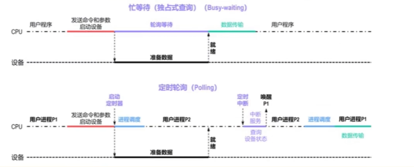
**独占式查询**
**定时轮询**

## 8-4 I/O控制方式--中断驱动方式

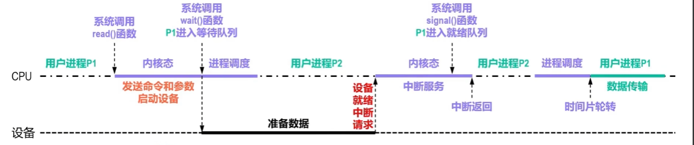

1. 基本原理
I/O设备在完成自身操作后，主动向CPU发出中断请求。CPU在等待期间可以执行其他任务，收到中断请求后再处理数据传送，提高了CPU利用率。

2. 对比程序查询方式的优势
- 相较于独占式查询策略：无需轮询设备状态。
- 相较于定时轮询策略：设备主动请求中断，实时性更好，无需选择定时器中断间隔。
- 整体效果：消除CPU轮询开销，大幅提升I/O效率，是现代计算机普遍采用的I/O技术。

3. 存在的额外时间开销
- 进程调度两次上下文切换时间
- 中断服务程序自身运行开销

4. 适用范围与局限
- 适用慢速设备：中断额外开销 < 设备准备数据耗时，效率提升。
- 不适合极高速I/O设备：设备准备数据时间短于中断开销，中断驱动效率低于独占式程序查询。

## 8-4 中断驱动方式

### 中断的作用和分类
#### 中断的作用
1. 提升并行性
外部设备主动“敲门”通知CPU，操作系统可在设备准备阶段调度CPU执行其他任务，实现CPU与外部设备并行工作。
2. 支持程序调试
通过设置断点（特殊中断）暂停程序运行，方便开发者观察中间结果与程序状态。
3. 实现故障与异常处理
- 硬件故障、软件异常触发中断并通知CPU；
- CPU立刻调用对应处理程序完成异常处理，提升系统可靠性。
4. 保障实时处理
- 适配现场测控、人机对话等实时场景；
- 依靠中断主动通知特性，保证关键数据及时响应处理。
5. 方便人机交互
键盘敲击、鼠标移动等外部输入，依靠中断机制告知系统。
6. 实现多任务调度
- 中断是多任务操作系统核心基础机制；
- OS依靠周期性定时中断回收CPU使用权，完成进程时间片轮转调度。
7. 支持多处理机系统交互
各处理器之间依靠中断完成信息交换、任务切换。

### 中断的分类
#### 一、内部异常
产生原因：通常由CPU执行指令引起，如未定义指令、越权指令、段页故障、存储保护异常、数据未对齐、除零异常、运算溢出、自陷调用、程序断点等；一般具有可预测性或可再现性。
1. 故障（Fault）
- 执行指令时发生异常，处理后可解决，需重新执行触发异常的指令。
- 系统保存指向故障指令本身的断点，用于返回重试。
- 举例：缺页异常，操作系统将数据从硬盘调入内存后，重新执行访问指令。
2. 自陷（Trap）
- 属于主动的异常。
- 异常处理完成后执行下一条指令，无需重跑触发异常的指令。
- 由程序员主动添加触发指令，用于跳转异常处理程序；例：系统调用int 0x80、syscall，处理完内核服务后返回用户态执行下一条指令。
3. 终止（Abort）
- 严重、不可恢复的错误。
- 多为硬件故障：内存校验错误、总线错误等。
- 系统仅记录错误信息，尽力安全关机。

#### 二、外部中断
产生原因：由CPU外部事件引起，多由外部设备触发，如定时器中断、I/O传输请求中断、I/O传输结束中断、设备故障中断；与程序无关，无预测性、不可重复。
1. 可屏蔽中断（INTR）
- 信号引脚：INTR
- 可被屏蔽，由IF标志控制
- 优先级最低
- 关中断时会被忽略
- 应用：键盘、磁盘、网卡等普通外设
2. 不可屏蔽中断（NMI）
- 信号引脚：NMI
- 无法屏蔽，必须响应
- 优先级最高
- 关中断时依旧响应
- 应用：硬件故障、掉电、关键定时器
### 向量中断/非向量中断

### 向量中断和非向量中断
#### 向量中断
1. 每种中断源预先分配唯一的向量地址，存储在中断向量表或硬件寄存器中。
2. 设备触发中断后，硬件自动根据中断源识别对应的向量地址。
3. CPU直接加载向量地址指向的中断服务程序（ISR），无需额外查询步骤，响应速度快。
4. 举例：x86系统中，外部中断通过可编程中断控制器（PIC）生成向量号，CPU据此从内存中读取ISR地址并执行。

#### 非向量中断
1. 多个设备可能共享同一中断请求线，硬件仅能识别“有中断发生”，无法直接定位具体设备。
2. CPU响应中断后，需通过软件逐个查询设备状态寄存器，确定触发中断的设备。
3. 根据查询结果，通过条件分支指令跳转到对应设备的ISR，流程相对繁琐，响应速度较慢。
4. 举例：早期ARM处理器中，外部中断请求（IRQ）可能由多个外设共享，需在中断服务程序（ISR）开头通过读取外设状态寄存器判断具体中断源。

### 单级中断/多重中断

- 对于单级中断，执行中断服务程序（ISR）时，不再响应其他中断请求。
- 对于多重中断，执行中断服务程序（ISR）时，可以被更高优先级的中断请求打断，也称为嵌套中断。
- 单级中断和多重中断都可以有多个中断源和中断优先级，二者的区别在于多个中断之间能否嵌套。
## 8-4 中断驱动方式--中断优先级与中断屏蔽

#### 中断优先级
1. 定义：中断优先级是CPU响应并处理中断请求的先后次序。
2. 多中断源同时请求规则
系统存在多个中断源，同时发起中断请求时，按优先级判定：高优先级先响应，低优先级后响应。
3. 多重中断（嵌套中断）规则
高优先级中断能够打断CPU正在运行的低优先级中断服务程序（ISR）。
4. 两层含义：中断优先级分为响应优先级、处理优先级。

### 响应优先级
1. 定义：CPU对同时来自多个中断源的中断请求进行响应的先后次序。
2. 特性：硬件设计阶段固定，无法随意修改。
3. 划分依据：依据中断事件的重要性、迫切性划分
- 优先级整体排序：不可屏蔽中断 > 内部异常 > 可屏蔽中断
- 内部异常内部：硬件终止(Abort)优先级最高，其次为故障(Fault)、自陷(Trap)等软件异常
- 传输类中断：DMA中断 > I/O设备传送中断
- I/O设备中断细分：高速设备高于低速设备、输入设备高于输出设备、实时控制设备高于普通设备

### 处理优先级
1. 定义：多重中断（嵌套中断）场景下实际的中断处理次序。
2. 两种情况
- 不使用中断屏蔽技术：处理优先级 = 响应优先级
- 使用中断屏蔽技术：可动态调整实际优先级，允许低优先级中断打断高优先级中断服务程序，中断处理更灵活
3. 现状：现代计算机普遍使用中断屏蔽技术
### 注意事项
1. 中断屏蔽仅对CPU运行中断服务程序ISR时的处理优先级（嵌套中断）起作用，不会影响CPU运行主程序时的中断响应优先级。
2. CPU运行ISR时若同时到达多个未屏蔽中断请求，处理优先级仍按照响应优先级处理。
3. IMR（中断屏蔽寄存器）的值仅在执行中断服务程序ISR时能够更新。

## 8-4 中断驱动方式--中断请求

如何将数量众多的外部中断源各自的中断请求信号与CPU进行有效的连
### 独立请求方式

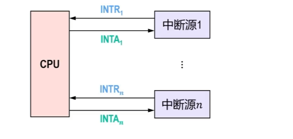
#### 优点
- CPU可以灵活处理中断优先级。
- 中断识别简单，通过简单的优先级编码电路实现。
- 方便实现向量中断，可快速找到中断服务程序。

#### 缺点
- 占用大量CPU引脚作为INTR信号线和INTA信号线。
- 系统难以扩展。
### 链式请求方式
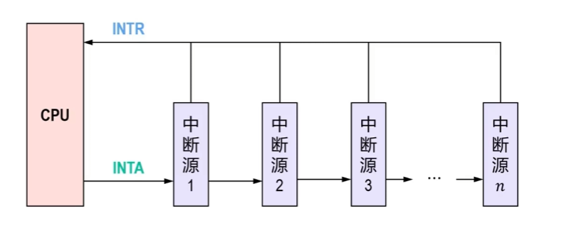

### 单线共享轮询法
1. 连接方式：所有中断源共用一条公共INTR中断请求线向CPU发送中断请求信号。
2. 特点：中断源识别流程复杂，分硬件查询、软件查询两种实现方式。
#### 硬件查询方法
- 依靠INTA中断应答信号链式串行传递，原理同总线链式查询仲裁。
- 优先级规则：链式路径里，离CPU越近的中断源优先级越高。
#### 软件查询方法
- 逻辑：公共中断服务程序依次轮询各外设I/O接口寄存器，判断是否产生中断；查到请求设备则跳转对应ISR，无请求则继续查询下一个。
- 优先级规则：由代码内轮询先后顺序决定，先查询的设备优先级更高。

### 单线共享轮询法优缺点
#### 优点
系统扩展性好。添加中断源只需接入公共的中断请求INTR线，无需额外布线，硬件实现简单。

#### 缺点
1. 中断源识别过程复杂。
2. 硬件查询方法：中断优先级由设备在链式串行传递中的物理位置固定，无法通过软件灵活调整。
3. 软件查询方法：需逐个轮询设备状态寄存器（需要CPU发起相应的总线事务）。

### 分组链式请求方式
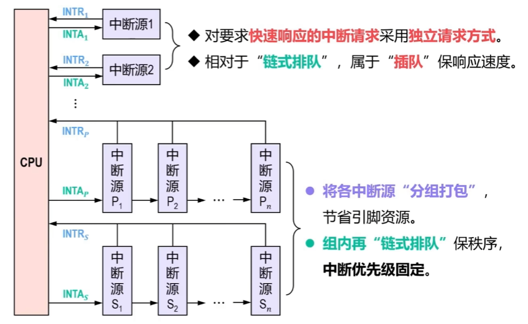

分组链式请求方式通过“二维分层”，用结构设计平衡了引脚资源消耗与中断响应速度。

### 中断控制器方式

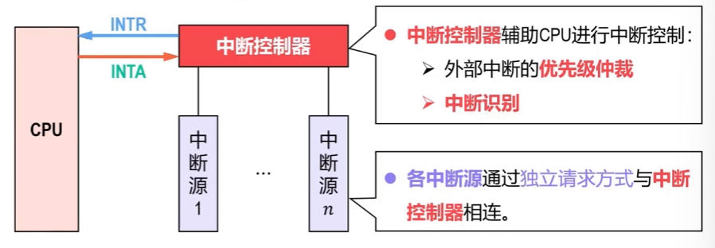

1. 有中断源发出中断请求。
2. 中断控制器进行中断优先级仲裁和中断识别后，通过中断请求INTR信号线向CPU发送中断请求。
3. CPU通过中断响应INTA信号线给中断控制器发送中断响应。

## 8-4 中断驱动方式--单级中断的处理流程

### 中断响应条件
1. 相应的中断请求未被屏蔽。
2. 当前没有更高优先级的其他中断请求。
3. 若CPU正在执行中断服务，则中断请求应符合中断嵌套条件。
4. 中断使能位处于使能状态（开中断）
    注意：内部异常、不可屏蔽中断NMI不受本条限制。
5. CPU执行完一条指令最后一个状态周期，处于可中断时机
    注意：内部异常指令无法执行完毕，中断时机不受本条限制。
### 单级中断的处理流程

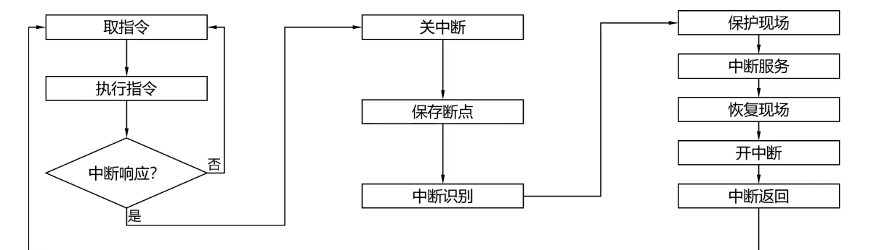

### 8-4 中断驱动方式--多重中断的流程

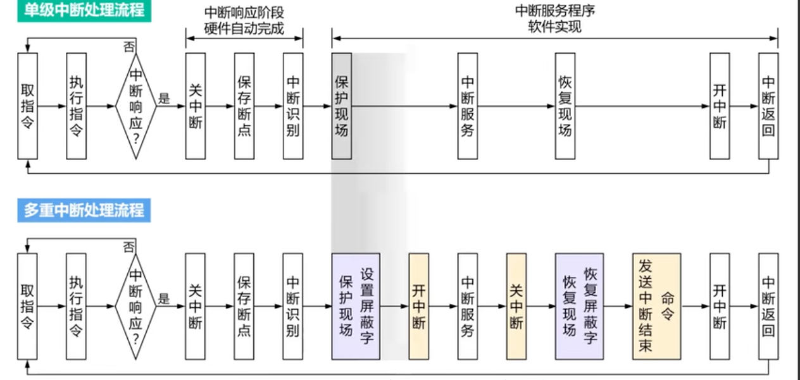

### 8-5 I/O控制方式--DMA方式

### 程序查询与中断驱动I/O的共同缺陷
1. 共性特点
程序直接控制（查询）方式和中断驱动方式，都需要CPU全程参与每一次I/O数据传输。
2. 数据传输流程
数据必须先从I/O设备读取到CPU的寄存器，再从寄存器写入主存（写操作流程相反）。
3. 大数据量场景弊端
- 适用场景：磁盘读写、网络数据包传输等大数据量传输场景
- 性能问题：频繁中断+寄存器中转会大量占用CPU时间，系统整体性能下降
- 表现：CPU忙于搬运数据，无法高效执行其他计算任务

### DMA方式
1. 核心硬件：引入独立硬件模块DMA控制器DMAC
- 大数据块传输时，DMAC临时向CPU借用总线控制权，直接控制I/O设备与主存之间的数据传输，数据不经过CPU寄存器。

2. DMA传输过程
① CPU访问DMAC接口，配置DMA传输参数（主存地址、数据块长度、传输方向等）。
② CPU向I/O设备接口发送命令与参数，启动I/O设备。
③ 数据传输期间，CPU可并行执行其他程序。
④ I/O设备需要传输数据时，DMAC向CPU申请总线控制权完成数据传输。
⑤ 整块数据传输完成后，DMAC发送中断请求，CPU处理缓冲区与DMAC收尾工作。

3. DMA技术作用
DMA是计算机重要性能优化技术，依靠硬件接管数据传输，解决I/O操作CPU开销大的瓶颈；将CPU从数据搬运工作释放，专注计算任务，是高效处理视频、文件读写、网络通信等大量I/O操作的基础。

### DMA控制器

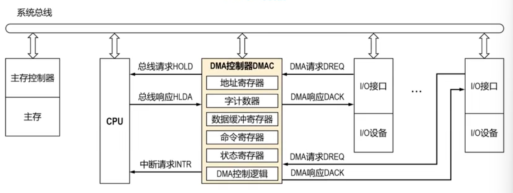
其中每个DMAC都要讲解

### DMA操作流程

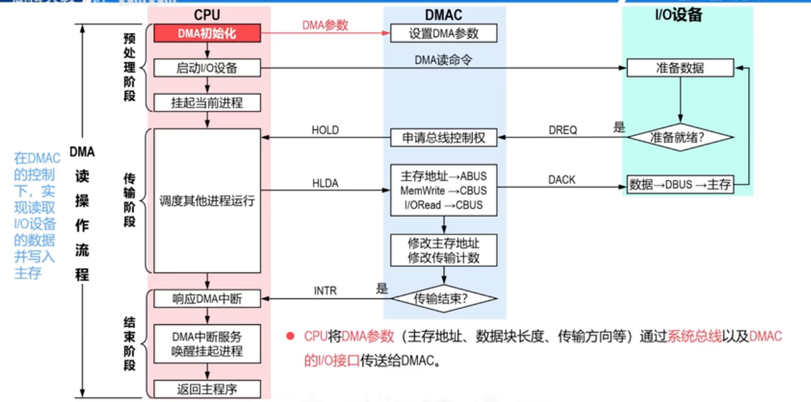

### 解决DMAC与CPU争用主存的三种常用方式
#### DMA独占访问
1. I/O设备采用DMA传输时，DMAC申请总线控制权，让CPU暂停访问主存。
2. DMAC拿到总线控制权后持续传输，直至整个数据块传输完成。
3. 传输完毕，DMAC归还总线控制权，通知CPU恢复使用主存。
流程：CPU访问主存 → DMAC独占访问主存传输整块数据 → 归还总线后CPU恢复访问
#### 优点
1. 控制简单
2. 适合I/O设备与主存速度相近场景
3. 适用于DMA传输期间CPU无需访问主存的场景

#### 缺点
当I/O设备与主存速度差距较大时，主存利用率低，CPU会长时间无法访问主存。
#### 交替访问

1. 核心机制
- DMAC不需要执行总线控制权申请、建立、交换流程。
- 将访存周期划分为两个固定时隙，分别分配给CPU、DMAC；二者在各自时隙访问内存，互不干扰。

2. 优点
- 无访存冲突，时序确定性高。
- DMAC无需实现复杂的总线申请、仲裁、释放逻辑。

3. 缺点
- 若CPU或DMAC当前时隙无访存需求，对应时隙会闲置，造成资源浪费。

4. 适用场景
对实时性、可预测性要求极高，负载固定的嵌入式/专用硬件；不适合I/O与CPU负载多变的通用计算机。
#### 周期挪用
1. 工作机制
仅在DMAC需要传输数据时，临时挪用一个存储周期传输1个机器字，传输完成立刻归还总线控制权给CPU，不会长时间独占总线。
2. 两种冲突场景
- CPU在挪用周期无访存需求：本次挪用不影响CPU性能。
- CPU同期也要访问主存（冲突）：DMAC优先访问主存，CPU访存延迟一个周期，性能损耗最小。
3. 挪用时机
挪用操作可发生在CPU指令周期任意一个机器周期结束时刻。
4. 性能优势
DMA传输不改动CPU寄存器、程序状态，无需像中断那样保存/恢复现场，切换效率更高。

### DMA方式与中断驱动方式的对比
|对比维度|中断驱动方式|DMA方式|
| ---- | ---- | ---- |
|请求-应答机制|请求的是CPU时间。 响应时机在指令周期结束时刻。|请求的是总线控制权。 响应时间在一个总线事务完成后。|
|数据传送实现方式|通过CPU执行程序实现数据传送。 需要保护和恢复程序执行现场，影响系统性能。|通过额外的硬件（DMAC）实现数据传送。 不改变CPU现场，不影响系统性能。|
|主要应用|处理各种随机事件。|大量、高速的数据传输。|

● DMA方式是中断驱动方式的进一步发展：
➢ 在数据传输的核心阶段（数据块传送），通过DMAC接管总线控制权来“解放”CPU的参与，从而实现了更高的效率。
➢ 但在传输的开始阶段，仍需要CPU参与设置DMA参数；在结束阶段，DMAC会通过DMA中断请求通知CPU。