## 6-1 中央处理器概述

中央处理器（Central Processing Unit，CPU），是整个计算机的核心。
- CPU会按照指令的要求，控制计算机的各部件协调工作，并且还要对信息处理过程中出现的异常情况进行处理。
- CPU上电复位后，就进入了“取指、译码、执行指令”的永久工作循环。

### CPU的具体功能
1. 程序控制
    - 控制程序的执行顺序
        - 通常情况下，程序中的指令按存储顺序自动执行。
        - 若遇到分支指令且分支条件满足、或者遇到跳转指令，则会改变程序的执行顺序，CPU必须能够正确获取到下一条指令的地址。
2. 操作控制
    - 产生指令执行过程中所需的若干操作控制信号，以控制相应部件按指令规定的操作正确运行。
3. 时序控制
    - 控制每个操作控制信号的开始时刻和持续时长，以便按规定的时序执行每个操作。
4. 异常和中断处理
    - 出现内部异常或外部中断请求时，CPU应暂时中断当前执行的程序并进行异常或中断处理，处理完成后，还要返回断点继续执行程序。
        - “未定义指令”、“整数除零”、“缺页”都属于内部异常。
### CPU的基本组成

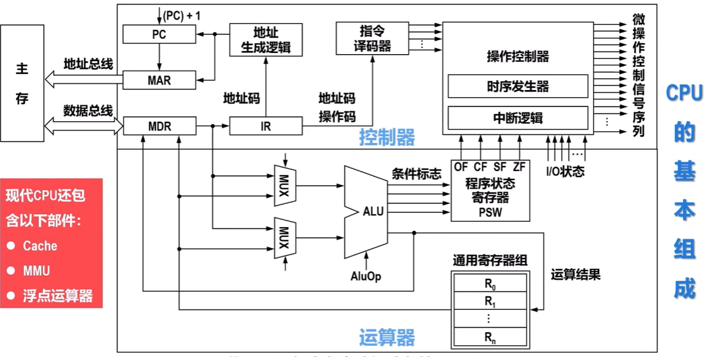

PC,PSW,通用寄存器组是对用户(汇编程序员)可见的

## 6-2-1 指令执行的一般流程

- 计算机的本质任务，就是运行事先编制好并存放在主存中的程序，进而实现用户应用。
- CPU内的控制器按照程序所对应的机器指令序列逐条执行指令。
- CPU上电复位后，就进入“取指、指令译码、执行指令”的“永久循环”。
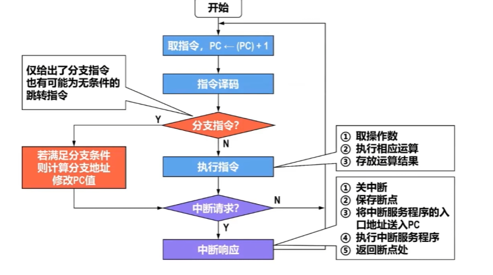

## 6-2-2 指令执行的指令周期

### 指令周期
- 指令周期是指CPU从主存取出并执行一条指令所需要的时间。
- 无条件转移指令（例如JMP ADDR），只需要取指阶段（包含译码）和执行阶段。
- 采用间接寻址方式的指令，需要进行2次访存才能取出操作数（先取操作数有效地址、然后从有效地址处取出操作数），因此，需要取指阶段、间址阶段和执行阶段。

- 当指令执行完毕后如果出现中断请求，CPU将进入中断响应阶段，进行保存断点、将中断处理程序入口地址送入程序计数器PC，进而实现当前程序与中断处理程序的切换。
- 综上所述，一个完整的指令周期包含取指周期、间址周期、执行周期和中断周期4个阶段。

指令周期分段图示：取指周期 → 间址周期 → 执行周期 → 中断周期，四段整体构成完整指令周期

- 以上仅仅是一种典型的指令周期划分方式，但这并不意味着所有架构的计算机都是这样划分指令周期的。
- 除上述4个阶段外，还可能包括：
  - 总线周期：完成总线操作以及总线控制权转移所需要的时间。
  - I/O周期：完成输入/输出操作所需要的时间。
- 不同指令的指令周期可能不同，例如：
  - 无条件转移指令的指令周期仅包含取指周期和执行周期。
  - 采用间接寻址方式的指令，其指令周期至少包含取指周期、间址周期和执行周期。

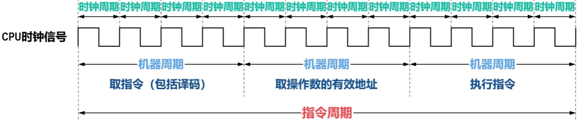

每个指令周期所包含的机器周期的数量、每个机器周期所包含的时钟周期的数量并不一定是固定的，这与处理器架构的具体实现有关，一般分为以下两种：
- 定长指令周期（早期计算机）
  所有指令的指令周期相同（指令周期所包含的机器周期的数量固定、机器周期所包含的时钟周期的数量也是固定的）。
- 变长指令周期（现代计算机）
  各指令按时钟周期（而不是机器周期）进行同步，每条指令的执行所需的时钟周期数量“按需分配”，因此，机器周期的概念逐渐消失。

## 6-2-3 指令周期各阶段的数据流

### 数据流
- 数据流是指为实现指令功能需要依次访问的数据序列。
- 在指令周期的不同阶段，需要依次访问的数据序列是不同的。
- 不同指令的数据流很可能不同。

### 取指周期的数据流

根据程序计数器中的值从主存中取出指令并将指令送入指令寄存器IR

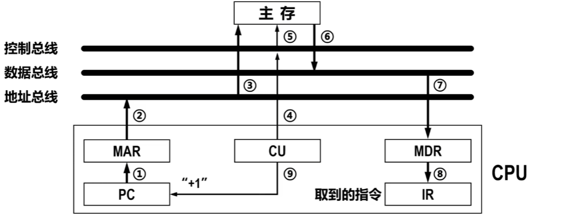

### 间址周期的数据流

根据指令中的地址码从主存中获取操作数的有效地址

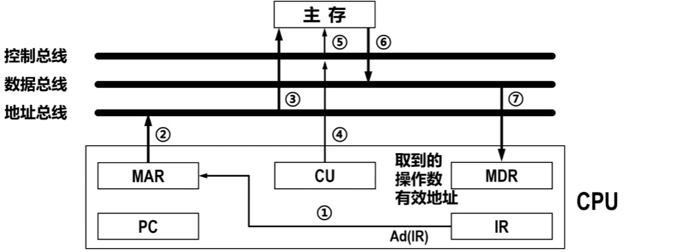

### 执行周期的数据流

- 不同的指令在执行周期的操作不同，可能涉及以下操作：
  - CPU内部寄存器之间的数据传送
  - 对主存（或I/O）进行读写操作
  - 对算术运算单元ALU的操作
- 综上所述，执行周期无法用统一的数据流图表示。

### 中断周期

保存断电、将中断服务程序的入口地址送入PC

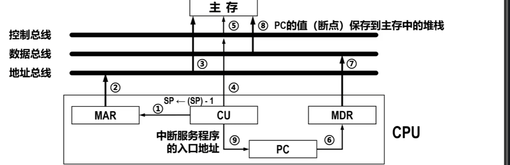

## 6-3-1 数据通路
- 数据通路是指数据在各功能部件之间传送的路径。
  - CPU内部的数据通路是指运算器与各寄存器之间的数据传送路径。
- 数据在数据通路中的传送操作需要在控制信号的控制下进行。
- 不同指令在指令周期的不同阶段可能使用不同的数据通路。
- 同一指令在指令周期的不同阶段也可能使用不同的数据通路。
- 综上所述，数据通路的结构对CPU内各种数据的传送路径、各种指令执行所需要的微操作（最基本的、不可再分割的动作）控制信号以及控制器的设计等都有重要影响。
- 数据通路的基本结构可分为：
  - 总线
  - 专用通路

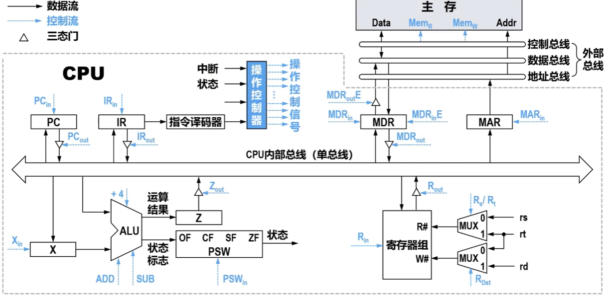

- 对于采用单总线结构的CPU内部总线，CPU内的运算器、控制器、专用寄存器、通用寄存器等核心部件都通过这条内部的公共总线连接。
  - 同一时刻只能有一个部件向总线发送数据，否则会出现数据冲突。因此，连接到总线上的部件都需要进行输出控制（使用图中所示的三态门），以防止总线上出现数据冲突。而各部件可同时接收总线上的数据。
- 本例中的单总线并不是指由一根物理传输线构成的总线，而是指CPU内各部件都共享该公共总线来传输信号。

## 6-4-1 控制器--CPU的时序及其控制方式

早期计算机采用**三级时序**对操作控制信号进行定时控制。

状态周期：完成一个基本操作（如取指、计算、执行）的时间单元（如取指周期、计算周期、执行周期）。

节拍电位：由状态周期划分出的若干个操作阶段（如PC → MAR）

节拍脉冲：节拍电位内的同步信号，用于触发具体微操作（如寄存器的写操作）

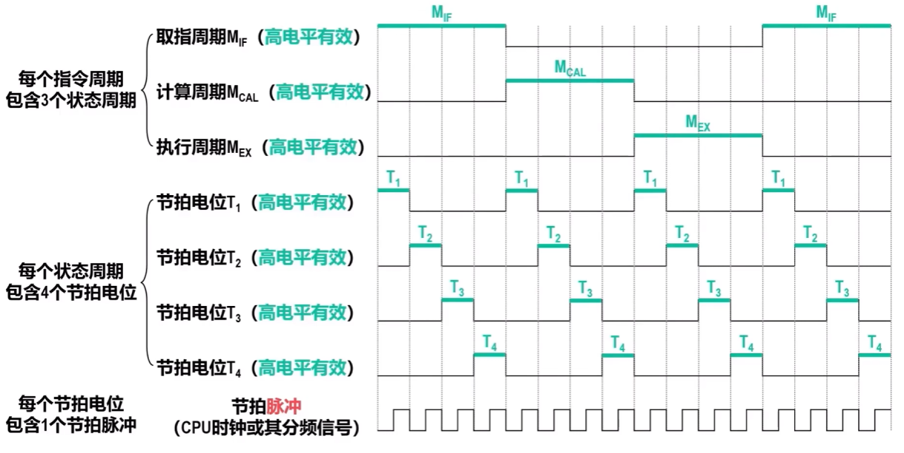

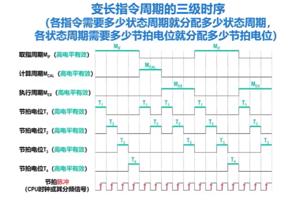

以上介绍的两种对控制器产生控制信号进行时间控制的方式都属于同步控制方式。

同步控制方式将各部件中最长操作时间作为标准时间间隔，各部件都在该时间间隔内启动并完成操作。

同步控制方式的时序关系比较简单，因此控制器的设计比较方便。然而，如果存在慢速部件，则CPU效率较低。

根据同步粒度（状态周期数量是否可变、节拍电位数量是否可变）的不同，同步控制方式还可进一步分类，例如以上介绍的定长指令周期和变长指令周期各自的三级时序。

### 同步控制方式
- 将各部件中最长操作时间作为标准时间间隔，各部件都在该时间间隔内启动并完成操作。
- 时序关系比较简单，因此控制器的设计比较方便。然而，如果存在慢速部件，则CPU效率较低。

### 异步控制方式
- 没有统一的CPU时钟信号，也没有固定的状态周期和节拍电位，执行各条指令需要多长时间就分配多长时间。
- 控制器对各功能部件的控制采用应答机制：控制器给功能部件发送操作控制信号后，必须等到功能部件发回应答信号才能开始下一步的操作控制。
  - 例如CPU访问内存（主存）时，可以采用内存的“READY”引脚发送的应答信号作为读写周期的结束信号。
- 各部件可按各自所需的时间工作，不存在快速部件等待慢速部件的情况，因此提高了系统速度。然而，异步控制方式的实现结构比较复杂。

### 联合控制方式
- 将同步控制方式与异步控制方式相结合。
  - 对于占大多数的、时间固定的操作，采用状态周期、节拍电位进行同步控制。
  - 对于少量的、时间难以确定的操作，采用异步控制方式。

## 6-4-2 控制器时序发生器

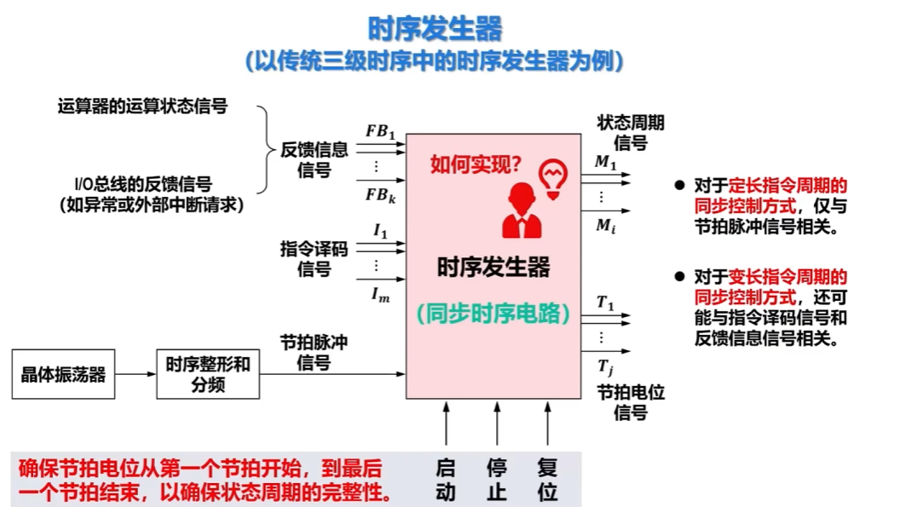

## 6-4-3 硬布线控制器

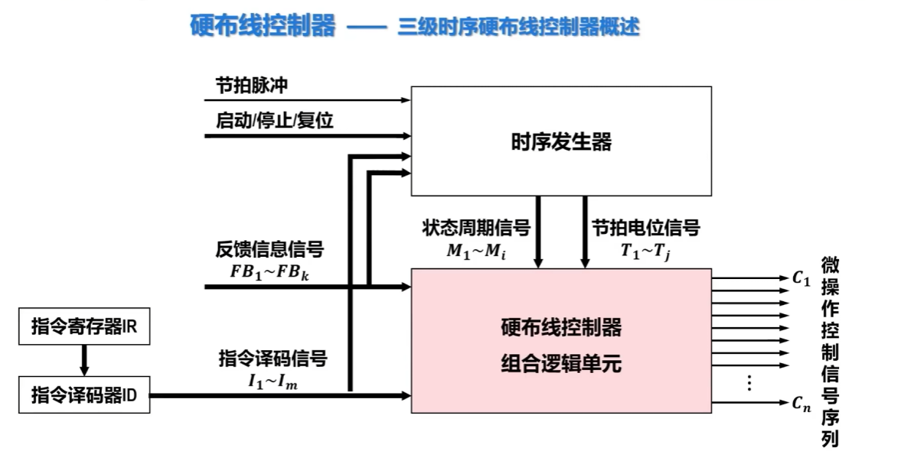

硬布线控制器是控制器的一种，用于产生操作控制信号。
- 根据指令集中各指令在不同状态周期、不同节拍电位以及不同的反馈信息条件下产生不同的操作控制信号，对指令执行过程中数据通路相关部件进行控制。
- 采用时序发生器产生的状态周期信号和节拍电位信号对操作控制信号进行定时控制，可以使控制器在不同的状态周期、不同的节拍电位向不同部件发送各种操作控制信号，并且确保信号的产生时间和持续时间。这样就可以协调各部件之间进行正确的操作，从而实现指令的功能。

硬布线控制器也称为组合逻辑控制器，由各种类型的逻辑门电路和触发器构成。
- 内部结构相对复杂但速度较快。
- 目前RISC指令集的处理器广泛采用硬布线控制器。

## 6-4-3  控制器--三级时序硬布线控制器设计

### 三级时序硬布线控制器的一般设计流程
① 对指令集中每一条指令执行时的数据通路进行分析，得出每一条指令的执行操作流程和每一步操作所需的控制信号。
② 将每一条指令的每一个微操作划分到相应状态周期的具体节拍电位信号上，也就是对操作控制信号进行定时控制。
③ 按照控制信号的同步控制方式（如定长指令周期、变长指令周期），构造相应的时序发生器。
④ 对于每一个控制信号，都要分析其在不同指令、不同状态周期以及不同节拍电位下是否有效，进而写出每一个控制信号的逻辑表达式。
⑤ 采用逻辑门、可编程逻辑阵列PLA或ROM实现每一个控制信号的逻辑表达式的功能。进而实现硬布线控制器的核心，也就是硬布线控制器组合逻辑单元。

## 6-4-4 控制器--现代时序硬布线控制器

### 现代时序硬布线控制器的一般设计流程
① 对指令集中每一条指令执行时的数据通路进行分析，得出每一条指令的执行操作流程和每一步操作所需的控制信号。
② 将每一条指令的每一个微操作划分到具体的时钟周期，也就是对操作控制信号进行定时控制。
③ 以时钟周期为单位画出指令执行的状态转换图，得出状态转换表，构造相应的有限状态机FSM。
④ 统计每一个控制信号产生的所有状态条件，进而写出每一个控制信号的逻辑表达式。
⑤ 采用逻辑门、可编程逻辑阵列PLA或ROM实现每一个控制信号的逻辑表达式的功能。

## 6-4-5 微程序控制器的相关基本概念

#### 微程序控制的核心思想
模仿“程序设计”的方式。
① 将指令集中每一条指令执行所需的相关控制信号按照某种规则编码成微指令。
② 使用相关的微指令，为每一条指令编写相应的微程序以实现指令功能。微程序由若干微指令构成。
③ 将每一条指令的微程序全部存放在一个只读存储器ROM中，这种存储器位于CPU中，称为控制存储器。
相较于硬布线控制器采用硬件时序对控制信号进行定时控制，微程序控制器采用软件时序对控制信号进行定时控制，简化了复杂的控制逻辑，提高了设计的灵活性和可维护性。
### 微命令和微操作

- 控制部件向执行部件发送的各种控制信号称为微命令。
- 执行部件收到微命令后执行的相应操作称为微操作。

微操作是执行部件的最基本操作。为了对数据通路及各功能部件的使用不产生冲突，微操作可分为相容性和互斥性两种。
- 相容性微操作：可以同时执行的微操作，或可以在同一个机器周期内并行执行的微操作（如$PC_{in}$、$MAR_{in}$、$IR_{in}$等微命令相应的微操作）。
- 互斥性微操作：不可以在同一个机器周期内并行执行的微操作（如主存读写控制$Mem_R$与$Mem_W$、所有向CPU内部单总线输出控制$XXX_{out}$、运算器控制ADD、SUB、+4等微命令相应的微操作）。

### 微指令和微程序
- 在一个机器周期中，一组实现某一特定操作功能的相容性微命令就构成了一条微指令。
  - 这些微命令各自产生相应的微操作控制信号，控制执行相应的一组微操作，实现一条指令的部分功能。

- 一般情况下，取指周期的操作会被编制成一段公共的微程序（即取指指令），称为取指微程序。
  - 取指微程序从控制存储器的0号地址单元开始存储。系统上电时会自动从取指微程序开始执行。
  - 取出指令后再依据指令译码情况进行分支跳转，跳转到相应指令的微程序入口地址。
  - 微程序中微指令的译码分支跳转取决于微指令的译码测试位$P_0$。
    - 取指指令的微程序中的最后一条微指令的$P_0$位应设置为1，表示并不需要检查其他状态条件，直接依据译码情况进行分支跳转。

综上所述，指令的相应微程序的执行，会控制该指令执行所需要的控制信号按照相应顺序（即微程序中微指令的执行顺序）依次有效，这实际上是一种软件时序控制。

### 微指令周期
- 微指令存储在CPU内的控制存储器中，只有将其从控制存储器读出后才能执行。
- 从控制存储器取出并执行一条微指令所需的时间称为微指令周期（简称微周期）。
  - 在微指令的串行执行方式下，将一个微指令周期设计为与一个机器周期相同，则可以在一个机器周期内处理一条微指令。

## 6-4-5 控制器--微程序控制器组成
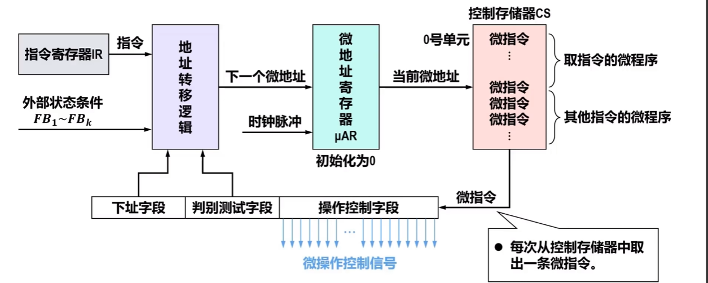

## 6-4-5 控制器--下一个微地址的形成

### 下址字段法（断定法）
在微指令中设置专门的下址字段。
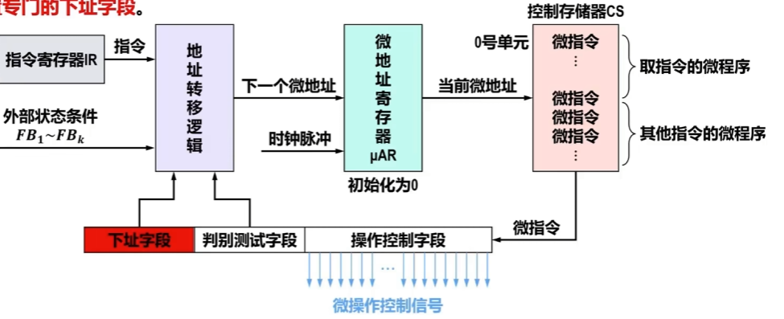
### 计数器法
采用与程序计数器PC类似的思想，即微地址自动“加1”。
- 因此，微指令中无需包含下址字段，这样可以有效减少微指令的长度，进而减少对控制存储器的容量需求。
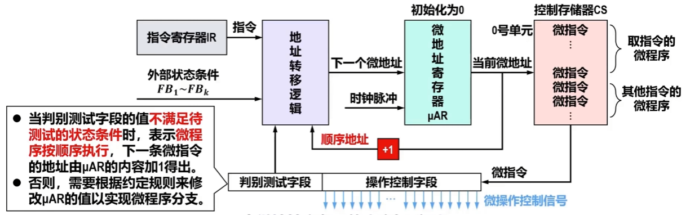
### 地址转移逻辑

#### 下地址法的地址转移逻辑

#### 计数器法地址转移逻辑

## 6-4-5 控制器--微指令设计
### 下地址法

### 计数器法
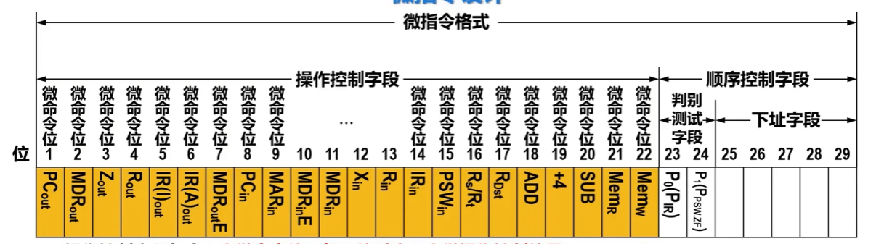

## 6-4-5 控制器--微程序设计

## 6-4-5 控制器--微指令中操作控制字段的表示方法

## 6-4-5 控制器--水平微指令和垂直微指令
| 对比项目 | 水平型微指令 | 垂直型微指令 |
| ---- | ---- | ---- |
| 设计思想 | 面向数据通路，直接控制硬件信号（高并行） | 面向操作算法，接近机器指令（高结构化） |
| 编码方式 | 操作控制字段采用直接表示法、编码表示法（字段译码法）、混合表示法 | 微操作码字段 + 微地址码字段 |
| 并行性 | 一条微指令控制数十个微操作（并行） | 一条微指令通常只控制1到2个微操作（串行化） |
| 所需控制存储器的空间 | 所编制的微程序短，需要存储空间小 | 所编制的微程序长，需要存储空间大 |
| 可读性/编程难度 | 可读性差（类似二进制位操控），编程难度大，较难维护 | 可读性好（类似汇编语言），相对容易编程 |
| 典型应用 | 追求极致性能的硬件加速场景（如CISC处理器、FPU、早期GPU、高性能DSP） | 资源受限或控制简单的场景（如微控制器MCU、RISC处理器的异常处理、简单I/O控制器） |

现代处理器常采用混合型微指令（如水平型为主，局部用垂直型优化），兼顾性能与灵活性。
##  6-4-5 控制器--微程序控制器的设计流程
① 对指令集中每一条指令执行时的数据通路进行分析，得出每一条指令的执行操作流程和每一步操作所需的控制信号。

② 将每一条指令的每一个微操作划分到相应状态周期的具体节拍信号上，也就是对操作控制信号进行定时控制。

③ 以时钟周期为单位画出指令执行的状态转换图，得出状态转换表，构造相应的有限状态机FSM。

④ 设计微指令格式（水平型微指令和垂直型微指令）、微命令编码方法（操作控制的直接表示法、编码表示法以及混合表示法）。

⑤ 根据指令执行的有限状态机FSM编写指令集中每一条指令相应的微程序，按照FSM将全部微程序排列并存放到控制存储器CS中。

⑥ 根据全部微程序在CS中的组织方式，构建微程序控制器中的地址转移逻辑、微地址寄存器μAR、控制存储器CS之间的通路，进而实现微程序控制器。
## 6-5-1 异常与中断--相关基本概念

#### 2.1 总类：中断
CPU 在正常执行程序过程中，收到来自外部硬件或 CPU 内部异常的信号，暂时停止当前程序，转去执行对应的处理程序，处理完成后返回原程序继续执行的机制，分为**外部中断**与**内部异常（内部中断）**两大类。

#### 2.2 外部中断（Interrupt）
- 触发来源：CPU 外部硬件设备（键盘、磁盘、定时器、网卡等）异步触发，和当前执行指令无绑定关系。
- 触发时机：任意时钟周期都可能产生，属于异步事件。
- 典型例子：定时器计时到、硬盘完成读写、键盘按键、IO 设备就绪。
- 处理特征：中断返回后，重新执行被打断的那条指令。

#### 2.3 异常（内部中断 Exception）
CPU 执行当前指令时，指令本身引发的内部同步事件，仅在特定指令执行阶段触发，分为 Fault、Trap、Abort 三类。
##### 2.3.1 故障 Fault
指令执行中途触发，CPU 会保存现场，修复问题后**重新执行出错指令**。
- 可恢复故障：缺页异常（页面置换后重新访问内存）、段缺失；
- 不可恢复故障：内存保护违规、非法地址访问，无法修复，程序通常崩溃。

##### 2.3.2 自陷 Trap
指令执行完成后触发，是主动、有意触发的异常，用于系统调用、断点调试。
- 特征：处理完陷阱服务程序后，执行**下一条指令**，不会重复执行触发指令。
- 典型例子：`int 0x80` 系统调用、调试断点指令。

##### 2.3.3 终止 Abort
严重硬件故障，无法确定出错指令位置，现场无法恢复，直接终止程序，无返回操作。
- 典型例子：总线错误、内存校验错误、硬件致命故障。

### 三、核心区分要点
#### 3.1 同步/异步特性区分
- 外部中断：异步事件，与当前执行指令无关，任意时刻均可触发；
- 异常（内部中断）：同步事件，仅由当前正在执行的指令直接引发。

#### 3.2 指令重执行规则区分
1. Fault（故障）：回到出错指令，重新执行；
2. Trap（自陷）：跳过触发指令，执行后续下一条指令；
3. Abort（终止）：无法恢复现场，不返回、不重执行任何指令。

## 6-5-2 异常和中断的处理过程
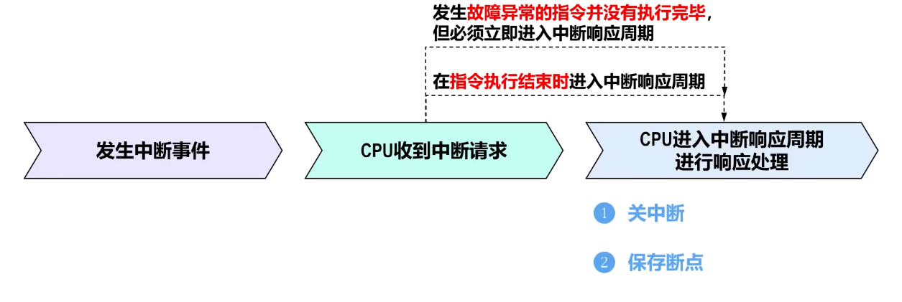
### 1 关中断
- 临时禁止中断请求：为了在中断响应周期的操作以及后续进入的中断服务程序中进行保护现场的操作的完整性，以确保中断服务程序执行完毕后能够返回断点正确执行。
  - 对于单级中断，只有在中断返回时才需要开中断。
  - 对于多级嵌套中断，完成现场保护后就可以通过指令开中断，以方便中断嵌套。

### 2 保存断点
- 保存中断服务程序结束后应返回到的、之前被中断的程序中的位置。
  - 对于已经执行完毕的指令，应保存的断点是下一条指令的位置（有可能不是顺序指令地址）。
  - 对于缺页故障、段错误等执行指令引起的故障异常，由于指令并没有执行成功，因此保存的断点应该是异常指令本身的PC值，以便异常处理后重新执行该指令。
- 为了支持多级嵌套中断，对于x86架构，硬件自动将断点压入内存堆栈，通过栈的LIFO特性天然支持多级嵌套；对于MIPS架构，硬件仅将断点存入易被覆盖的异常指令寄存器EPC，需由软件在中断服务程序中立即将EPC的内容保存至内存（如内核栈），否则嵌套发生时新中断会覆盖EPC从而导致原始断点丢失、无法正确返回。

### 3 中断识别
- 根据当前的中断请求识别出中断来源，即识别出具体发生了什么中断，并将该中断的中断服务程序入口地址送入PC。

#### 注意要点
- 中断响应周期内的操作全部由硬件实现、并且不可被打断。
- 中断响应周期结束后，CPU从当前PC中取出中断服务程序的第一条指令开始执行，直到中断返回。这部分任务是软件实现的。
- 综上所述，整个中断处理过程是硬件和软件协同实现的。
  - 下节课介绍中断处理的相关硬件。
## 6-5-3 异常与中断--为CPU增加中断处理功能数据通路部分
.
.
.
