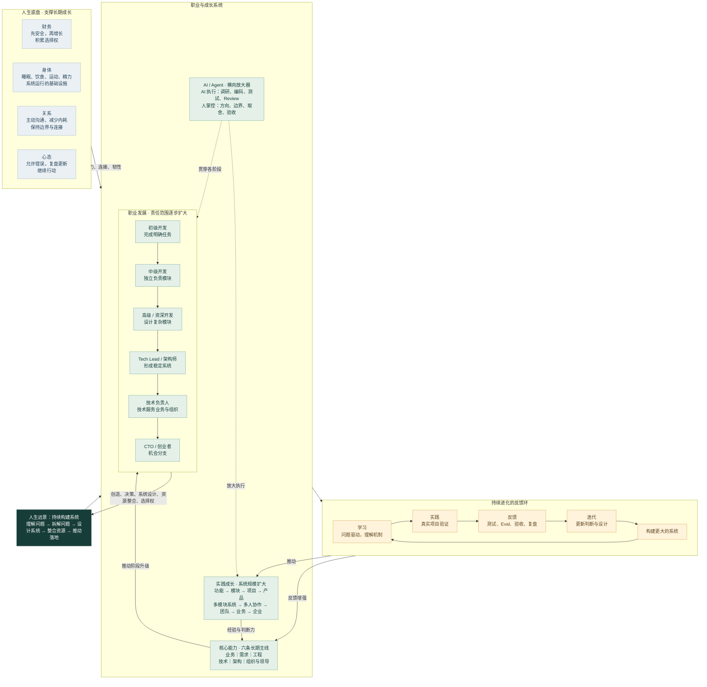

# 人生战略地图 / Life Map

> 持续解决更大的问题，构建更成熟的系统，逐渐获得更强的创造能力与人生选择权。

## 地图的读法

- **远景**：职位是阶段载体。长期目标是理解问题、设计系统、整合资源，推动复杂事情落地。
- **职业**：从完成任务、独立负责模块，走向复杂系统、团队与组织；CTO / 创业是机会分支，不是必达终点。
- **能力**：六条长期主线协同增长，推动责任范围扩大。
- **AI**：贯穿各阶段，放大执行能力；人负责方向、判断、边界与验收。
- **实践**：真实问题产生经验，复盘形成工程、技术、业务和系统判断，再增强能力。
- **底盘**：财务、身体、关系和心态提供长期运行所需的安全、精力、连接与韧性。

## 职业阶段

| 阶段 | 核心问题 | 重点能力 |
|---|---|---|
| 初级开发 | 能否正确完成明确任务？ | 编码、Debug、Git、数据库、API、测试、工程规范、AI 辅助开发 |
| 中级开发 | 能否独立负责完整模块？ | 需求理解、模块 / 接口 / 数据设计、边界、异常处理、测试验收、AI 驱动效率 |
| 高级 / 资深开发 | 能否设计复杂模块并解决复杂问题？ | 系统设计、性能、稳定性、可维护性、选型与取舍、复杂定位、跨模块理解 |
| Tech Lead / 架构师 | 能否让多模块和多人协作形成稳定系统？ | 系统边界、架构、数据流、技术决策、演进、复杂度控制、协作、风险管理 |
| 技术负责人 / CTO | 能否让技术服务业务和组织？ | 业务理解、技术战略、团队建设、成本收益、产品判断、资源配置、人才判断、长期规划 |

## 六条长期能力主线

1. **业务能力**：理解用户与客户、真实问题、业务流程、商业价值和成功标准；从接收任务走向判断应该做什么。
2. **需求能力**：澄清模糊需求，拆解目标、场景、功能、优先级、边界、输入输出、异常和验收标准；让想法可开发、可测试、可验收。
3. **工程能力**：掌握项目结构、模块边界、数据流、API、数据库、状态、日志、测试、部署、可维护性和可观测性；让系统长期运行并迭代。
4. **技术能力**：当前关注 Python、后端、PostgreSQL、Redis、Docker、AI 应用、LLM、RAG、Agent、LangChain、LangGraph、Runtime、Tool、Memory、Context Engineering、Eval；优先理解问题、位置、机制、适用边界与取舍。
5. **架构能力**：在模块、边界、数据流、状态归属、选型、扩展性、性能、稳定性、成本、安全和复杂度之间做合理取舍。
6. **组织与领导能力**：积累沟通、文档、决策、推动、协调、分工、招聘、培养、团队建设和冲突处理；组织一群人解决更大的问题。

## AI 时代的工作方式

人的业务理解 → 需求拆解 → 系统 / 模块设计 → 提供上下文与 Skill → Agent 实现 → 自动测试 / Eval → 人做关键 Review → 验收 → 复盘 → 迭代。

AI 可以承担调研、方案比较、编码、测试、重构、Debug、文档、Review 和数据分析。人持续掌握为什么做、做什么与不做什么、模块边界、关键技术决策、取舍、成本、风险和验收标准。

## 学习与实践机制

**学习链**：问题驱动 → 找到技术 → 明确系统作用 → 理解核心机制 → 最小实践 → AI 辅助实现 → 项目验证 → 复盘 → 形成判断力。不追求掌握所有技术。

值得亲手理解和实践：核心抽象、数据流、异步与并发、状态管理、事务、系统边界、Debug 和性能问题。重复 CRUD、模板与样板代码可交给 AI。

**实践链**：小功能 → 独立模块 → 完整项目 → 完整产品 → 多模块系统 → 多人协作 → 复杂系统 → 团队 → 业务 → 企业。每轮追问：问题是什么、为什么做、如何拆解与设计、如何实现和验收、判断哪里错了、下次如何改。

## 人生底盘

- **财务**：先保证安全，再追求增长。约 20% 为安全资金 / 低风险储蓄，约 30% 用于长期投资自己，其余依阶段和风险承受能力配置；比例动态调整。投资自己包括 AI 会员、工具、学习、设备、生产力、必要形象和有价值的体验。目标是长期选择权。
- **身体**：以可感知、可持续的健康状态为目标，关注睡眠、饮食、运动、精力和情绪。
- **关系**：重要关系不要长期拧巴；主动沟通、解决问题、减少内耗、保持边界，与积极且有行动力的人建立连接。
- **心态**：允许判断错误、失败与后悔；不沉溺，复盘并更新认知模型，继续行动。人生中的错误也是训练数据。

> 持续学习 → 真实实践 → 获得反馈 → 迭代判断 → 构建更大的系统。
